# Label Printer Hub

[](https://github.com/strausmann/Label-Printer-Hub/actions/workflows/ci.yml)
[](https://github.com/strausmann/Label-Printer-Hub/actions/workflows/codeql.yml)
[](https://codecov.io/github/strausmann/Label-Printer-Hub)
[](https://cla-assistant.io/strausmann/Label-Printer-Hub)
[](https://www.gnu.org/licenses/agpl-3.0)
[](https://conventionalcommits.org)
[](https://github.com/semantic-release/semantic-release)
[](https://github.com/strausmann/label-printer-hub/issues)

> Self-hosted print server for Brother PT-Series and QL-Series label printers and for page printers over IPP (label sheets). Pull-mode (scan a barcode, print) and push-mode (Spoolman/Grocy webhooks). Integrates with Snipe-IT, Grocy and Spoolman. Plugin-based architecture for additional printer models. Installable as a PWA on a phone.

## Features

**Printers**
- **Tape and label printers** — Brother PT-Series (P-touch tape) and QL-Series (DK rolls), several at once
- **Page printers over IPP** — any office printer that speaks IPP prints label sheets, no print dialog, no driver
- **Added in the UI** (Settings > Printers) while the hub runs, no restart and no environment variables
- **Live status** — ready, printing, cover open, tape empty, toner levels; pages update without reloading (Server-Sent Events)
- **Tape detection** from the Brother status block: the hub knows which tape width is loaded

**Printing**
- **Pull-mode** — open the web UI on your phone, scan a barcode, print
- **Push-mode** — Spoolman and Grocy webhooks print a label automatically
- **Preview before printing**, layout and copies per label, a cart for printing many labels at once
- **Print queue** per printer: pause, resume, cancel, retry; an interrupted tape run stops at the unknown part and offers continue or reprint

**Label sheets**
- **36 sheet types included** (Avery, Avery Zweckform, Herma, Endisch; A4 and US Letter), more can be created or imported
- **Partly used sheets** — every sheet gets a code; the hub remembers which cells are used and prints only onto free ones
- **Calibration** per printer and tray: print a test page, read the offsets, the hub corrects every print

**Integrations**
- **Snipe-IT** (assets), **Grocy** (products), **Spoolman** (3D-printer filament spools): look an item up by its ID or barcode and print its label

**Running it**
- **One container**, multi-arch (amd64, arm64), on GHCR and Docker Hub
- **Installable on a phone** (PWA), also behind single sign-on
- **Versioned REST API** under `/api/v1/` with an interactive reference at `/docs`; API keys with scopes and per-printer restrictions
- **Pluggable** — a new printer model is one Python file in `backend/app/printer_models/`

## Screenshots

Every screenshot follows the colour scheme of your system (light or dark).

### Overview

The start page. **Printing now** shows the running jobs, **Needs attention** lists failed jobs and printers with a problem, **Material** shows the tape, paper or toner each printer holds. Below are all printers with their state. The **Scan** button opens the camera and looks up the scanned barcode; the search field finds items in the integrations.

<p>
  <picture>
    <source media="(prefers-color-scheme: dark)" srcset="docs/screenshots/overview-dark.png">
    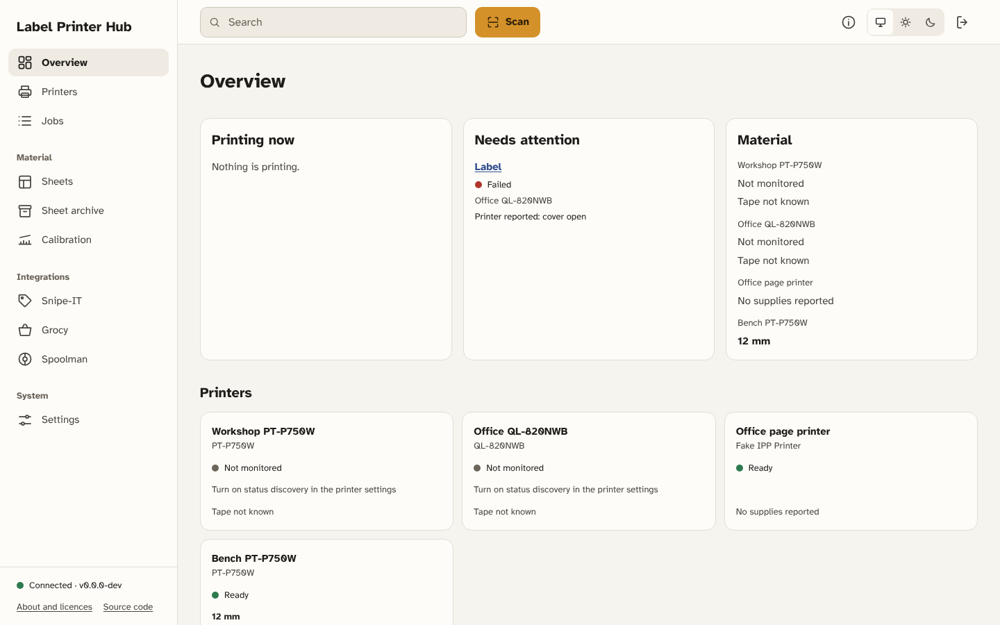
  </picture>
</p>
### Printers

All printers with their state and the loaded material. Admins add, change and disable printers under Settings > Printers.

<p>
  <picture>
    <source media="(prefers-color-scheme: dark)" srcset="docs/screenshots/printers-dark.png">
    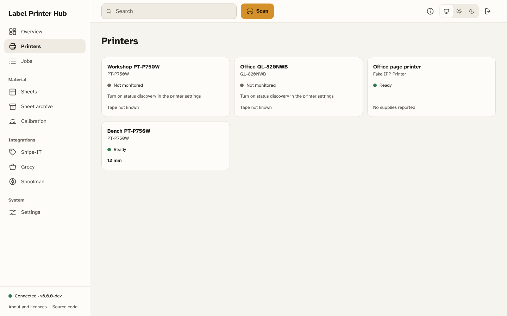
  </picture>
</p>
### Printer details

One printer: its state, the loaded tape (after a roll change the hub asks for the tape colour, since the printer does not report it), the connection, the calibration and the queue. **Test print** prints a sample label, **Pause** holds the queue.

<p>
  <picture>
    <source media="(prefers-color-scheme: dark)" srcset="docs/screenshots/printer-detail-dark.png">
    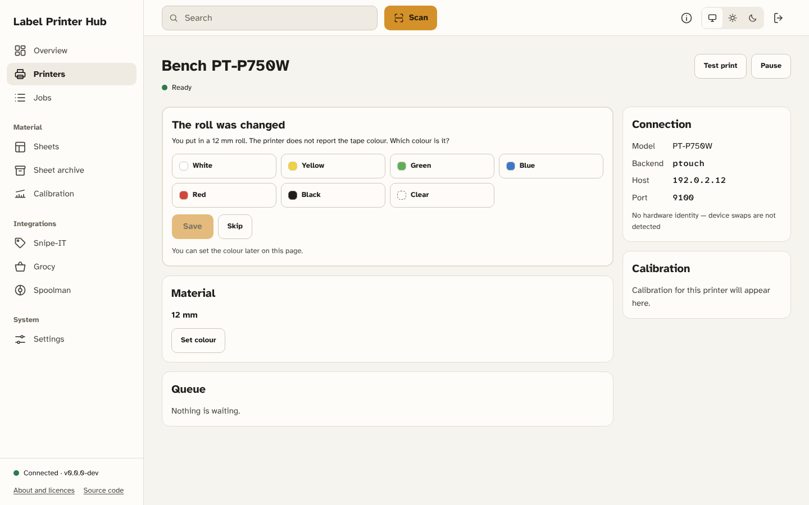
  </picture>
</p>
### Jobs

Every print job, filtered by state (queued, printing, done, failed, cancelled). A failed job shows why it failed and can be retried.

<p>
  <picture>
    <source media="(prefers-color-scheme: dark)" srcset="docs/screenshots/jobs-dark.png">
    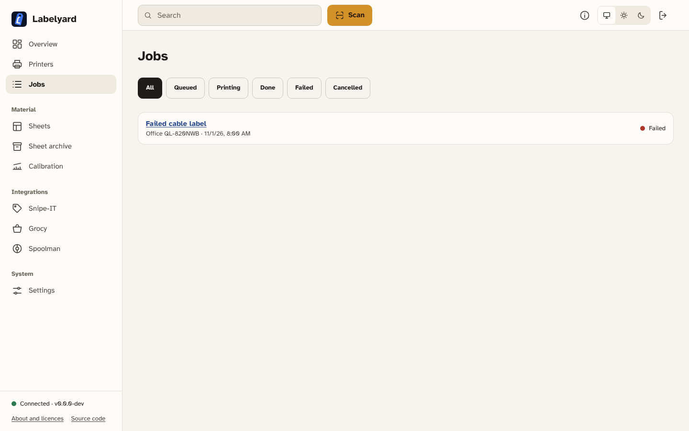
  </picture>
</p>
### Printing one item

An item from an integration (here Snipe-IT): a preview of the label, the printer, the layout and the number of copies. **Print now** prints at once, **Add to cart** collects it for later.

<p>
  <picture>
    <source media="(prefers-color-scheme: dark)" srcset="docs/screenshots/print-dialog-dark.png">
    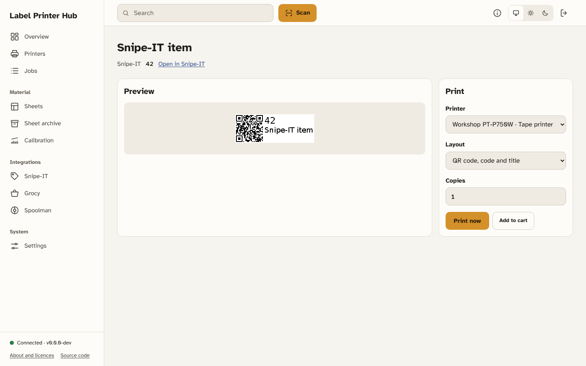
  </picture>
</p>
### Cart and printing onto a sheet

The cart collects labels from several items and prints them together: on a tape printer one after the other, on a page printer onto a sheet. For a sheet you choose the sheet type, the tray and the sheet; scan the code on a partly used sheet and the hub prints only onto its free cells.

<p>
  <picture>
    <source media="(prefers-color-scheme: dark)" srcset="docs/screenshots/cart-sheet-dark.png">
    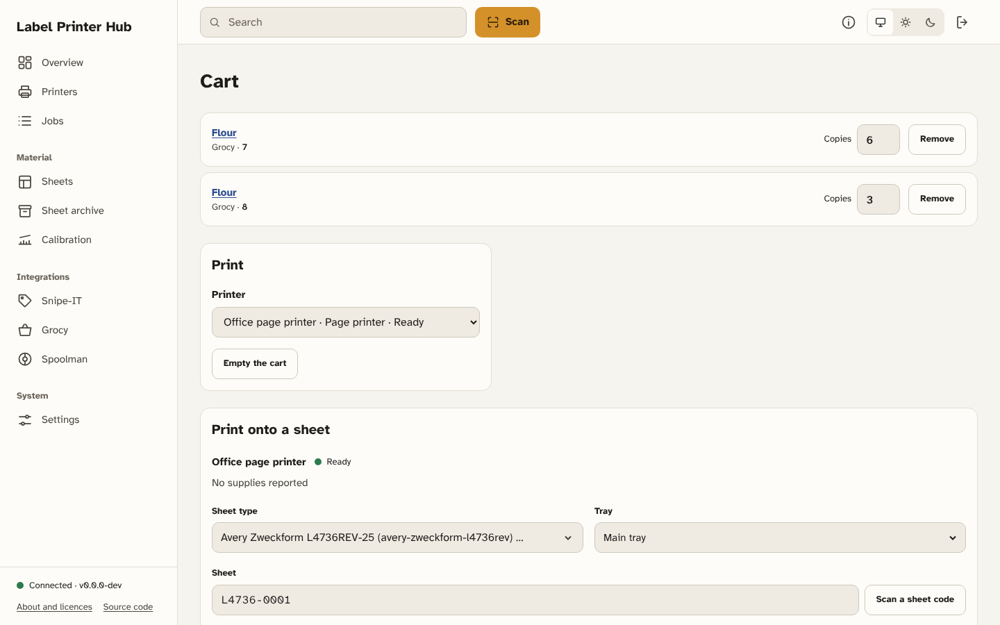
  </picture>
</p>
### Sheets

The sheets in use, each with its code, its type and how many cells are used. Used-up and discarded sheets are hidden unless you ask for them. **New sheet** registers a fresh sheet.

<p>
  <picture>
    <source media="(prefers-color-scheme: dark)" srcset="docs/screenshots/sheets-dark.png">
    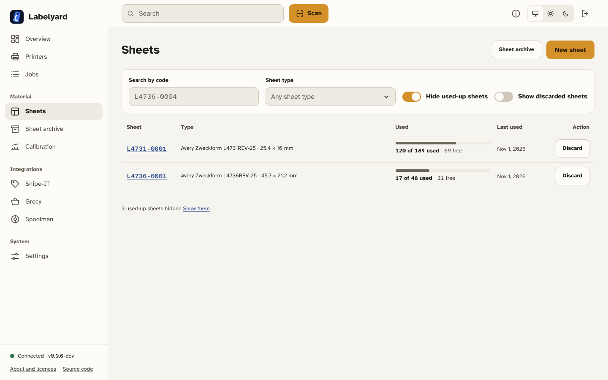
  </picture>
</p>
### Sheet archive

The catalogue of sheet types: search by product code, filter by page size, vendor and label size. Each type keeps its measurements as versions. **New type** enters the measurements of a sheet that is not listed, **Import type** loads one exported from another hub.

<p>
  <picture>
    <source media="(prefers-color-scheme: dark)" srcset="docs/screenshots/sheet-archive-dark.png">
    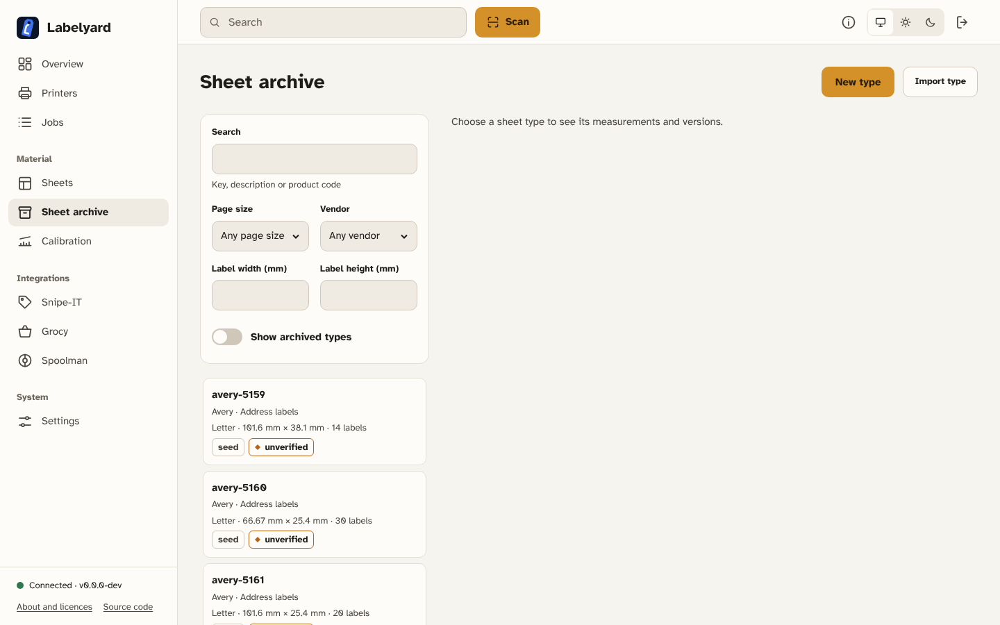
  </picture>
</p>
### Calibration

Page printers rarely print exactly where the page says. Choose printer and tray, print the calibration page onto a real sheet, read the offsets from its scales and enter them; the hub then moves every print on that tray by the opposite amount.

<p>
  <picture>
    <source media="(prefers-color-scheme: dark)" srcset="docs/screenshots/calibration-dark.png">
    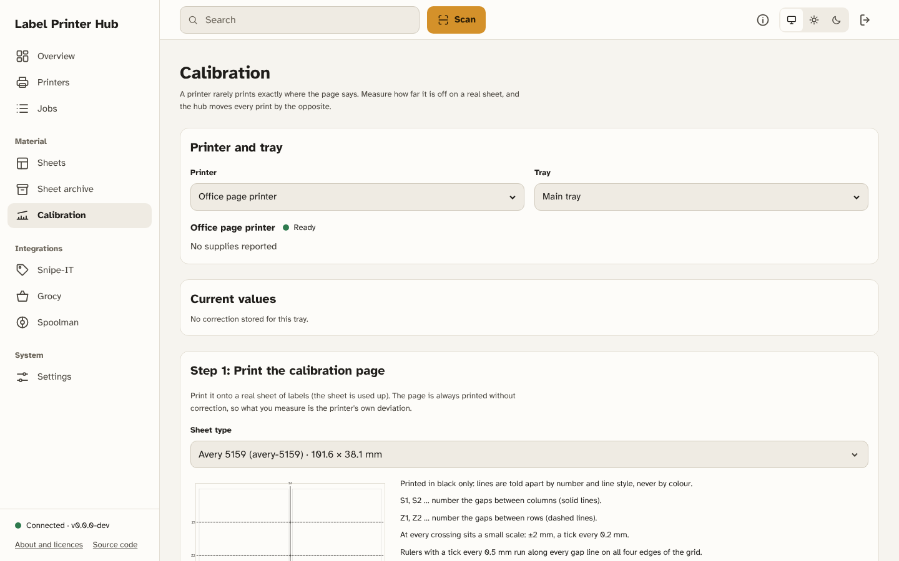
  </picture>
</p>
### On a phone

The same pages adapt to a phone held next to the printer.

| Overview | Printer details | Sheets |
|:---:|:---:|:---:|
| <picture><source media="(prefers-color-scheme: dark)" srcset="docs/screenshots/overview-dark-phone.png">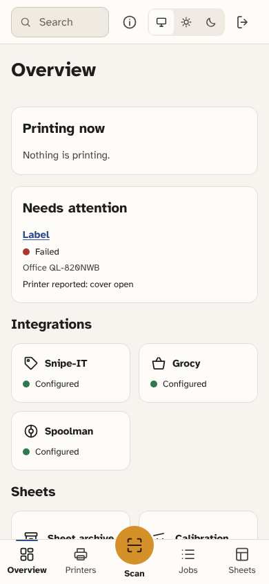</picture> | <picture><source media="(prefers-color-scheme: dark)" srcset="docs/screenshots/printer-detail-dark-phone.png">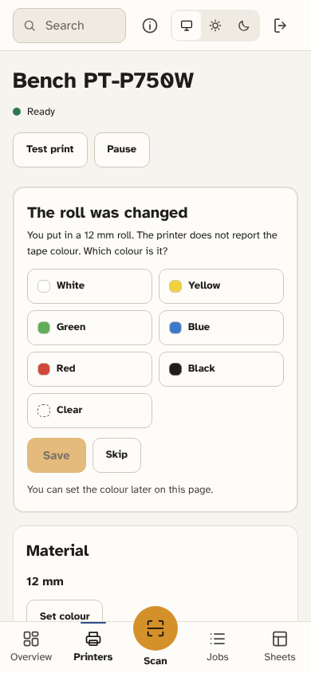</picture> | <picture><source media="(prefers-color-scheme: dark)" srcset="docs/screenshots/sheets-dark-phone.png">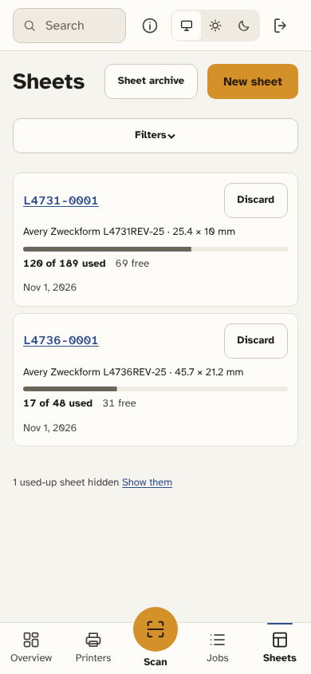</picture> |

## Roadmap

What comes next, by release. Each release is a [GitHub milestone](https://github.com/strausmann/Label-Printer-Hub/milestones) and ships when all its issues are closed; the order within the list can still change.

| Release | Main content |
|---|---|
| [1.6.0](https://github.com/strausmann/Label-Printer-Hub/milestone/2) | New name **Labelyard** with its website, licence list and SBOM in the product, page printers confirmed on hardware |
| [1.7.0](https://github.com/strausmann/Label-Printer-Hub/milestone/3) | Grocy's own label webhook, a notification centre, resolving unconfirmed sheet cells, SNMP status discovery in the printer form |
| [1.8.0](https://github.com/strausmann/Label-Printer-Hub/milestone/8) | Sheets and calibration: what was printed on each cell, keep-out zones for preprinted areas, probe print on plain paper, a guided calibration |
| [1.9.0](https://github.com/strausmann/Label-Printer-Hub/milestone/9) | Integrations: free-text search, item details before printing, links into the apps, Snipe-IT locations, **Kept**, **Paperless-ngx** ASN labels on sheets |
| [1.10.0](https://github.com/strausmann/Label-Printer-Hub/milestone/10) | Printers: more QL models and DK rolls (QL-1110NWB), detection by IP address, a printer test kit, job priorities |
| [1.11.0](https://github.com/strausmann/Label-Printer-Hub/milestone/11) | E-mail notifications, a redesigned tape label layout, a print inbox other apps can fill |

## Supported hardware

The printer protocols follow the [Brother PT-E550W/P750W/P710BT Raster Command Reference v1.02](https://download.brother.com/welcome/docp100064/cv_pte550wp750wp710bt_eng_raster_102.pdf) and the [QL-800/810W/820NWB Raster Command Reference](https://download.brother.com/welcome/docp100278/cv_ql800_eng_raster_101.pdf); page printers are reached over IPP (RFC 8011).

| Device | Kind | Tested |
|---|---|---|
| Brother PT-P750W | Tape printer (TZe) | Printing and status on the device |
| Brother QL-820NWB | Label printer (DK rolls) | Driver included; test on the device pending |
| HP LaserJet CP1525N | Page printer (IPP) | Status over IPP on the device; sheet printing on the device pending |

Other Brother PT and QL models that share the command reference will likely work; other IPP printers should, since the hub uses only standard IPP operations. Tested another device, or one of these further? Please tell us with a [printer compatibility report](https://github.com/strausmann/Label-Printer-Hub/issues/new?template=printer-compatibility.yml) — works, partly works or not at all.

## Supported label sheets

The hub ships with these sheet types. Their measurements come from the [gLabels templates](https://github.com/j-evins/glabels-qt) and are marked *unverified* until someone confirms them on a real sheet; please confirm or correct them with the [sheet type dimensions form](https://github.com/strausmann/Label-Printer-Hub/issues/new?template=sheet-type-feedback.yml) — the sheet archive in the hub opens it with the stored values filled in. Any other sheet can be added in the sheet archive (**New type**) or imported as JSON.

<details>
<summary>36 sheet types (A4 and US Letter)</summary>

| Vendor | Product codes | Labels | Label size | Per sheet | Page |
|---|---|---|---|---|---|
| Avery | 7160, L7160, J8160 | Mailing labels | 63.99 × 38.1 mm | 3 × 7 = 21 | A4 |
| Avery | 7162, L7162 | Mailing labels | 99.1 × 33.9 mm | 2 × 8 = 16 | A4 |
| Avery | 7164, L7164, J8164 | Address labels | 63.5 × 71.98 mm | 3 × 4 = 12 | A4 |
| Avery | 7165, L7165, J8165 | Address labels | 99.06 × 67.73 mm | 2 × 4 = 8 | A4 |
| Avery | 8651, L8651, J8651, J8551 (+2 more) | Mini address labels | 38.1 × 21.2 mm | 5 × 13 = 65 | A4 |
| Avery | L4732 | Mini labels | 35.6 × 16.9 mm | 5 × 16 = 80 | A4 |
| Avery Zweckform | 3474 | Address labels | 70 × 37 mm | 3 × 8 = 24 | A4 |
| Avery Zweckform | 3481 | Multipurpose labels | 70 × 41 mm | 3 × 7 = 21 | A4 |
| Avery Zweckform | 3669 | Rectangular labels | 70 × 50.8 mm | 3 × 5 = 15 | A4 |
| Avery Zweckform | 4760 | Lever arch file labels | 192 × 38 mm | 1 × 7 = 7 | A4 |
| Avery Zweckform | 4761 | Lever arch file labels | 192 × 61 mm | 1 × 4 = 4 | A4 |
| Avery Zweckform | 4780 | Multipurpose labels | 48.5 × 25.4 mm | 4 × 10 = 40 | A4 |
| Avery Zweckform | 6021 | Multipurpose labels | 46 × 16.9 mm | 4 × 16 = 64 | A4 |
| Avery Zweckform | L4731REV-25, L4731REV-10, L4731REV-65, L4731 | Mini labels, removable | 25.4 × 10 mm | 7 × 27 = 189 | A4 |
| Avery Zweckform | L4736REV-25, L4736REV-10, L4736REV-65, L4736REV-100 (+1 more) | Mini labels, removable | 45.7 × 21.2 mm | 4 × 12 = 48 | A4 |
| Endisch | 6500040x | Round labels | 40 × 40 mm | 4 × 6 = 24 | A4 |
| Endisch | 6500060x | Round labels | 60 × 60 mm | 3 × 4 = 12 | A4 |
| Herma | 10001 | Rectangular labels | 25.4 × 10 mm | 7 × 27 = 189 | A4 |
| Herma | 4097, 4221, 4232, 4235 (+10 more) | Rectangular labels | 45.72 × 21.2 mm | 4 × 12 = 48 | A4 |
| Herma | 4098, 4222, 4233, 4347 (+12 more) | Rectangular labels | 63.5 × 29.6 mm | 3 × 9 = 27 | A4 |
| Herma | 4103, 4113, 4641b, 4677 (+14 more) | Rectangular labels | 63.5 × 38.1 mm | 3 × 7 = 21 | A4 |
| Herma | 4283, 5090, 5091 | Arch file labels | 192 × 39 mm | 1 × 6 = 6 | A4 |
| Herma | 4293, 5092 | Arch file labels | 192 × 38 mm | 1 × 7 = 7 | A4 |
| Herma | 4606, 4270 | Multipurpose labels | 38 × 21.2 mm | 5 × 13 = 65 | A4 |
| Herma | 4607, 4271 | Multipurpose labels | 48.3 × 16.9 mm | 4 × 16 = 64 | A4 |
| Herma | 4614, 4670, 5053 | Multipurpose labels | 66 × 33.8 mm | 3 × 8 = 24 | A4 |
| Herma | 4625, 4674, 5057 | Mailing labels | 105 × 42.3 mm | 2 × 7 = 14 | A4 |
| Avery | 5159 | Address labels | 101.6 × 38.1 mm | 2 × 7 = 14 | Letter |
| Avery | 5160, 5260, 5510, 5520 (+27 more) | Address labels | 66.67 × 25.4 mm | 3 × 10 = 30 | Letter |
| Avery | 5161, 5261, 5961, 8161 (+2 more) | Address labels | 101.6 × 25.4 mm | 2 × 10 = 20 | Letter |
| Avery | 5162, 5262, 5512, 5522 (+11 more) | Address labels | 101.6 × 33.87 mm | 2 × 7 = 14 | Letter |
| Avery | 5163, 5263, 5513, 5523 (+13 more) | Shipping labels | 101.6 × 50.8 mm | 2 × 5 = 10 | Letter |
| Avery | 5164, 5264, 5514, 5524 (+5 more) | Shipping labels | 101.6 × 84.67 mm | 2 × 3 = 6 | Letter |
| Avery | 5167, 5267, 5667, 5927 (+10 more) | Return address labels | 44.45 × 12.7 mm | 4 × 20 = 80 | Letter |
| Avery | 5195, 5295 | Round labels | 84.14 × 84.14 mm | 2 × 3 = 6 | Letter |
| Avery | 8195 | Return address labels | 44.45 × 16.92 mm | 4 × 15 = 60 | Letter |

</details>

## Tech Stack

**One container:** a single backend process serves the REST API, the live event stream and the web UI ([ADR 0015](docs/decisions/0015-single-process-deployment.md)). Printers are added in the UI (Settings > Printers), not through environment variables.

- **Backend** (`label-printer-hub-backend`, the only image): Python 3.12+, FastAPI, SQLModel (SQLite), asyncio
- **Printer protocols**: `nbuchwitz/ptouch` (PT-Series), `pklaus/brother_ql` (QL-Series), `pysnmp` for status polling; an own IPP client over `httpx` for page printers ([ADR 0020](docs/decisions/0020-backend-kinds-ipp-page-printers.md)), with `reportlab` drawing the PDF pages
- **Web UI** (built into the backend image from `frontend/`): React + TypeScript, Vite, PWA (manifest + service worker + camera scanning) — [ADR 0016](docs/decisions/0016-react-typescript-web-ui.md)
- **Container**: Docker (multi-stage, one image), GHCR + Docker Hub publishing, multi-arch (amd64 + arm64)
- **CI/CD**: GitHub Actions, semantic-release, Dependabot

## Container images and tags

Every stable release publishes to **GitHub Container Registry (GHCR)** and **Docker Hub** with this tag scheme:

| Tag | Example for `1.0.0` | Use when |
|---|---|---|
| `1.0.0` | exact version | You want full reproducibility |
| `1.0` | latest patch in 1.0.x | Auto-update bug fixes |
| `1` | latest minor.patch in 1.x.x | Stay on major version, get features |
| `latest` | most recent stable | You're fine with anything new |

Pre-releases (`1.0.0-rc.1` etc.) publish **only the full version tag** — never `latest`, `<major>`, or `<major>.<minor>` — so a pre-release can never silently become the default.

Both registries receive identical multi-arch images (`linux/amd64`, `linux/arm64`).

## Quick Start

See [`examples/README.md`](examples/README.md) for sample compose files (standalone / Traefik / Pangolin / Caddy).

```bash
git clone https://github.com/strausmann/Label-Printer-Hub.git
cd Label-Printer-Hub/examples
cp .env.example .env
# Required: PRINTER_HUB_SECRET_KEY (openssl rand -base64 32 | tr '+/' '-_')
#           PRINTER_HUB_PUBLIC_URL (the address you open the hub at; a local
#           address such as http://localhost:8000 is fine)
$EDITOR .env
docker compose -f compose.standalone.yml up -d

curl http://localhost:8000/healthz
curl http://localhost:8000/api/v1/info
# Open http://localhost:8000/ and sign in. A fresh install has no admin key:
# either set PRINTER_HUB_BOOTSTRAP_ADMIN_KEY (one-time key, 32+ characters) or run
docker exec label-printer-hub-backend printer-hub admin create-key --scope admin --name first-admin
# then add your printers under Settings > Printers.
```

Other containers in the same stack can call the hub directly with an API key: [using the hub from other services](examples/README.md#using-the-hub-from-other-services-in-the-same-stack).

For the REST API alone, without the web UI, see [`examples/compose.backend-only.yml`](examples/compose.backend-only.yml).

## REST API surface

The complete, always current reference is served by the hub itself at `/docs` (interactive) and `/openapi.json`. The calls most integrations need:

| Method | Path | Purpose |
|---|---|---|
| `POST` | `/api/v1/print` | Submit a print job (body below) |
| `GET` | `/api/v1/jobs/{job_id}` | Poll job status |
| `GET` | `/healthz` | Liveness probe |
| `GET` | `/readiness` | Readiness probe |

### Health Probes

The backend exposes two HTTP probes with different semantics:

| Endpoint | Purpose | What it answers |
|----------|---------|-----------------|
| `GET /healthz` | Liveness — Docker / Kubernetes container restart signal | "the process and the event loop are alive" |
| `GET /readiness` | Readiness — reverse-proxy routing signal | "the process can serve traffic right now": database connectable, alembic at head, templates seeded, runtime printer matches DB, SNMP probe fresh, queue worker alive, SSE bus capacity ok |

`/readiness` returns HTTP 200 with `status` of `ready` (all checks ok) or `degraded` (non-critical checks failing — still routable), and HTTP 503 with `not-ready` when a critical check (database, alembic, template_seed) fails.

The check `render_slots` counts page renders (sheet previews, page jobs) that ran past `PRINTER_HUB_RENDER_TIMEOUT_S` (default 60 s) and whose drawing thread has not ended (`metric.stuck` of `metric.slots`). A thread cannot be stopped, so such a render keeps its slot until it ends; with every slot stuck the check fails and the hub reports `degraded`. `/healthz` does not look at it, so the container healthcheck never restarts the hub for it: restart the hub by hand.

Pangolin's `targets[0].healthcheck.path` can use `/readiness` for deep checks instead of `/healthz`; Docker container healthchecks should stay on `/healthz` to avoid restart loops on transient DB failures.

### `POST /api/v1/print` request body

```jsonc
{
  // One of the ContentType values (app/schemas/content_type.py), e.g. "qr_two_lines".
  "content_type": "qr_two_lines",
  // Exactly one of `data` or `lookup` is required.
  "data":    { "title": "Asset 123",
               "primary_id": "ASSET-123",
               "qr_payload": "https://snipe.example/assets/123",
               "secondary": ["optional", "extra lines"] },
  // "lookup": { "app": "snipeit", "identifier": "123" },
  "options": { "copies": 1,              // 1..10, default 1
               "auto_cut": true,
               "high_resolution": false }
}
```

Unknown fields are rejected (`extra="forbid"`). The label is laid out for the loaded tape width.

### Synchronous error codes (`POST /api/v1/print`)

| HTTP | `error_code` | When |
|---|---|---|
| 409 | `tape_empty` | preflight detects no media |
| 409 | `no_tape_loaded` | no tape cassette is loaded |
| 409 | `printer_cover_open` | preflight detects cover open |
| 409 | `printer_disabled` | the printer is disabled |
| 409 | `unsupported_tape` | the loaded tape width is not supported by the layout engine |
| 422 | `content_type_data_mismatch` | `data` lacks fields the `content_type` needs (`error_detail.missing_fields`) |
| 422 | `integration_unknown_app` | `lookup.app` is not a configured integration |
| 502 | `integration_lookup_failed` | integration plugin raised |
| 503 | `printer_offline` | SNMP preflight could not reach the printer |

## Environment variables

Full reference lives in [`backend/.env.example`](backend/.env.example). The most-used variables grouped by purpose:

| Variable | Default | Purpose |
|---|---|---|
| **`PRINTER_HUB_SECRET_KEY`** | _required_ | Master key for secrets stored in the database (base64url of 32 random bytes; `openssl rand -base64 32 \| tr '+/' '-_'`) |
| **`PRINTER_HUB_PUBLIC_URL`** | _required_ | Any `http(s)` URL, local ones included (`http://localhost:8000`, `http://printer-hub:8000`, a LAN IP). Set it to the address people open the UI at if you use the browser UI; decides cookie security (`Secure` and `__Host-` prefix when `https`) and the allowed `Origin` |
| `PRINTER_HUB_BOOTSTRAP_ADMIN_KEY` | _empty_ | One-time key (32+ characters) that signs you in while no admin key exists; empty disables it |
| `PRINTER_HUB_DATABASE_URL` | `sqlite+aiosqlite:////data/printer-hub.db` | Database |
| `PRINTER_HUB_SSO_TRUST_TOKEN` | _empty_ | Shared secret the proxy sends as `X-Pangolin-Token`; without it `Remote-User` is ignored |
| `PRINTER_HUB_TRUST_LEGACY_PANGOLIN_USER` | `false` | Opt in to the legacy `X-Pangolin-User` header |
| `PRINTER_HUB_TRUST_PANGOLIN_BASIC_BYPASS` | `false` | Opt in to the `Authorization: Basic` bypass credential |
| `PRINTER_HUB_WEBHOOK_API_KEY` | _empty_ | Bearer for inbound integration webhooks (≥ 32 chars; generate with `openssl rand -hex 32`) |
| `PRINTER_HUB_WEBHOOK_LIMIT_PER_MINUTE` | `120` | Webhook calls per minute and webhook key (Spoolman and Grocy together); above it the webhook answers `429` with `Retry-After` |
| `PRINTER_HUB_MAX_QUEUED_RUNS_PER_PRINTER` | `5` | Tape runs one printer has queued or printing at once (at least `5`); above it a batch answers `429` `too-many-queued-runs` |
| `PRINTER_HUB_MAX_QUEUED_RUNS_PER_KEY` | `20` | Tape runs one API key has at once over all printers, held runs included; above it a batch answers `429` `too-many-queued-runs` |
| `PRINTER_HUB_RENDER_TIMEOUT_S` | `60` | Seconds one page may take to draw (sheet preview, page job); above it the preview answers `504` `render-timeout` and the page job fails `render_timeout` (max `600`) |
| `PRINTER_HUB_SNIPEIT_URL` | _empty_ | Snipe-IT base URL |
| `PRINTER_HUB_SNIPEIT_API_KEY` | _empty_ | Snipe-IT bearer token |
| `PRINTER_HUB_GROCY_URL` | _empty_ | Grocy base URL |
| `PRINTER_HUB_GROCY_API_KEY` | _empty_ | Grocy API key |
| `PRINTER_HUB_SPOOLMAN_URL` | _empty_ | Spoolman base URL (no auth) |
| `PRINTER_HUB_LOG_LEVEL` | `INFO` | `DEBUG` / `INFO` / `WARNING` / `ERROR`. At `DEBUG` the hub's own loggers are verbose, but the database driver stays at `INFO` and SQL statements and their bound values are not logged. Third-party libraries do log at `DEBUG`: read a debug log before you share it |

All variables share the `PRINTER_HUB_` prefix and map 1:1 to the `Settings` model in `backend/app/config.py`. A variable set in the environment wins over the stored value and locks the field in the UI. Printers have no variables: they are managed in Settings > Printers.

## Documentation

**In this repository (engineering — change with code):**

- [Architecture overview](docs/architecture.md) — how the pieces fit
- [Decisions (ADRs)](docs/decisions/) — *why* each architectural choice was made
- [Getting started](docs/getting-started.md) — from `docker compose up` to the first label, the phone app and webhooks
- [Plugin development](docs/plugin-development.md) — adding a printer model or a lookup plugin
- [Privacy policy](docs/policies/privacy.md), [Trademark policy](docs/policies/trademarks.md)
- [`CONTRIBUTING.md`](CONTRIBUTING.md) — Conventional Commits, TDD, PR workflow

**On the wiki (tutorials and platform recipes — community-friendly):**

- [Snipe-IT integration](https://github.com/strausmann/label-printer-hub/wiki/Snipe-IT-Integration)
- [Grocy integration](https://github.com/strausmann/label-printer-hub/wiki/Grocy-Integration)
- [Spoolman integration](https://github.com/strausmann/label-printer-hub/wiki/Spoolman-Integration)

**Live API reference** (when running): `/openapi.json` and `/docs` (interactive reference, Scalar, served by the hub itself) — see [ADR 0011](docs/decisions/0011-openapi-as-api-contract.md).

## Contributing

Contributions are welcome — especially **printer model plugins**. See [CONTRIBUTING.md](CONTRIBUTING.md) for the workflow (Conventional Commits, TDD, semantic-release).

## Trademarks and disclaimer

> **Brother**, **P-touch**, **PT-Series**, and **QL-Series** are trademarks or registered trademarks of **Brother Industries, Ltd.** All other trademarks are the property of their respective owners.
>
> This project is **not affiliated with, endorsed by, or sponsored by Brother Industries, Ltd.** It is an independent open-source project that interoperates with Brother label printers via documented protocols (Brother Raster Command Reference, IEEE 802.3, RFC 3805 SNMP Printer-MIB, RFC 8011 IPP).
>
> "Brother" is used in this README solely for the purpose of describing the hardware that this software is compatible with. No commercial use of the Brother trademarks is intended.

## License

Label Printer Hub is licensed under the **GNU Affero General Public License, version 3 or later** (`AGPL-3.0-or-later`) — see [LICENSE](LICENSE).

Releases up to and including 1.0.3 are MIT; from 1.1.0 on AGPL-3.0-or-later. Anyone who received an earlier release keeps the MIT terms for that release.

Why the change:

- The hub depends on [`brother_ql`](https://github.com/pklaus/brother_ql), which is GPL-3.0-or-later, so the combined work is distributed under terms at least as strong as GPL-3.0.
- The hub is a network service. Section 13 of the AGPL gives the people who use a modified version over a network the right to its source.

If you run a modified version for others, set `HUB_REPO_URL` to where its source is published — the About page links there. Unmodified releases link to the exact tag of the running version.

## Acknowledgements

- [`pklaus/brother_ql`](https://github.com/pklaus/brother_ql) — QL-Series Python library
- [`nbuchwitz/ptouch`](https://github.com/nbuchwitz/ptouch) — PT-Series Python library
- [`donkie/Spoolman`](https://github.com/donkie/Spoolman), [Grocy](https://github.com/grocy/grocy), [Snipe-IT](https://github.com/snipe/snipe-it) — apps this hub integrates with
