# Design mockups for release 1.8.0

Review page. Each mockup is a static, self-contained HTML page (open it in a browser, or add `?theme=dark` / `?view=<name>`)
that implements the matching part of the [1.8.0 design](../../superpowers/specs/2026-11-21-milestone-1-8-0-design.md).
They use the app's real tokens. All names, printers and addresses are invented; zone and correction values are demo values,
not measurements. M6 was dropped from the milestone.

Screenshots are quantized PNGs (the 390 px ones at 1x) in `png/`, named `<page>[-<view>]-<1280|390>-<light|dark>.png`. Views marked "keyboard" also
have a `-390x500-light.png` shot that simulates the open on-screen keyboard (spec section 12).

Rebuild: `cd frontend && pnpm install`, then `node ../docs/designs/1.8.0/src/build.mjs` and `node ../docs/designs/1.8.0/src/shoot.mjs`.

## M1 Preprinted areas

Spec section 5, 11. Edit details of a sheet type: the sheet-code position, the preprinted zones with a refused overlap, and a diagram of the top band.
[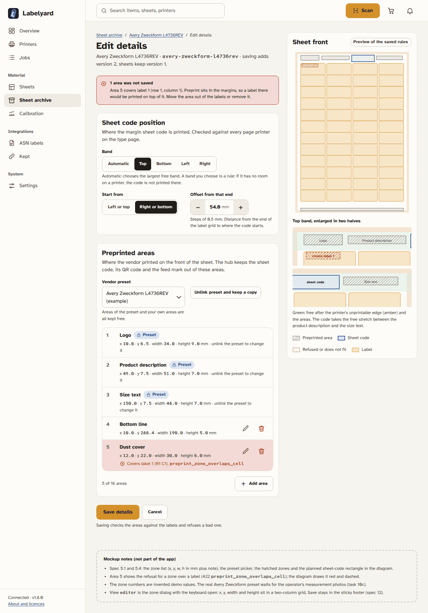](png/m01-preprinted-areas-1280-light.png)
Links: [page](./m01-preprinted-areas.html), [1280 dark](png/m01-preprinted-areas-1280-dark.png), [390 light](png/m01-preprinted-areas-390-light.png), [390 dark](png/m01-preprinted-areas-390-dark.png), [editor 1280](png/m01-preprinted-areas-editor-1280-light.png), [editor 1280 dark](png/m01-preprinted-areas-editor-1280-dark.png), [editor 390](png/m01-preprinted-areas-editor-390-light.png), [editor 390 dark](png/m01-preprinted-areas-editor-390-dark.png), [editor with keyboard](png/m01-preprinted-areas-editor-390x500-light.png)

## M2 Sheet code section

Spec section 5, 11. Type detail: the chosen place of the sheet code and, per printer, whether it fits, is too small or overlaps a preprinted area.
[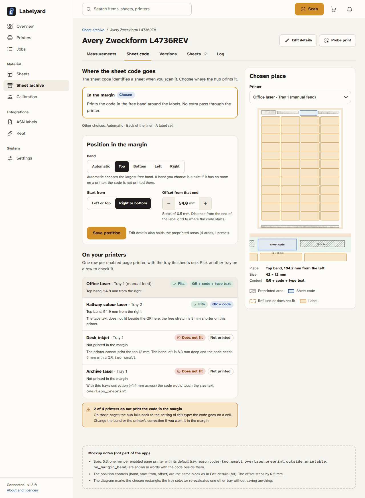](png/m02-sheet-code-section-1280-light.png)
Links: [page](./m02-sheet-code-section.html), [1280 dark](png/m02-sheet-code-section-1280-dark.png), [390 light](png/m02-sheet-code-section-390-light.png), [390 dark](png/m02-sheet-code-section-390-dark.png)

## M3 Check pages

Spec section 7.3, 11. The three printed check pages (A4, real LYC1 codes) with crossing sets, zooms and the margin run blocks. Paper, light only.
[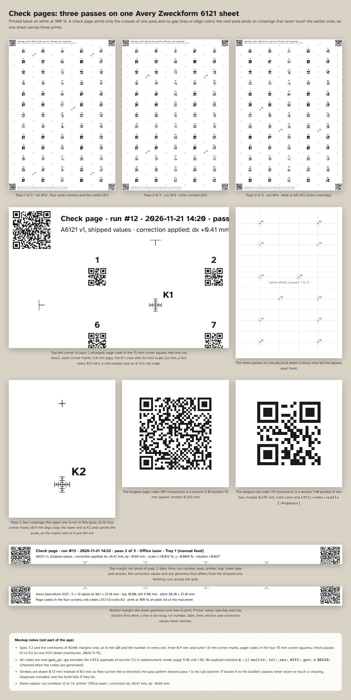](png/m03-check-pages-1280-light.png)
Links: [page](./m03-check-pages.html), [A4 at full size](png/m03-check-pages-a4-light.png)

## M4 Catalog tab

Spec section 6, 11. Catalog entries with Installed, Update and Add states, the empty fresh installation and the search with the keyboard open.
[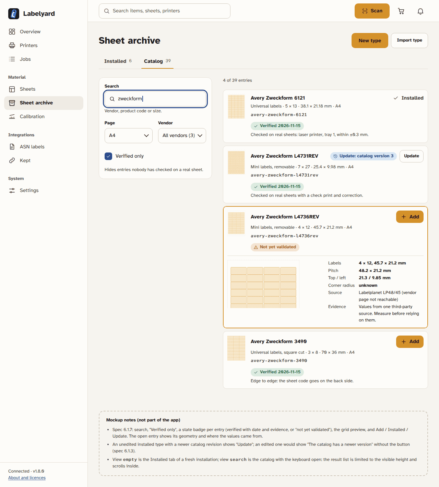](png/m04-catalog-tab-1280-light.png)
Links: [page](./m04-catalog-tab.html), [1280 dark](png/m04-catalog-tab-1280-dark.png), [390 light](png/m04-catalog-tab-390-light.png), [390 dark](png/m04-catalog-tab-390-dark.png), [empty 1280](png/m04-catalog-tab-empty-1280-light.png), [empty 1280 dark](png/m04-catalog-tab-empty-1280-dark.png), [empty 390](png/m04-catalog-tab-empty-390-light.png), [empty 390 dark](png/m04-catalog-tab-empty-390-dark.png), [search 1280](png/m04-catalog-tab-search-1280-light.png), [search 1280 dark](png/m04-catalog-tab-search-1280-dark.png), [search 390](png/m04-catalog-tab-search-390-light.png), [search 390 dark](png/m04-catalog-tab-search-390-dark.png), [search with keyboard](png/m04-catalog-tab-search-390x500-light.png)

## M5 Installed types

Spec section 6, 11. Installed list with usage badges, detail with the catalog-update diff, and the bulk remove dialog.
[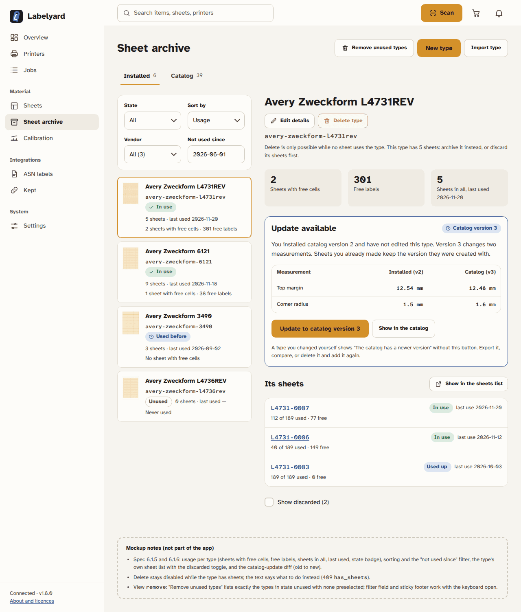](png/m05-installed-types-1280-light.png)
Links: [page](./m05-installed-types.html), [1280 dark](png/m05-installed-types-1280-dark.png), [390 light](png/m05-installed-types-390-light.png), [390 dark](png/m05-installed-types-390-dark.png), [remove 1280](png/m05-installed-types-remove-1280-light.png), [remove 1280 dark](png/m05-installed-types-remove-1280-dark.png), [remove 390](png/m05-installed-types-remove-390-light.png), [remove 390 dark](png/m05-installed-types-remove-390-dark.png), [remove with keyboard](png/m05-installed-types-remove-390x500-light.png)

## M7 Calibration history

Spec section 7.5, 11. Corrections per tray with diffs and Restore, the actual-tray warning, the runs table and the restore dialog.
[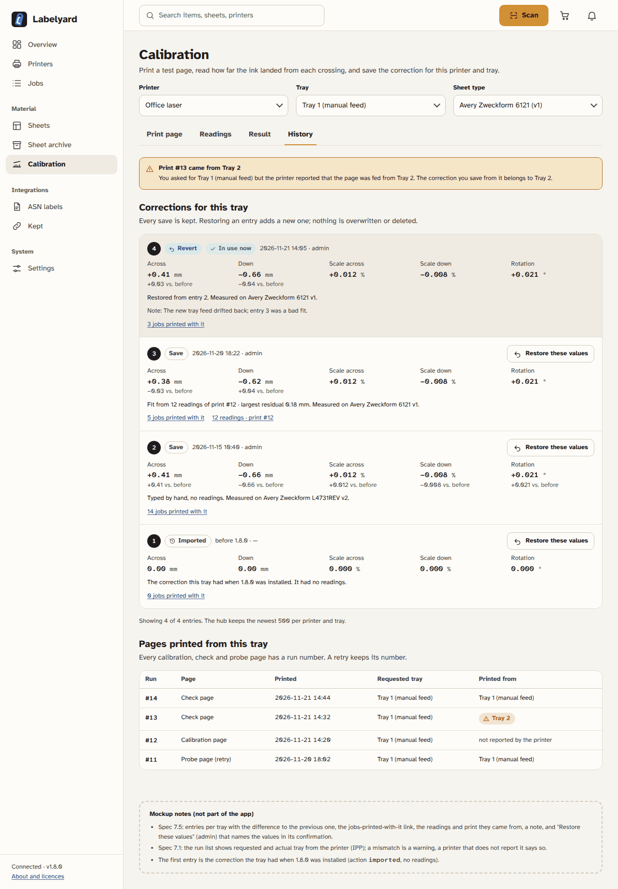](png/m07-calibration-history-1280-light.png)
Links: [page](./m07-calibration-history.html), [1280 dark](png/m07-calibration-history-1280-dark.png), [390 light](png/m07-calibration-history-390-light.png), [390 dark](png/m07-calibration-history-390-dark.png), [restore 1280](png/m07-calibration-history-restore-1280-light.png), [restore 1280 dark](png/m07-calibration-history-restore-1280-dark.png), [restore 390](png/m07-calibration-history-restore-390-light.png), [restore 390 dark](png/m07-calibration-history-restore-390-dark.png), [restore with keyboard](png/m07-calibration-history-restore-390x500-light.png)

## M8 Calibration readings

Spec section 7.4, 11. Guided readings with direction pickers and a 0.1 mm stepper, live fit with residuals, and the geometry suggestion.
[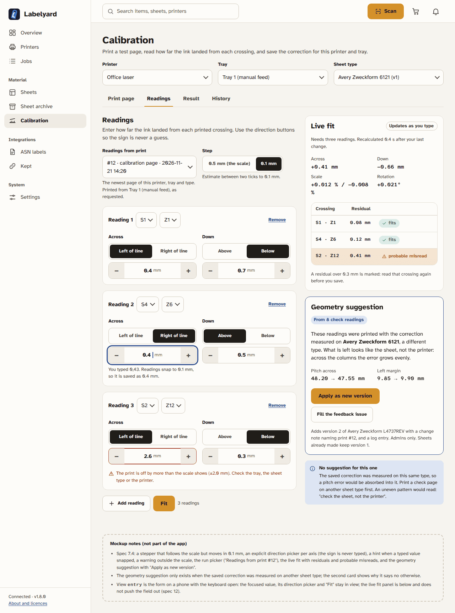](png/m08-calibration-readings-1280-light.png)
Links: [page](./m08-calibration-readings.html), [1280 dark](png/m08-calibration-readings-1280-dark.png), [390 light](png/m08-calibration-readings-390-light.png), [390 dark](png/m08-calibration-readings-390-dark.png), [entry 1280](png/m08-calibration-readings-entry-1280-light.png), [entry 1280 dark](png/m08-calibration-readings-entry-1280-dark.png), [entry 390](png/m08-calibration-readings-entry-390-light.png), [entry 390 dark](png/m08-calibration-readings-entry-390-dark.png), [entry with keyboard](png/m08-calibration-readings-entry-390x500-light.png)

## M9 Probe print

Spec section 7.3, 5.5, 11. The probe-print dialog (also the offline refusal) and the two paper pages: probe page and measurement sheet. Paper, light only.
[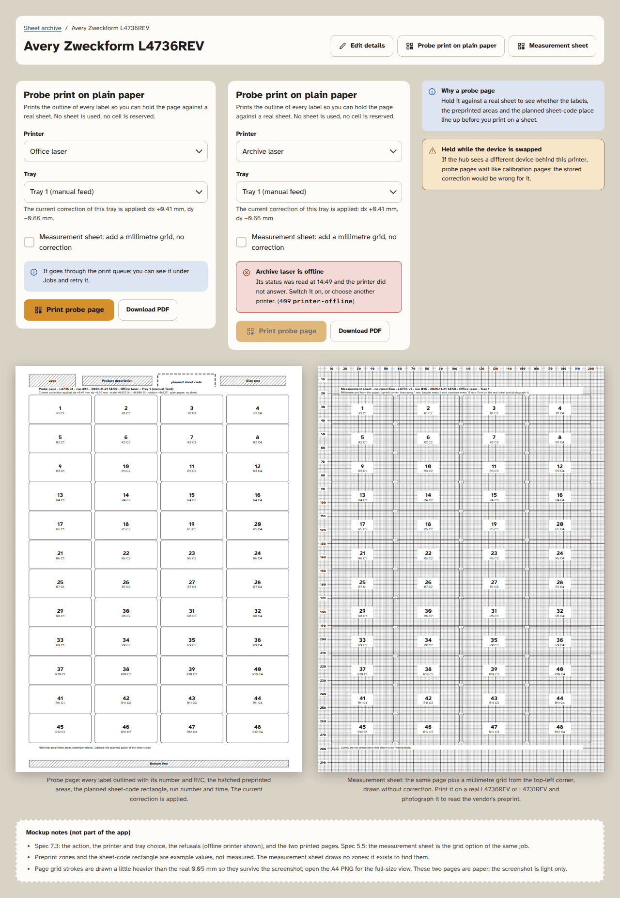](png/m09-probe-print-1280-light.png)
Links: [page](./m09-probe-print.html), [A4 at full size](png/m09-probe-print-a4-light.png)

## M10 Printer not wired

Spec section 9.3, 11. Printers list and detail with the Not wired state, its reason in words and the other reason codes.
[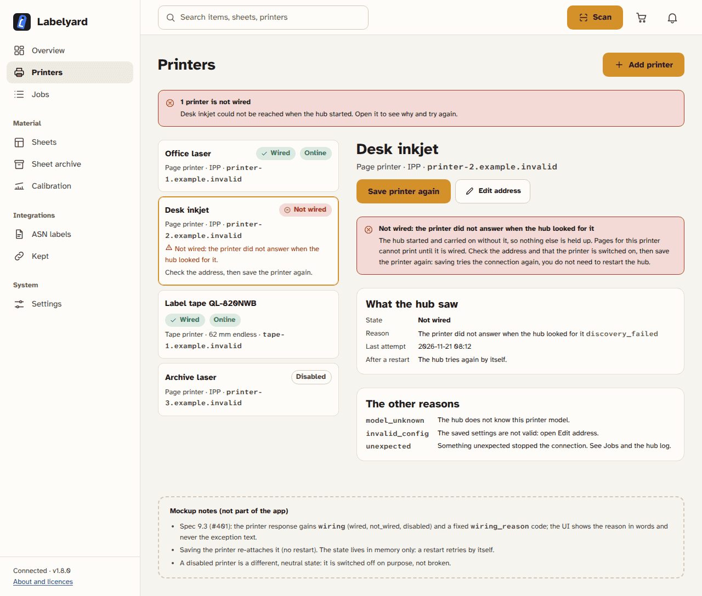](png/m10-printer-not-wired-1280-light.png)
Links: [page](./m10-printer-not-wired.html), [1280 dark](png/m10-printer-not-wired-1280-dark.png), [390 light](png/m10-printer-not-wired-390-light.png), [390 dark](png/m10-printer-not-wired-390-dark.png)

## M11 Public web URL

Spec section 9.4, 11. Settings, Integrations: public web address per integration, saved, refused and empty.
[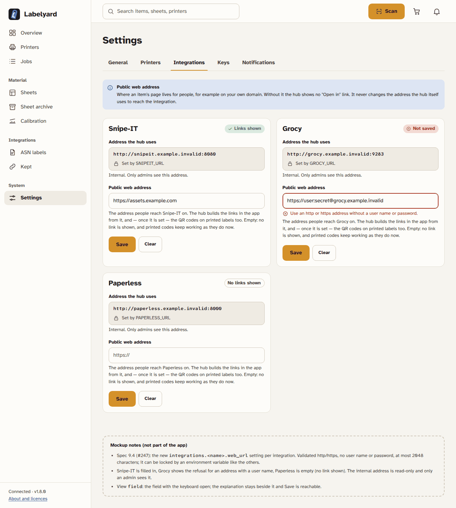](png/m11-integrations-web-url-1280-light.png)
Links: [page](./m11-integrations-web-url.html), [1280 dark](png/m11-integrations-web-url-1280-dark.png), [390 light](png/m11-integrations-web-url-390-light.png), [390 dark](png/m11-integrations-web-url-390-dark.png), [field 1280](png/m11-integrations-web-url-field-1280-light.png), [field 1280 dark](png/m11-integrations-web-url-field-1280-dark.png), [field 390](png/m11-integrations-web-url-field-390-light.png), [field 390 dark](png/m11-integrations-web-url-field-390-dark.png), [field with keyboard](png/m11-integrations-web-url-field-390x500-light.png)

## M12 Type log

Spec section 7.6, 11. The per-type log with verdicts, readings and the correction in effect, plus the add-a-note dialog.
[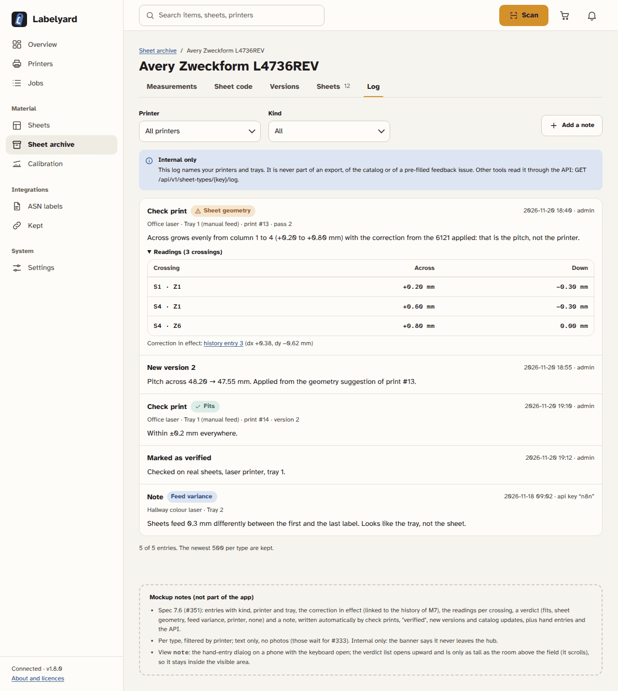](png/m12-type-log-1280-light.png)
Links: [page](./m12-type-log.html), [1280 dark](png/m12-type-log-1280-dark.png), [390 light](png/m12-type-log-390-light.png), [390 dark](png/m12-type-log-390-dark.png), [note 1280](png/m12-type-log-note-1280-light.png), [note 1280 dark](png/m12-type-log-note-1280-dark.png), [note 390](png/m12-type-log-note-390-light.png), [note 390 dark](png/m12-type-log-note-390-dark.png), [note with keyboard](png/m12-type-log-note-390x500-light.png)

## M13 Cell panel

Spec section 8.1, 11. Sheet detail with the text-only cell grid and the cell panel that renders the label on demand; old cells say Not recorded.
[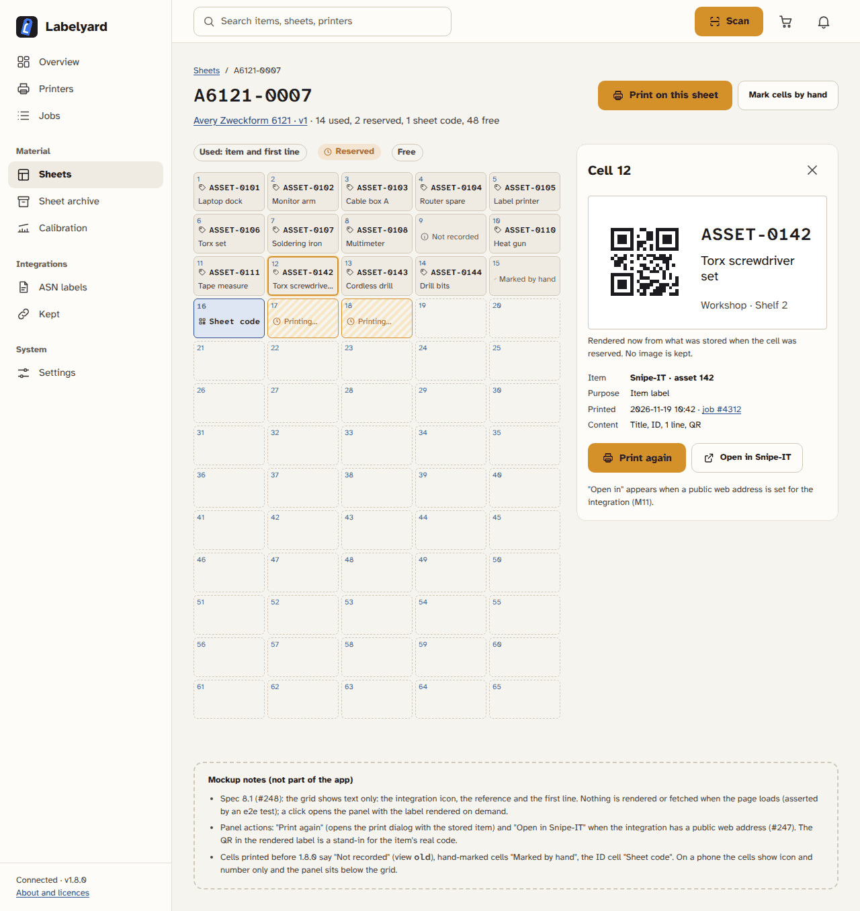](png/m13-cell-panel-1280-light.png)
Links: [page](./m13-cell-panel.html), [1280 dark](png/m13-cell-panel-1280-dark.png), [390 light](png/m13-cell-panel-390-light.png), [390 dark](png/m13-cell-panel-390-dark.png), [old 1280](png/m13-cell-panel-old-1280-light.png), [old 1280 dark](png/m13-cell-panel-old-1280-dark.png), [old 390](png/m13-cell-panel-old-390-light.png), [old 390 dark](png/m13-cell-panel-old-390-dark.png)

## Decisions (the spec left them open)

- Sheet-code and cell QR codes are real LYC1 codes (alphanumeric, 5-M page, 1-M cell) made with segno.
- Check passes use disjoint, non-touching crossing sets (K1 5, K2 4, K3 3).
- The keyboard is simulated with a 390x500 viewport; dialogs align to the top there and keep a sticky footer.
- On narrow screens tables become card lists; in M13 cells show icon and number only.
- M11 shows saved, refused (address with a user name) and empty side by side.
