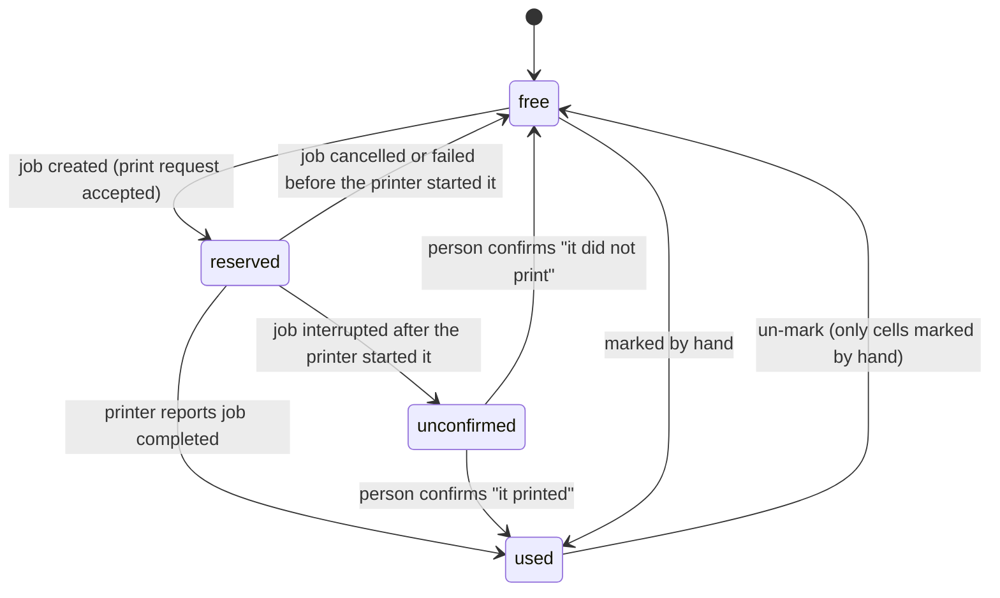

<!--
SPDX-FileCopyrightText: 2026 Björn Strausmann and Labelyard contributors
SPDX-License-Identifier: AGPL-3.0-or-later
-->

# Sheet archive, numbered sheets and IPP page printers (Part A)

- **Date:** 2026-11-05
- **Status:** Draft, awaiting maintainer review. Builder check done on 2026-11-05; its questions are answered in the text (OC-38 to OC-44). Amended 2026-11-07 (operator decisions on where the sheet ID is printed and on a feed-direction mark, with the rulings of the plan review): requirements 17 and 17a, sections 7, 10.1, 10.2, 10.2a, 15, 17.1, 17.4, 19 and 25 (OC-16, OC-40, OC-45 to OC-58).
- **Issue:** #150 (this document is **Part A**). Related: #151 (Paperless ASN, builds on this), #149 (parts and partial retry), #155 (QL continuous and die-cut media), #178 (label rendering redesign), #179 (printer choice with status and media), #173 (Kept lookup in the hub)
- **Builds on:** [`2026-11-03-web-ui-redesign-design.md`](2026-11-03-web-ui-redesign-design.md) (slots `/sheets`, `/sheets/archive`, `/calibration`, feature flags `sheets` and `calibration` in `GET /api/info`, design system, scan resolver hook, sessions/CSRF)
- **Mockups:** <https://claude.ai/artifact/BLKZ7Vhe1RkksXuwptB5ha> (screens 1–3 sheets, screen 4 `#calibrate`)
- **How decisions are marked:** values and behaviour the maintainer fixed in #150 are listed in section 6 and followed as written. Everything else that this document decides is marked **OC-n** ("Orchestrator's call"): decided while the maintainer was away, to be checked on review. All calls are listed in section 25.

## 1. Intent

Label sheets (A4 or Letter, die-cut) are printed today through a browser or OS print dialog. Scaling, margins and tray handling differ per driver, and a partly used sheet can only be reused if someone remembers which cells are gone. The hub should do for sheets what it already does for tape: pick a printer, see a preview, print, no dialog, and every client sees the same state.

That needs four things the hub does not have: a page-printer backend (IPP, PDF), a catalogue of sheet types with exact geometry, a record of each physical sheet and its used cells, and per-printer, per-tray alignment. This document specifies those, plus printing onto sheets from the hub's own integrations (Snipe-IT, Grocy, Spoolman, lookup and cart).

The why for placing all of this in the hub (rather than in each client) is the maintainer's: sheet geometry is material, like tape, and the hub prints sheets for clients that are not Kept (Paperless ASN in #151, the built-in integrations). Physical sheets must be shared, or two apps print onto the same cell.

## 2. Scope: Part A and Part B

The whole of #150 is too large for one plan. This document covers Part A completely and names Part B only to draw the line.

| Part A (this document) | Part B (later, own design) |
|---|---|
| Sheet archive: types with full geometry, versions, own types, JSON export/import, seed | Calibration from a photo or scan: ArUco markers, OpenCV, rectification, residual per row and column, per-row/column corrections, deviation map, "sheet dimensions are wrong" detection |
| Physical sheets: IDs, used cells with purpose, discard, marking by hand, capacity check, ID placement, scan | Consumption overview (sheets per type and month, by client) and the reorder hint |
| IPP page-printer backend: config, status incl. toner, PDF print, job tracking, cancel | Print endpoint for finished client output (PNG per tape label, PDF per sheet, from Kept) |
| Printing onto sheets from the hub's integrations, with full-page preview | Paperless ASN labels (#151) |
| Manual calibration per printer and tray, with a printable calibration page | |
| `GET /api/printers/{id}/capabilities` (read-only) | |
| UI for `/sheets`, `/sheets/archive`, `/calibration`, print dialog for band or sheet; English and German | |
| REST API for all of the above, OpenAPI complete, existing ACL | |

Part A leaves room for Part B: the calibration record has a `method` field and reserves space for corrections (section 13.1), the calibration page reserves the four corners for markers (13.2), and the job payload model has a `kind` so a "finished document" job can be added (11.5).

## 3. Goals, non-goals, anti-goals

**Goals**

1. A user prints 9 labels from Grocy onto a partly used L4736REV sheet on an IPP laser printer: the hub picks the next free cells, shows the whole page with the real content, prints without a dialog, and records the cells as used with their purpose once the printer reports the job completed.
2. The same sheet, picked by any client, shows the same used cells and what each one holds.
3. A sheet type is defined once with full geometry, versioned, shareable as a small JSON file, and 36 common types ship as a seed (section 9.5).
4. A page printer is added in Settings › Printers like a tape printer, by IPP URI, and shows state and toner where tape printers show tape.
5. Alignment is measured once per printer and tray, entered by hand, and applied to every sheet print; clients read it from the capabilities endpoint.

**Non-goals (Part A)**

- Anything listed under Part B.
- Custom page sizes beyond A4 and Letter (OC-1). The schema keeps page width and height so this can be added without a migration of meaning.
- IPP printers that need authentication (OC-2), and any printer path other than IPP with PDF (no PostScript, PCL, URF, no CUPS).
- Editable label layouts (#104) and the redesign of label content, font and render quality (#178). This document defines the interface #178 plugs into (section 12.3).
- Copies on sheet jobs (OC-3): a client that wants three of a label sends it three times.
- Hold-Job / Release-Job, duplex, colour content on labels.

**Anti-goals (failure even if it "works")**

- A cell recorded as used for a job that never printed, or recorded as free for a page that came out. When the hub cannot know, it says so (state `unconfirmed`, section 8).
- Two jobs that print into the same cell because they were planned at the same time.
- A sheet ID issued twice, including after a discard.
- A sheet started under one version of a type that prints at another version's positions after an edit.
- Silent scaling: a PDF that the printer is allowed to fit to the page.
- Colour in the calibration page (colour misregistration would enter the measurement).
- German prose, real hostnames, IPs, device serials or printer captures in the repository (`docs/policies/privacy.md`). IPP fixtures are synthetic.
- Copying gLabels XML files or Labelplanet pages into the repository. Only numbers go into our own schema.

## 4. Constraints

- AGPL-3.0-or-later project. New dependencies are proposed with their licence in the PR (`CLAUDE.md`). This design adds one: **reportlab** (BSD licence, pulls in `charset-normalizer`, MIT) for PDF output (section 12.4). The IPP client is written in the project on top of `httpx` (section 11.2), so no IPP library is added.
- Single container, single process (ADR 0015). Everything runs in the FastAPI backend; no worker processes, no CUPS.
- SQLite with Alembic migrations; the existing repository and session patterns.
- Security boundaries stay as they are: sessions, CSRF on cookie-authenticated writes, origin checks, scopes `read` / `print` / `admin`, printer-restricted keys (`check_printer_access`), secrets encrypted and write-only (ADR 0017). Part A stores no new secret.
- Print queue mandatory (ADR 0005); sheet jobs go through the existing per-printer queue.
- No external fetches at runtime (QR codes are rendered locally, fonts are bundled, no CDN).
- Prose in code, docs, commits and UI strings: English; UI translated to German via Lingui.
- `mypy --strict`, `httpx`, `logging`, TDD, Conventional Commits.
- Design skills for every UI task in the plan (section 17.6).

## 5. Vocabulary

| Term | Meaning |
|---|---|
| **Sheet type** | A kind of label sheet, e.g. Avery Zweckform L4731REV. Has a stable `key`, a short `prefix` for sheet IDs, and one or more versions. |
| **Version** | Immutable geometry of a sheet type: page, label size, grid, pitch, margins, corner radius, shape. Editing geometry creates a new version. |
| **Sheet** | One physical sheet with an ID such as `L4736-0002`, pinned to one version of its type. |
| **Cell** | One label position on a sheet, numbered row by row, 1…N (N = columns × rows). |
| **Placement** | Which cells of which sheet a print uses. |
| **Reservation** | A cell taken by a job that is queued or printing. |
| **Tray** | An input source of a page printer (IPP `media-source`, e.g. `main-tray`, `alternate-tray`), or `auto`. Calibration is per printer and tray. |
| **Page job** | A queue job that prints one page (one sheet) as a PDF. |
| **Deviation** | How far the printer puts things from where they were drawn: offset X/Y, scale X/Y, rotation. Entered by hand in Part A. |

## 6. Decided by the maintainer (from #150, latest wording wins)

These are taken as requirements. Section 24 lists where this document departs from the issue text and why.

1. A page printer is a new backend kind `ipp`, configured by IPP URI, not discovered via the Brother PJL OID. (Issue: "in `printers.yaml`" — printers are managed in the UI since D6, so it is configured there.)
2. The hub lays out a whole sheet in millimetres and sends it as **PDF** with Print-Job, A4 media, `media-type=labels`, **no scaling**, optional `media-source`.
3. Status via Get-Printer-Attributes (`printer-state`, `printer-state-reasons`, `marker-names`/`marker-levels`) mapped onto the existing status model; toner shown where tape is shown for PT/QL.
4. Get-Jobs and Cancel-Job so queue and cancel semantics carry over.
5. Calibration is a property of **printer and tray**, valid for every sheet type; a new type needs dimensions, not a new calibration.
6. Sheet types carry label width/height, columns × rows, pitch across/down (gap = pitch − label), margin top/left, corner radius, shape, page size. Values from the vendor template, checked by calibration.
7. The **sheet archive lives in the hub**: catalogue with full geometry, own types created and edited in the hub, **versions** (changing a type creates a new version; sheets in use keep their version and cell numbering), **export/import** of a type as a small JSON file.
8. A sheet gets an ID on first use: type prefix plus counter (`L4736-0003`); the ID is **never reused**.
9. Per sheet the hub stores the **set of used cells**, not a start cell; gaps work. Cells are numbered **row-major 1…N**.
10. Each used cell records **what it was used for** (e.g. `Grocy · flour 1 kg`), so the sheet view shows what is stuck where and a reprint finds the old position.
11. Picker: partly used sheets of the matching type, searchable by ID, those with enough free cells first; "new sheet" shows the ID it will get.
12. **Capacity check** before printing: fewer free cells than labels → the client is told and can split across sheets or pick another.
13. Cells become used **only when the job is reported completed**; a failed or cancelled job leaves them free.
14. **Discard** a sheet: hidden from the picker, ID never reused.
15. **Mark the used cells** of a sheet that was started before the hub knew it.
16. Small cells: at 25.4 × 10 mm a QR gets about 8 mm; that type defaults to **code only** until a test print proves a QR scans.
17. The sheet prints its own ID, three options on first use: (1) on the **first free cell**, only when chosen for the sheet, with ID, sheet type and a QR of the ID, stored as used; (2) in the **sheet margin** (**default**), printed once on the sheet's first job, in the margin band where name and QR fit largest for the sheet type and printer, text only where the band is narrower, not printed at all where no band is wide enough, never moved into a cell (section 10.2); (3) **by hand**, no print. On 25.4 × 10 mm cells the ID label is text only; scanning needs option 2 there. *Changed 2026-11-07 (operator decision): the margin is the default, most label sheets carry their name in a corner and the ID should not use up a label cell; the margin ID goes into the best of the four margin bands instead of the top margin only. This replaces "(1) on the first free cell (default) … (2) in the sheet margin … only where the margin is wide enough".*
17a. On a sheet's first job the hub prints a small **feed-direction mark** in the margin: an arrow ▲ with the text "Top – this edge first" (in German "Oben – diese Kante zuerst", following the hub's language), so anyone reloading a partly used sheet sees at once which edge goes first. It shows only the top edge and the feed direction; which side faces up in the tray stays with the print dialog's per-tray load hint and is not printed. It applies to every ID placement (`cell`, `margin`, `manual`) and is printed once per sheet (section 10.2a). *Added 2026-11-07 (operator decision).*
18. Scanning the sheet ID selects that sheet in the print dialog; a scan target clients can resolve and a lookup `GET /api/sheets/{id}`; a discarded sheet resolves to "discarded", not to nothing.
19. Manual calibration: print a calibration page, read the offset and enter it.
20. The calibration page: a **centre line in every gap**, **mini scales at every gap crossing** (±2 mm, 0.2 mm ticks), gap lines **numbered** (S1… column gaps, Z1… row gaps), **0.5 mm rulers** at every gap on all four edges, **black only** (lines told apart by number and line style, never colour). Sheets without gaps: labels peeled in a checkerboard.
21. Capabilities endpoint `GET /api/printers/{id}/capabilities`: resolution, printable height per tape (PT/QL) or page size and margins (page printers), loaded media, calibration values per tray.
22. Hub integrations (Grocy, Spoolman, Snipe-IT) use everything: types, rendering in the hub, sheets, calibration.
23. Seed from gLabels-qt `templates/` (MIT, commit `37901c1`), only the numbers, with a `THIRD_PARTY_NOTICES` entry; L4731REV and L4736REV added by hand from the cited third-party sources. Avery 7163, 8658, L4730 and L4770 "deviate enough to need a cross-check before going in".
24. Values for the two first types (L4731REV, L4736REV) as given in the seed comment; corner radius of L4736REV open (measure).

## 7. Data model

All lengths are stored as **integer hundredths of a millimetre** and exposed in the API as millimetres with at most two decimals (OC-4). This keeps geometry comparison exact (import identity, version identity) and is enough for die-cut tolerances. Calibration scale and rotation are stored as decimals (section 13.1).

### 7.1 Tables

**`sheet_types`** — one row per type, never hard-deleted once a sheet references it.

| Column | Notes |
|---|---|
| `id` | UUID, PK |
| `key` | stable, unique, `^[a-z0-9][a-z0-9-]{1,62}[a-z0-9]$`, e.g. `avery-zweckform-l4731rev`; immutable |
| `prefix` | sheet-ID prefix, unique, `^[A-Z][A-Z0-9]{1,9}$`, e.g. `L4731`; editable only while no sheet of the type exists (OC-5) |
| `vendor`, `product_codes` (JSON list), `description` | descriptive; product codes are the first-listed code plus aliases |
| `allow_qr` | whether QR content is allowed in cells of this type (section 12.5); not versioned |
| `verified` | false until someone confirms the geometry with a test print; shown as a badge |
| `origin` | `seed`, `custom`, `imported` |
| `source_name`, `source_url`, `notes` | provenance, shown in the archive |
| `archived_at` | archived types offer no new sheets; existing sheets keep printing |
| `created_at`, `updated_at`, `created_by` | `created_by` is an audit field: stored, not exposed by the API (#264) |

**`sheet_type_versions`** — immutable after insert.

| Column | Notes |
|---|---|
| `id` | UUID, PK |
| `type_id`, `version` | unique together; version counts 1, 2, … per type |
| `page_size` | `A4` or `Letter`; `page_w`, `page_h` stored alongside (hundredths of mm) |
| `label_w`, `label_h`, `cols`, `rows`, `pitch_x`, `pitch_y`, `margin_top`, `margin_left` | geometry |
| `corner_radius` | nullable: unknown (L4736REV today) |
| `shape` | `rectangle` or `round` (OC-6: `round` requires `label_w == label_h`; corner radius ignored) |
| `geometry_hash` | hash of the normalised geometry, for import identity |
| `created_at`, `created_by`, `change_note` | `created_by` is an audit field: stored, not exposed by the API (#264) |

Validation on insert: `pitch_x ≥ label_w`, `pitch_y ≥ label_h`, `cols, rows ≥ 1`, `cols × rows ≤ 400` (OC-7), and the grid fits the page: `margin_left + (cols − 1) × pitch_x + label_w ≤ page_w` and the same downwards. Asymmetric remaining margins are allowed (real on some die-cuts) and shown as a hint, not refused.

**`sheet_id_counters`** — `prefix` PK, `next_value` int. Incremented in the same transaction that inserts a sheet; never decremented, never reset, kept when a type is archived. This is what makes "never reused" hold even if sheet rows were ever removed by hand.

**`sheets`** — one row per physical sheet.

| Column | Notes |
|---|---|
| `id` | UUID, PK |
| `code` | unique, e.g. `L4736-0002`: prefix, hyphen, counter zero-padded to four digits (`L4736-0100`; above 9999 the number simply grows: `L4736-10000`). *Changed 2026-11-05 (operator decision): four-digit codes, replacing "at least 2 digits".* |
| `type_id`, `type_version_id` | the version is pinned for life |
| `state` | `active` or `discarded` (+ `discarded_at`, `discarded_by`) |
| `id_placement` | `cell`, `margin`, `manual`; **default `margin`** when a sheet is created without a choice. *Changed 2026-11-07 (operator decision): the default was `cell`.* |
| `id_printed` | for `margin`: set when the first job that carries the margin ID completes; stays false while every job was printed without it because no margin band was wide enough (10.2); for `cell`: set when the ID cell is used |
| `feed_mark_printed` | set when the first job that carries the feed-direction mark completes (10.2a); independent of `id_printed`, since `manual` sheets never set that. *Added 2026-11-07 (operator decision).* |
| `note` | optional, plain text |
| `created_at`, `created_by`, `last_used_at` | `created_by` is an audit field: stored, not exposed by the API (#264); `last_used_at` see section 8 |

**`sheet_cells`** — one row per **non-free** cell. A free cell has no row.

| Column | Notes |
|---|---|
| `sheet_id`, `cell_no` | composite PK; `cell_no` in 1…N |
| `state` | `reserved`, `used`, `unconfirmed` |
| `job_id` | the job holding or having printed the cell; null for cells marked by hand |
| `source` | who: `snipeit`, `grocy`, `spoolman`, `hub` (sheet ID label), `manual`, or a client tag such as `kept` (`^[a-z][a-z0-9_-]{0,31}$`) |
| `purpose` | plain text, ≤ 120 characters, e.g. `flour 1 kg`; the UI shows `Grocy · flour 1 kg` |
| `ref` | optional integration reference (app identifier of the item), so a reprint can find where an item was printed before |
| `marked_by_hand` | true when entered by a person rather than by a job |
| `updated_at`, `updated_by` | |

**`printer_trays`** — per page printer: `printer_id`, `tray_key` (IPP `media-source` keyword or `auto`), `label`, `load_hint` (plain text, e.g. "written side down, top edge first"), `enabled`, `is_default`. Filled when the printer is saved (section 11.1).

**`printer_calibrations`** — `printer_id`, `tray_key` (PK together), `method` (`manual` in Part A), `offset_x`, `offset_y` (hundredths of mm), `scale_x`, `scale_y`, `rotation_deg` (decimals), `corrections` (JSON, null in Part A; reserved for Part B row/column corrections), `measured_on_type_version_id` (nullable, informational), `updated_at`, `updated_by`.

**Existing tables touched**

- `printers.backend` accepts `ipp`; `printers.connection` holds `{uri, tls_verify}` for IPP printers.
- `jobs.payload` gains a `kind` (`tape` default for existing rows, `sheet_page`, `calibration_page`); `jobs.result` holds the IPP job reference while it is tracked (section 11.5).
- `print_batches` groups the page jobs of one sheet print request.
- `printer_status_cache.parsed` holds the mapped IPP status for IPP printers (section 11.3).

### 7.2 Migrations

One Alembic migration per table group is fine; the builder chooses the split. The seed is not a migration (section 9.5).

## 8. Cell lifecycle and concurrency

Maintainer rule: cells become used only when the job is reported completed. Two clients may pick the same sheet at the same moment. Both are handled by **reservations**: a print request reserves its cells when the job is created, a completed job turns them into used, a job that ends cleanly without printing deletes its reservations.

- **Free cells** = N − (rows in `sheet_cells`). Reserved and unconfirmed cells are not free.
- **Atomic reservation.** Planning (which cells) and inserting the `reserved` rows happen in one database transaction. The composite primary key is the guard: a second transaction that tries to take the same cell fails on the constraint. For `first_free` placements the server re-plans once and retries; for explicit cells it answers `409 cells_taken` with the conflicting cell numbers.
- **Preview and print stay consistent (OC-8).** The preview returns the plan it computed. The print request may send that plan back as `expected_cells`; if the fresh plan differs (someone else took a cell in between), the request fails with `409 plan_changed` and the new plan, and the UI re-renders the preview. Without `expected_cells`, the server prints into whatever is free at that moment.
- **Unconfirmed (OC-9).** A page printer may have pulled the sheet in before a job is cancelled, aborted or lost. Recording those cells as free risks a second label on top of a printed one; recording them as used risks wasting cells that are empty. The hub does neither: the job ends `failed` with `error_code=interrupted` and its cells become `unconfirmed`, shown on the sheet with two actions ("printed" / "not printed"). The rule is: if the printer ever reported the job as `processing` (or `job-impressions-completed` > 0), the outcome is unknown; otherwise it is clean and the cells go back to free. This refines the maintainer's "a failed or cancelled job leaves them free" for the one case the hub cannot observe (section 24).
- **`first_free`** means the lowest free cell numbers in ascending (row-major) order. A placement may also carry `skip: [numbers]`: cells the person tapped to leave out of this print (mockup: "tap a cell to skip it"); skipping is not stored (OC-38).
- **Job retention** may delete old job rows; `sheet_cells.job_id` is therefore not a foreign key that blocks deletion, and a cell keeps its state, source and purpose when its job is gone (OC-39).
- **`last_used_at`** (ruling of #264): marking cells by hand and resolving cells as `printed` stamp the time of the request ("now"); a completed job stamps the time the job finished.
- **The write lock is the first statement** of every sheet write transaction, and this is enforced: the engine counts the statements of each transaction, and the lock refuses with an error when another statement ran before it or when the engine has no counter (#264). A read snapshot that later asks for the lock would otherwise fail with `database is locked`.
- **Discard** needs the `admin` scope (ruling of #264; marking and resolving stay `print`) and is refused with `409 sheet_busy` while the sheet has reserved cells.
- **Un-marking** is only for cells marked by hand (to fix a mistake). A cell used by a job stays used; it physically carries a label.

## 9. Sheet type archive

### 9.1 Current version and editing

- The **current version** of a type is its highest version. New sheets use the current version unless the request names another (useful when a sheet started under an old version is added by hand).
- **Editing geometry** creates version n+1 with a change note. The UI says how many sheets stay on older versions ("3 sheets keep version 1").
- **Editing non-geometric fields** (description, vendor, product codes, notes, `allow_qr`, `verified`, prefix while unused) changes the type row, not the version.
- **Archive / unarchive** instead of delete for any type that has sheets. A custom type without any sheet may be deleted (OC-10). Seed types are only archived.
- Writes to types need **`admin`** scope (OC-11): a type is shared configuration; a wrong edit affects every client. Reads need `read`.

### 9.2 Export format

One JSON document per type, small enough to paste into an issue:

- `format: "label-printer-hub.sheet-type"`, `format_version: 1`
- `type`: key, prefix, vendor, product codes, description, allow_qr, verified, source name/URL, notes
- `version`: the version number at export, and `geometry` with all values in millimetres
- `exported_at`, `exported_by_hub` (version string only, no URL)

Export always contains one version (the current one, or the one asked for). No sheet data is exported.

### 9.3 Import

`POST` of an export document, size limit 64 KB, strict schema (unknown fields refused), the same validation as a new version.

| Situation | Result (OC-12) |
|---|---|
| key unknown | type created with `origin=imported`, version 1 = imported geometry |
| key exists, geometry identical to any existing version (hash) | nothing changes; the response names that version |
| key exists, geometry differs | `409 type_exists` unless the request says `mode=new_version` (adds a version) or `mode=as_new_key` with a new key (and prefix) |
| prefix taken by another type | `409 prefix_taken`; the request may supply another prefix |

"Identical geometry on another hub" (acceptance 10) holds because geometry is stored in hundredths of a millimetre and exported as such.

### 9.4 Prefixes

The prefix is the first product code without vendor-specific suffixes (`L4731REV-25` → `L4731`); if that code starts with a digit, the vendor initial is put in front (Herma `4097` → `H4097`, Avery `5160` → `A5160`). The builder derives the seed prefixes by this rule and checks uniqueness; a collision is resolved by hand in the seed file. Users can choose any free prefix for their own types.

### 9.5 Seed

<!-- REUSE-IgnoreStart -->

- **File:** `backend/app/seed/sheet_types.json`, a list of documents in the export format (one parser for both), plus a `seed_revision` integer.
- **Content:** the researched seed, converted to our schema: only the numbers and provenance, **notes translated to English**, the derived "remaining margin" fields dropped (they are computed), `verified=false` everywhere. The research file was checked for private data: it contains vendor data, public source URLs and the public gLabels commit hash only; its notes are German and must be translated.
- **36 types, not 42 (OC-13, see Operator question 1).** The issue says Avery 7163, 8658, L4730 and L4770 deviate enough to need a cross-check "before going in". They are held back from the seed until cross-checked. The plan review found two more that fail the geometry rules of section 7.1 as researched: Avery 7161 (`pitch_y` 46.74 < label height 46.78) and Avery Zweckform 3475 (three 70.05 mm columns at 0 mm margin are wider than A4). They are held back as well until their values are checked (maintainer ruling 2026-11-05). Users can still create all six as custom types.
- **L4731REV:** 25.4 × 10, 7 × 27, pitch 27.9 / 10.0, margins top 13.5 / left 8.6, radius 1.5, `allow_qr=false`. **L4736REV:** 45.7 × 21.2, 4 × 12, pitch 48.2 / 21.2, margins top 21.3 / left 9.85, radius **null** (to be measured), `allow_qr=true`. Both A4, rectangle.
- **Loading (OC-14):** on startup a seeder inserts every seed type whose key is missing. A type already in the database is never changed automatically, with one exception: if all its versions have `origin=seed` and no sheet uses it yet, and the seed geometry changed in a newer `seed_revision`, a new version is added. Locally edited types are left alone; the change is logged.
- **Notices:** `THIRD_PARTY_NOTICES.md` gets an entry for the gLabels-qt template database: project URL, commit `37901c1`, the copyright line ("Copyright (C) 2001-2026 Jaye Evins") and the MIT text. The two hand-added types cite Labelplanet LP189/25, MR-Label MR111 and Labelplanet LP48/45 as sources in their `source_*` fields; only facts are taken, no page content.
- **Trademarks:** vendor names and product codes identify which sheet is meant ("for Avery Zweckform L4731REV"); the archive never implies affiliation. Same spirit as `docs/policies/trademarks.md`.

<!-- REUSE-IgnoreEnd -->

## 10. Physical sheets

### 10.1 Creating a sheet

A sheet comes into existence in one of three ways, all through the same service:

1. **New sheet in the print dialog** ("+ New L4736REV sheet (becomes L4736-0004)"): created inside the print transaction (section 8). With ID placement `cell`, the first free cell holds the ID label in the same job; with `margin`, the ID is drawn in the margin of that same job.
2. **Add sheet** (mockup screen 3) without printing: type, version, cells already used (tapped on the grid, stored as `manual`, purpose "marked by hand" unless typed), ID placement.
   - `cell`: needs a printer and tray; a job printing only the ID label into the first free cell is queued at once. This is what makes "creating a sheet with option 1 prints the ID label into the first free cell" true.
   - `margin` (the default): the ID is printed with the sheet's first job, in the band section 10.2 chooses for that job's printer and tray.
   - If the ID-only job fails cleanly, the ID cell is free again and `id_printed` stays false; the next job printed onto that sheet puts the ID label into its first free cell (OC-40, `cell` sheets only; a `margin` sheet whose first job fails gets the margin ID on its next job instead, 10.2).
   - `manual`: nothing printed.
3. **API** (`POST /api/sheets`), same options; `id_placement` may be left out and is then `margin`. The same default holds for a new sheet inside a print request (section 15). *Changed 2026-11-07 (operator decision).*

The ID shown before creation ("becomes L4736-0004") comes from `GET /api/sheets/next-code?type=…`. It is a hint, not a reservation; under concurrency the actual ID may be higher, and the UI says so only if it happens (the response of the create call is authoritative).

### 10.2 The sheet ID label and margin ID

- **Scan payload (OC-15):** the public hub URL `{PRINTER_HUB_PUBLIC_URL}/sheet/{code}` (the public URL is a required setting since the foundation; if it is empty, e.g. in a test setup, the short form is encoded instead). A phone camera opens the hub directly. The scan resolver also accepts the short form `sheet:{code}` so clients and people can type it.
- **ID label in a cell:** content `qr_two_lines` with `primary_id` = code, `title` = vendor and first product code (the type label, shortened by the renderer if the cell is too narrow), QR = payload. *Changed in 1.5.x (#266): the title ended in "· sheet ID", which never fitted a 45.7 × 21.2 mm cell.* The API marks this cell with `is_id_cell: true`; clients use that flag, not `source`. On types with `allow_qr=false` it becomes `text_two_lines` (maintainer: text only on 25.4 × 10). The cell is reserved with `source=hub`, purpose "Sheet ID".
- **ID in the margin (OC-16, OC-45 to OC-52):** drawn once, on the sheet's first job, in the **best of the four margin bands**. Content: the code, the vendor and first product code (as the ID cell's title), and a QR of the payload above where it fits. *Changed 2026-11-07 (operator decision): the margin ID was always drawn in the top margin, and the margin option was refused below 4 mm. It now goes into whichever band fits it largest, and below 4 mm everywhere it is simply not printed.* The rules:
  - **Bands.** The four strips between the label grid and the page edges. With `grid_right = margin_left + (cols − 1) × pitch_x + label_w` and `grid_bottom = margin_top + (rows − 1) × pitch_y + label_h`, each band has a **depth** (its size across, which is the QR edge and the text height) of:

    | Band | Room | minus hardware margin | minus calibration offset of its axis | minus safety |
    |---|---|---|---|---|
    | top | `margin_top` | top | `abs(dy)` | 1.0 mm |
    | bottom | `page_h − grid_bottom` | bottom | `abs(dy)` | 1.0 mm |
    | right | `page_w − grid_right` | right | `abs(dx)` | 1.0 mm |
    | left | `margin_left` | left | `abs(dx)` | 1.0 mm |

    The hardware margin of a side is the printer's reported minimum margin for that side (`hardware_margins_mm` in the capabilities, section 14); a printer that reports none counts **5.0 mm on every side**. `dx` and `dy` are the stored deviation of the printer and tray (13.1). Both bands of an axis lose the full absolute offset of that axis, whatever its sign: this holds whether the printer clips in its own page coordinates (where the correction moves content toward one edge) or on the paper (where it does not), so it is safe under either reading and calibration never decides between the two bands of an axis. Scale and rotation are not counted (OC-51). The 1.0 mm safety lies between the band and the grid, so the band ends 1.0 mm before the nearest cell.
  - **Length.** Top and bottom bands run along the grid width (`margin_left` … `grid_right`), left and right bands along the grid height (`margin_top` … `grid_bottom`). The square where two bands meet outside the grid is not used (OC-45).
  - **Usable size.** The usable size of a band is its depth, capped at **20.0 mm** (OC-52): a deeper band is used only in its 20 mm next to the grid. Everything below (QR edge, text height, ranking) uses the usable size.
  - **What fits.** Usable size **≥ 4.0 mm**: text. Usable size **≥ 9.0 mm**, and the encoded QR fits a square of the usable size at the job's render resolution with a module of at least 0.25 mm and its four-module quiet zone (the rule the first version already used, at render dpi), and the band is at least `usable size + 2 mm + 10 mm` long: a QR next to the text (OC-48). Otherwise text only.
  - **Choice (OC-46).** Among the bands with usable size ≥ 4.0 mm:
    1. if any band holds a QR, only the bands that hold one compete;
    2. the deepest horizontal band (top or bottom) and the deepest vertical band (right or left) are compared; the vertical one wins only if it is at least **2.0 mm** deeper, so rotated text is used only where it buys clearly more room;
    3. equal sizes within a side pair go by the order **top, bottom, right, left**.

    Sizes compare exactly, in hundredths of a millimetre: a vertical band 1.99 mm deeper than the best horizontal band loses, one 2.00 mm deeper wins. When only one side pair has a candidate, its best band wins.
  - **Corner and layout.** The corner is fixed per band: top → top-left, bottom → bottom-left, right → top-right, left → top-left. The ID uses the usable size measured from the band's grid side. In the top and bottom bands the QR sits at the left end of the grid and the text runs to its right after a 2 mm gap, centred across the band, shrunk and then shortened with an ellipsis so that it never passes the grid's far end (as in the first version). In the left and right bands the same layout is turned a quarter turn clockwise: the QR at the top end, the text below it reading top to bottom, centred across the band, never past `grid_bottom`. The QR itself is not rotated (OC-47).
  - **No band wide enough.** Below 4.0 mm in every band the margin ID is **not printed**, and no cell is taken instead. The job prints without it, `id_printed` stays false, and the next job onto the sheet tries again (another printer or tray may have room). For that page the preview and the print response say "Sheet ID not printed, add it by hand"; the sheet detail shows "Sheet ID not printed yet" while a `margin` sheet has `id_printed=false`. Nothing is refused, and the error code `margin_too_small` is retired (OC-49).
  - **Decided once.** Band, corner, depth and QR yes/no are decided when the page job is created, at the job's render resolution, inside the reservation, and stored in the page payload. The PDF renderer and the preview draw what is stored and never choose again. The preview of a print request makes the same choice for its own plan; the job agrees with it unless the printer, tray, calibration or the length of the code changed in between (OC-50).
  - **Examples** (render dpi 600; `dy = −0.8 mm`, `dx = 0` unless stated):

    | Sheet | Hardware margin | top | bottom | right | left | Chosen |
    |---|---|---|---|---|---|---|
    | L4736REV | none reported (5.0 mm) | 14.50 | 14.50 | 3.85 | 3.85 | top-left, QR |
    | L4736REV | 4.23 mm every side | 15.27 | 15.27 | 4.62 | 4.62 | top-left, QR |
    | L4731REV | none reported (5.0 mm) | 6.70 | 6.70 | 2.60 | 2.60 | top-left, text only |
    | L4731REV | 4.23 mm every side | 7.47 | 7.47 | 3.37 | 3.37 | top-left, text only |
    | L4731REV, `dy = 0` | 3.0 mm every side | 9.50 | 9.50 | 4.60 | 4.60 | top-left, QR |

    The bottom band wins over the top only through the hardware margins: L4736REV with 6.0 mm reported at the top and 4.23 mm at the bottom (5.0 mm left and right) gives top 13.50, bottom 15.27 → bottom-left.
- `id_printed` makes "only on the first job" hold across retries: a job that **fails cleanly** (nothing printed) leaves it false, so the next job draws the ID again. The same holds for a job that was printed without the ID because no band was wide enough.
- **"Once" holds across unconfirmed outcomes (ruling F3-1).** A job that carried the margin ID and ended `unconfirmed` (the page may be on the sheet: interrupted, lost across a restart, or swept) keeps the ID **in flight**: no further job of the sheet draws it, whatever its other cells, until a human resolves the cells. Resolving them as `printed` sets `id_printed` from that job; resolving them as `not_printed` removes the reason, and the next job draws the ID. Retention never deletes such a job (10.2a, section 15). The price: a sheet with unresolved cells carries no new margin ID until someone resolves them. The `cell` placement already behaved so for the ID: an unconfirmed hub cell blocks a second ID cell.

### 10.2a The feed-direction mark

*Added 2026-11-07 (operator decision, requirement 17a). Everything below the first bullet is decided in this document (OC-53 to OC-58).*

- **Content (OC-55):** every caller that reserves (preview, print, ID-only job, retry) hands over the language as a required input, so leaving it out is an error, not English by accident. One line of text in the bundled font, which contains both special characters (U+25B2 and U+2013), in the hub's `general.language` setting **at the moment the reservation decides the mark**: `de` → `▲ Oben – diese Kante zuerst`, `en` → `▲ Top – this edge first`, any other or unknown value → the English text. The chosen text is stored with the mark (`detail.feed_mark.text`); a later change of the setting does not change a stored job, its PDF or its preview. *Changed 2026-11-07 (operator decision, ruling A-5): was a fixed English string.*
- **Where (OC-53):** only in the **top band** of 10.2 (same depth, same hardware margins, same `abs(dy)`, same 1.0 mm safety), right-aligned at its **top-right** end, opposite the ID's top-left corner. Its right end is `min(grid_right, page_w − hw.right − abs(dx) − 1.0 mm)`, so it never reaches the right hardware margin; it lies above `margin_top − 1.0 mm`, so it never touches a cell. Baseline centred across the top band's usable size, like the ID text.
- **Size (OC-54):** 7.0 pt; if it is wider than the space it may use, it shrinks in 0.5 pt steps to the 6 pt floor; if it still does not fit, it is not printed. It is never shortened: a cut-off mark says nothing.
- **When the ID also takes the top band:** the mark goes first. The ID's top band is then shorter by the distance from the mark's left end to the grid's right end plus 2.0 mm, which is the mark's width plus 2.0 mm unless the right hardware margin pulled the mark in (this length is what the ID's QR length rule of 10.2 sees), and the ID text ends 2.0 mm before the mark. When the space left is too short for the ID, the ID chooses with the shorter band like any other.
- **Top band below 4.0 mm:** the mark is **not printed**; no other band is used, because an arrow in a side band is easily read as "this side first". The tray load hint in the print dialog still tells the user how to load (OC-53).
- **Once per sheet (OC-56):** due on a page when the sheet's `feed_mark_printed` is false and no job of the sheet has the mark in flight: a queued or printing job that carries it, **a job that carried it and still owns an unconfirmed cell of the sheet (F3-1; it may have printed)**, or a reservation whose job row is not saved yet (same in-flight rule as the margin ID). Set in the transaction that completes a job carrying it, and by resolving its unconfirmed cells as `printed`; resolving them as `not_printed` makes the next job carry the mark again. A job printed without it (no room) leaves the flag false; the next job tries again. The mark never makes a job on its own: a request with nothing else to print stays `empty`.
- **Decided once (OC-57):** text, position and size are decided in the reservation at the job's render dpi, together with the margin ID, and stored in the page payload (`feed_mark`). The PDF renderer and the preview draw the stored values and never place it again. Calibration is applied to the whole page as for everything else (13.1); the `abs(dy)`/`abs(dx)` terms keep the corrected mark inside the band.
- **All placements (OC-58):** `cell` sheets get the mark on the job that also prints the ID cell (including the ID-only job), `manual` sheets on their first print job.
- **Example:** L4736REV on a printer that reports no margins: top band 15.30 mm deep (y 5.00 … 20.30 mm), grid right 200.15 mm, baseline at y 13.54 mm in both languages.

  | Language | Width at 7 pt | Mark from x … to x | ID text ends at x | ID's top band counts as |
  |---|---|---|---|---|
  | `de` | 35.07 mm | 165.08 … 200.15 mm | 163.08 mm | 153.23 mm |
  | `en` | 27.15 mm | 173.00 … 200.15 mm | 171.00 mm | 161.15 mm |

  The German text is 7.92 mm longer, so on a narrow grid it shrinks or drops sooner (at 6 pt: 30.06 mm against 23.27 mm); the size rules are the same for both.

### 10.3 Lookup, scanning, discarded sheets

- `GET /api/sheets/{code}` returns the sheet with type, version geometry, state, counts and all non-free cells with purpose and source. A discarded sheet returns `200` with `state=discarded`; an unknown code `404`.
- SPA route `/sheet/$code` (the scanned URL) resolves the code and opens the sheet detail; a discarded sheet shows "Discarded on …, this ID is not used again".
- Scan resolver `sheet` registered by the sheets module: matches the URL path or the short form. In the print dialog's sheet picker, a scan button opens the camera and selects the scanned sheet if its type matches, or explains why not (other type, discarded, full).
- Reprint lookup: `GET /api/sheet-cells?source=grocy&ref=42` lists where an item was printed (sheet, cell, date). The print dialog shows it as a hint ("printed before on L4736-0002, cell 5"). It never prints into a used cell.

## 11. IPP page-printer backend

A new ADR (proposed **0020**, amends 0004) records this: printer families beyond the Brother raster protocol are added as **backend kinds**, not as `PrinterModel` plugins. `ipp` is standards-based and model-agnostic; the `PrinterModel` protocol stays the extension point for raster families with PJL identification. ADR 0005's ban on mid-print cancel applies to TCP/9100 streams; IPP defines Cancel-Job, so the hub may use it.

### 11.1 Adding a printer

- Settings › Printers: backend choice gains "Page printer (IPP)". Fields: **IPP URI** (`ipp://`, `ipps://`, `http://`, `https://`; no user info in the URI), **verify TLS** (default on; off allowed for printers with self-signed certificates, with a warning, OC-17), name, slug, enabled, queue timeout. No SNMP, no cut defaults.
- **Read printer** button: `POST /api/admin/printers/ipp/probe` (admin) runs Get-Printer-Attributes live and returns a summary: make and model, IPP versions, PDF supported (and PDF versions), resolutions, media sizes, media types, media sources, colour modes, margins, state. **Saving is refused if `application/pdf` is not supported** (OC-18), because the hub sends nothing else.
- Trays: the form lists the reported `media-source-supported` values plus `auto` (send no `media-source`); a printer that reports none gets `auto` only. Per tray: enabled, label, load hint, default. At least one enabled tray.
- `model` is filled from `printer-make-and-model` (informational).

### 11.2 IPP client

**Decision: an own, small IPP/1.1–2.0 client over `httpx`** (`app/printer_backends/ipp/`), covering encode/decode of the binary IPP message (RFC 8010) and five operations: Get-Printer-Attributes, Print-Job, Get-Job-Attributes, Get-Jobs, Cancel-Job (Validate-Job optional for the probe).

Why not a library:

| Option | Why not |
|---|---|
| `pyipp` (MIT) | Built on `aiohttp` (checked on PyPI, version 0.17.2): a second HTTP client stack next to `httpx`, against the project rule; designed for status reading (Home Assistant), printing support would have to be verified; extra dependencies (`deepmerge`, `awesomeversion`, `backoff`, `yarl`). |
| `pycups` / CUPS | Requires CUPS on the host or in the image; adds the driver layer the issue rules out. |

The message format is small and fully specified; recorded, synthetic request/response fixtures make the client testable without a device. Response size is capped (1 MB), timeouts 5 s for attribute and job queries, 30 s for Print-Job uploads (builder may tune within that order).

Print-Job request (OC-19):

- `document-format=application/pdf`, `job-name` = "Sheet L4736-0002 · 9 labels" (no personal data), `requesting-user-name` = `label-printer-hub`.
- Media: `media-col` with `media-size` (21000 × 29700 for A4, 21590 × 27940 for Letter, in hundredths of mm), `media-type=labels` and `media-source` (unless `auto`) when the printer lists `media-col` as supported. Otherwise the `media` keyword (`iso_a4_210x297mm`, `na_letter_8.5x11in`) alone, and the capabilities report `media_type_settable=false` (assumption **V-IPP-1**, to verify on the CP1525N).
- Scaling: `print-scaling=none` when `print-scaling-supported` lists it; the PDF page is always exactly the media size, so a printer without the attribute has nothing to scale.
- `print-color-mode=monochrome` when supported (labels and the calibration page are black only).
- `copies=1`, `sides=one-sided` when supported.

### 11.3 Status mapping

A status producer for IPP printers (same interval and debounce rules as the SNMP producer) calls Get-Printer-Attributes and writes a mapped record into `printer_status_cache.parsed`:

| IPP | Hub status |
|---|---|
| request fails / times out | `online=false` (as today) |
| `printer-state` 3 idle | online, idle |
| `printer-state` 4 processing | online, printing |
| `printer-state` 5 stopped | online, `error_state` from the reasons below |
| `printer-state-reasons` | list kept as is; severity from the suffix `-report` / `-warning` / `-error`, no suffix treated as error (OC-20); `none` ignored |
| `marker-names`, `marker-colors`, `marker-levels`, `marker-low-levels`, `marker-types` | `markers[]`: name, colour (as material, like tape colour), type, `level_percent` (null for negative values: unknown, or "some remaining" for −3), `low` (level ≤ low level or a `marker-supply-low`/`toner-low` reason), `empty` |
| `media-source-supported`, `media-ready` / `media-col-ready` | `trays[]` with what is loaded where known |

Reasons that stop printing (`media-empty`, `media-jam`, `door-open`, `cover-open`, `toner-empty`, `marker-supply-empty`, `paused`, `offline`, any `-error`) produce an `error_state` with a readable word. `toner-low` and other `-warning` reasons are shown as warnings and do not block. The real-device check in the issue (stopped, `toner-low-warning`, black 0 %) shows as "stopped" plus "black 0 %, low" — the UI shows it as is, as the mockup does.

`PrinterStatus` (API and SSE `printer.status`) gains optional fields: `kind` (`tape` / `page`), `markers`, `trays`, `state_reasons`. `tape_loaded` stays null for page printers. Existing clients ignore the new fields.

### 11.4 Queue integration

- The per-printer worker gains a third item type next to `Job` and `BatchJob`: a **page job**. The worker dispatches by type, as it does for batches today.
- A page job is rendered to PDF (section 12) right before sending, from its persisted payload (deterministic; no PDF is stored in the database). The payload holds: kind, sheet id and code, type version id, tray, render dpi, the calibration **snapshot taken at submit time** (so the preview and the print agree even if calibration changes while the job waits), the cells with their label data and content type, and the ID instructions.
- Tape jobs to an IPP printer and page jobs to a tape printer are refused at submit with `409 media_kind_mismatch`.
- **Preconditions before sending (OC-21):** right before the job is marked printing, the hub reads the printer's attributes (Get-Printer-Attributes). If that read fails, or the printer is stopped with a blocking reason, or it is not accepting jobs, the job **stays queued** (it was never marked printing), the printer is paused with `source=printer_error` and the reason code, and nothing is failed. The mockup says exactly this: "you can still add the job to the print queue; it waits until the printer is ready". Unlike tape (where the user must change tape and press resume), an IPP printer reports when the reason is gone, so a `printer_error` pause on an IPP printer **resumes automatically** when the status probe sees no blocking reason (OC-22). A pause set by a user never resumes by itself. Once the job is marked printing there is no way back to queued: a Print-Job that is refused before any byte of it can have reached the printer (connect error, `server-error-busy`, `client-error-*`) ends the job `failed` cleanly (cells freed, retry allowed); any failure after the upload began ends it `failed` with `error_code=interrupted` (cells unconfirmed).
- Only one hub job is at the printer at a time (per-printer serialisation as today): the worker waits for the job to reach a final IPP state before taking the next.
- The printer's existing `queue_timeout_s` bounds each IPP request (upload, attribute and job queries), not the time a job may wait at the printer (OC-41).
- A request spanning several sheets creates one page job per sheet, in placement order, grouped in one `print_batches` row. Each page has its own outcome: page 1 may complete while page 2 fails.
- **Retry** (`POST /api/jobs/{id}/retry`) of a page job is allowed for a `failed` or `cancelled` sheet page when **no cell of the job is `unconfirmed`** (OC-42). A job that ended cleanly has none; an `interrupted` job, a `failed_restart` job and a cancelled job the printer had started have, so they are refused (`409 cells_unconfirmed`) until the person resolves the cells, and once they are resolved `not_printed` the retry is allowed. A `done` job is not retried. It re-reserves the **same cells** (and the ID cell where it was) if they are still free, else answers `409 cells_taken` with the cell numbers and the person prints again from the dialog. A job with unconfirmed cells cannot be retried until they are resolved (OC-42, `409 cells_unconfirmed`). The retry is a new job: it takes a **fresh** calibration snapshot (the snapshot of 'at submit time' is the retry's submit), and it decides again whether the margin ID and the feed-direction mark are still due and where they go, for the printer, tray and calibration it is sent to; the first attempt's band is not reused. The labels are the ones the first attempt stored; nothing is looked up again.

### 11.5 Job tracking, cancel, failures, restart

After Print-Job is accepted, the hub stores `ipp_job_id` (and `job-uri`) in `jobs.result` and polls Get-Job-Attributes (about every 2 s while at the printer).

| IPP `job-state` | Hub job state | Cells |
|---|---|---|
| 3 pending, 4 pending-held | `printing` (shown "waiting at the printer") | reserved |
| 5 processing, 6 processing-stopped | `printing` ("printing" / "stopped at the printer" with reasons) | reserved; marks "printer started it" |
| 9 completed | `done` | reserved → **used**; `last_used_at`, `id_printed` set |
| 7 canceled, 8 aborted | `cancelled` / `failed` with the job-state-reasons as error detail | free if never started; otherwise **unconfirmed** and `error_code=interrupted` |

- **Cancel** of a queued job: as today, cells freed. Cancel of a job at the printer: the hub sends Cancel-Job and keeps tracking until the printer reports a final state; the table above decides the cells.
- **Document rejected** (`client-error-document-format-not-supported`, `client-error-attributes-or-values-not-supported`, other `client-error-*` on Print-Job): job `failed`, cells freed (nothing was printed). The error code names the IPP status; the message is fixed text, not the printer's raw text.
- **No time-based failure while the printer still knows the job.** A stopped printer may hold a job for hours; the job waits and stays cancellable. If the printer stops knowing the job (Get-Job-Attributes answers `client-error-not-found`, e.g. after a printer reboot), the job ends `failed` with `error_code=interrupted` and its cells **unconfirmed**, whether or not the hub saw it start: a job the printer forgot may have printed, so the hub cannot call the cells free (OC-23, refined by ruling T5-3, section 24).
- **Restart of the hub:** today a `printing` job becomes `failed_restart`. A page job with a stored `ipp_job_id` instead **resumes tracking** on startup; only a page job without an IPP job id (crash between start and acceptance) becomes `failed_restart`, with its cells **unconfirmed** (the upload may have reached the printer) (OC-24).
- **Get-Jobs** is used by the status producer to report how many other jobs are ahead at the printer (shown as "2 jobs from other computers ahead"), and during restart recovery as a cross-check.

## 12. Rendering pipeline

All geometry is in millimetres from the top-left corner of the page; y grows downwards (as the sheet is read). The pipeline is the same for the preview and the print, except that the preview never applies calibration (calibration exists so that print equals the nominal layout; the preview shows the nominal layout).

### 12.1 Cell geometry

- Cell n (1-based) has column `c = (n − 1) mod cols`, row `r = (n − 1) div cols`, origin `x = margin_left + c × pitch_x`, `y = margin_top + r × pitch_y`, size `label_w × label_h`.
- **Content box (OC-25):** the cell inset by `1.0 mm + 0.3 × corner_radius` on each side (unknown radius counted as 2.0 mm for this purpose only); for `round` cells the content box is the square inscribed in the circle, inset by 1.0 mm. Content is clipped to the cell; nothing is drawn outside a cell except the margin ID.

### 12.2 Steps

1. Resolve placements (section 8) and the label data per cell (from the integration lookup or the request). The cell's `purpose` is the request's `purpose`, else the label's `title`, else its `primary_id`, cut to 120 characters (OC-43); `source` is the integration name for lookups, the request's `source` for raw data (default `api`), and `ref` the lookup identifier.
2. Pick the content type per cell: the requested one, mapped for types with `allow_qr=false` (section 12.5).
3. Render each cell's content with the **cell renderer** (12.3) at the render resolution: the printer's highest reported resolution, capped at 600 dpi (OC-26); 600 dpi if unknown.
4. Build the PDF page (12.4): exact page size, correction transform, cell images at their nominal positions and sizes, margin ID if due.
5. Send it (section 11) — or, for the preview, rasterise only the new content at 150 dpi (12.6).

Cells that reach into the printer's hardware margins (some seed types have 0 mm page margins) are **flagged** in the preview ("may be cut off by this printer"), not refused (OC-44).

### 12.3 Cell renderer interface (the hook for #178)

A small protocol, separate from the tape `LayoutEngine`:

- **Input:** content box width and height in mm, render resolution (dpi), content type, `LabelData`.
- **Output:** a 1-bit image of exactly the content box at that resolution, plus a `truncated` flag (text had to be shortened).
- **Rules every implementation follows:** same content types and the same required fields as the tape `LayoutEngine` (one `ContentDataMismatch` error for missing fields); QR module size a whole number of device pixels, quiet zone of four modules kept inside the box; text shrinks down to a minimum size of 1.6 mm cap height (OC-27), then is shortened with an ellipsis; nothing outside the box.
- **Part A implementation:** a raster renderer that derives its geometry from the box height the way `TAPE_GEOMETRY` derives it from the tape's printable height (QR edge = box height, text column to the right, font sizes as fractions of the height), and fits the width. It reuses the existing QR generation and the bundled font. #178 replaces or improves this implementation (font, threshold, quality) without touching the sheet code.

### 12.4 PDF output

- **reportlab** (BSD) writes a single-page PDF, page size exactly A4 (595.28 × 841.89 pt) or Letter, no crop or bleed boxes beyond the media box.
- Cell images are placed at their exact mm rectangles; 1-bit images stay 1-bit (no resampling in the PDF writer). Margin ID text is drawn as vector text with the bundled font embedded, using plain string drawing (never reportlab's markup-interpreting paragraph API, because purposes and codes are user input).
- Colour: **DeviceGray only**, black = gray 0. No RGB or CMYK operators, so a colour laser prints with K only.
- **Correction transform (section 13.1)** is applied as the page's transformation matrix around the page centre. Images are not resampled by the hub; the printer applies the transform at its own resolution.

### 12.5 Small cells and QR

- Default `allow_qr` when a type is created: true if the shorter label side is at least 15 mm, else false (OC-28). L4736REV (21.2) → true; L4731REV (10) → false. A person flips it after a test print proves a QR scans (maintainer: "until a test print proves a QR scans").
- Mapping when `allow_qr=false`: `qr_only` → `text_one_line` (needs `primary_id`), `qr_one_line` → `text_one_line`, `qr_two_lines` and `qr_three_lines` → `text_two_lines`, `qr_with_listing` → `text_two_lines` (header only). A cell whose mapped type lacks required fields fails the request with `422 content_type_data_mismatch` for that item. The preview marks mapped cells ("code only on this sheet type").

### 12.6 Preview

`POST /api/print/{printer}/sheet/preview` returns JSON (OC-29): the plan (per page: sheet code or "new", version geometry, every cell with state `used` / `reserved` / `unconfirmed` / `new` / `free`, purpose for non-free cells, the new cells' item reference and `truncated`/`mapped` flags), the free count after printing, and per page a base64 PNG (1-bit, 150 dpi, page size) containing **only the new content** at nominal positions. The UI draws the sheet (cells, hatching, numbers, legend) as SVG at the same scale and lays the PNG on top. This keeps the server image small and the cell states accessible as real UI elements, not pixels.

## 13. Calibration (manual)

### 13.1 Model

Calibration describes the printer's **deviation**, as the mockup shows it: "offset X +1.4 mm, printed too far right". Stored values are the deviation; the hub applies the inverse.

- Deviation model around the page centre C: a point drawn at q is printed at `C + R(θ) · diag(sx, sy) · (q − C) + (dx, dy)`.
- Correction: the hub draws at `q' = inverse(deviation)(nominal)`, so the print lands on the nominal position.
- Signs (OC-30): `dx > 0` printed too far right, `dy > 0` printed too low, `sx, sy > 1` printed too large, `θ > 0` rotated clockwise as seen on the printed side.
- Ranges: offsets ±10 mm, scale 0.950–1.050, rotation ±2°; outside is refused (more is a fault, not a calibration).
- No calibration stored = identity. Every sheet print (sheet jobs and ID-only jobs) uses the calibration of its printer and tray; the snapshot is in the job payload (11.4).
- `method=manual` in Part A; `corrections` stays null and is ignored. Part B adds `method=photo` and per-row/column corrections without changing these fields.

### 13.2 Calibration page

Printed onto a **real sheet** of a chosen type (gaps are the reference), always **without** correction, so readings are the raw deviation. It is a page job of kind `calibration_page`, does not create or touch a physical sheet record (the sheet is sacrificed).

Contents, all black (DeviceGray), lines told apart by number and line style:

- **Reference lines:** in every column gap, a centre line along the gap; in every row gap, the same. Where the type has **no gap** in a direction (pitch = label size; this is the case **down** on both L4731REV and L4736REV), the line sits on the nominal cut between two rows instead, and the page says "peel every other label (checkerboard) if the cut is hard to see" (maintainer rule for sheets without gaps).
- **Numbers:** column gap lines S1…S(cols − 1), row lines Z1…Z(rows − 1), printed near the line ends.
- **Mini scales** at every crossing of a column line and a row line: ±2 mm, ticks every 0.2 mm, longer every 1 mm, one scale along each axis (maintainer). A vernier is not drawn (OC-31; 0.2 mm ticks meet Part A's tolerance).
- **Rulers:** 0.5 mm rulers at every gap line on all four edges of the grid.
- **Corner marks** at every nominal label corner (short L-shaped marks), so cut edges can be read where there is no gap.
- **Corners of the page** left empty (reserved for Part B's markers).
- **Footer:** sheet type key and version, printer name, tray, date, "Calibration page — printed without correction". No hostnames.

### 13.3 Entering values

The calibration screen offers two ways (OC-32):

1. **Direct entry** of offset X/Y, scale X/Y, rotation.
2. **Readings helper:** the person reads the deviation at named crossings ("Z6 at S2: +0.8 across, +0.4 down") for at least three crossings that are far apart (the UI suggests the four outermost, e.g. S1/Z1, S(cols−1)/Z1, S1/Z(rows−1), S(cols−1)/Z(rows−1)). `POST /api/printers/{id}/calibration/{tray}/fit` fits the deviation model to the readings (least squares) and returns the values and the residual per reading, without saving. Residuals above 0.3 mm are flagged ("check this reading"). The person saves explicitly.

A **check print** prints the same page **with** the current correction; all readings should then be within tolerance. The tolerance for Part A is **±0.5 mm at every crossing** (OC-33), verified by the operator with a test print.

Writes need `admin` (calibration affects every client's prints, OC-11); printing a calibration page needs `print` and access to the printer.

## 14. Capabilities endpoint

`GET /api/printers/{id}/capabilities` — `read` scope and printer access; reads only cached state (no live call), like the status endpoint.

| Field | Tape printers (PT/QL) | Page printers (IPP) |
|---|---|---|
| `kind` | `tape` | `page` |
| `resolution_dpi` | from the model plugin (x, y) | highest supported, and the full list |
| `media` | loaded tape: width mm, type, printable height in px and mm (from `TAPE_GEOMETRY`), `null` if no tape | supported page sizes with width/height mm; `media_type_settable` and the supported media types; hardware margins (top/left/bottom/right mm) where reported |
| `trays` | — | per tray: key, label, load hint, enabled, default, loaded media where reported, **calibration** (offset, scale, rotation, method, updated_at) or null |
| `document_formats` | — | as reported (the hub only uses PDF) |
| `captured_at` | time of the status reading the values come from | same |

The response is a stable schema for clients that render themselves (Kept in Part B). It never includes the IPP URI or any connection detail.

## 15. API surface

> Paths below predate #226; all API paths are now under `/api/v1/`.

All under `/api`, Pydantic models, complete OpenAPI (ADR 0011), errors in the existing `{error_code, error_message, error_detail}` shape.

| Method and path | Scope | Purpose |
|---|---|---|
| `GET /sheet-types` | read | list; filters `page`, `vendor`, `q` (key, codes, description), `w`/`h` (label size ± 0.5 mm), `include_archived` |
| `GET /sheet-types/{key}` | read | type with current version and version list |
| `GET /sheet-types/{key}/versions/{n}` | read | one version |
| `POST /sheet-types` | admin | create type + version 1 |
| `PATCH /sheet-types/{key}` | admin | non-geometric fields |
| `POST /sheet-types/{key}/versions` | admin | new version (geometry, change note) |
| `POST /sheet-types/{key}/archive`, `/unarchive` | admin | |
| `DELETE /sheet-types/{key}` | admin | only custom types without sheets |
| `GET /sheet-types/{key}/export` | read | export document (`?version=n`) |
| `POST /sheet-types/import` | admin | import (`mode`, optional new key/prefix) |
| `GET /sheets` | read | list; `type`, `free_at_least`, `state` (`active` default, `full`, `discarded`, `all`), `q` (code) ; sorted: fits first, then most free (OC-34) |
| `GET /sheets/next-code?type=` | read | the ID a new sheet would probably get |
| `GET /sheets/margin-check?type=&printer=&tray=` | read + printer access | *added in Plan 3:* the four margin bands of a type on a printer, the band the sheet ID would take, whether the feed-direction mark prints (in the hub's current language) and `printable` |
| `GET /sheets/{code}` | read | sheet with all non-free cells |
| `POST /sheets` | print | create (type, version, id placement — `margin` if left out —, cells already used, printer/tray for option 1) |
| `POST /sheets/{code}/discard` | admin | *changed in 1.5.x (#264): was `print`*; a print key gets `403 insufficient_scope` |
| `POST /sheets/{code}/cells/mark` | print | mark cells used by hand (`[{cell, purpose?}]`) |
| `POST /sheets/{code}/cells/unmark` | print | only cells marked by hand |
| `POST /sheets/{code}/cells/resolve` | print | unconfirmed → `printed` or `not_printed` |
| `GET /sheet-cells?source=&ref=` | read | where an item was printed before |
| `POST /print/{printer_key}/sheet/preview` | read + printer access | plan and preview (12.6) |
| `POST /print/{printer_key}/sheet` | print + printer access | print onto sheets; returns batch id and per page job id, sheet code, cells |
| `GET /printers/{id}/capabilities` | read + printer access | section 14 |
| `GET /printers/{id}/calibration` | read + printer access | all trays |
| `PUT /printers/{id}/calibration/{tray}` | admin | save values |
| `DELETE /printers/{id}/calibration/{tray}` | admin | back to identity |
| `POST /printers/{id}/calibration/{tray}/fit` | read + printer access | readings → values (no save) |
| `POST /printers/{id}/calibration/{tray}/page` | print + printer access | queue a calibration page (`type`, `version?`, `corrected: bool`) |
| `GET /printers/{id}/calibration/{tray}/page/pdf` | read + printer access | the same page as a download (OC-35) |
| `POST /admin/printers/ipp/probe` | admin | live Get-Printer-Attributes summary (11.1) |

Admin printer CRUD (`/api/admin/printers…`) accepts `backend: "ipp"` with `connection: {uri, tls_verify}` and a `trays` list.

**Sheet print request** (shape decided, names left to the builder):

- `items`: up to 500 (as batch), each a `PrintRequest` (content type + data or lookup) plus optional `purpose`, `source` (for raw data; lookups use the app name) and `ref`.
- `placements`: an ordered list; each is either an existing sheet `{sheet: code, cells: "first_free" | [numbers], skip?, count?}` or a new sheet `{new_sheet: {type, version?, id_placement?}, count?}` (`id_placement` defaults to `margin`, *changed 2026-11-07, operator decision*). Items fill placements in order. A single placement without `count` takes all items.
- `tray` (default tray if omitted), `expected_cells` (from the preview).
- **Capacity:** if the items do not fit the placements, `409 insufficient_cells` with `free_cells` per placement and the shortfall. The UI then offers: rest onto another sheet of the type, rest onto a new sheet, or a sheet with enough room (mockup screen 2).

**Error codes added:** `sheet_type_not_found`, `sheet_type_version_not_found`, `sheet_type_archived`, `type_exists`, `prefix_taken`, `invalid_geometry`, `sheet_not_found`, `sheet_discarded`, `sheet_busy`, `sheet_type_mismatch`, `cells_taken`, `cell_out_of_range`, `plan_changed`, `insufficient_cells`, `media_kind_mismatch`, `tray_unknown`, ~~`margin_too_small`~~ (retired 2026-11-07, OC-49), `calibration_out_of_range`, `calibration_type_unsuitable`, `readings_insufficient`, `printer_not_found`, `ipp_unreachable`, `ipp_pdf_unsupported`, `ipp_rejected`. Existing ones (`content_type_data_mismatch`, `printer_disabled`, `printer_not_allowed`) are reused.

*Added 2026-11-05 with the sheet API (Plan 1, Task 8): the codes that the type and sheet routes of Plan 1 answer with, as built.*

| Code | Status | Meaning, `error_detail` |
|---|---|---|
| `cell_out_of_range` | 422 | a cell number is not on the sheet's pinned version; `{cells, max}` |
| `cells_not_marked_by_hand` | 409 | un-mark of a cell a job used or that is not used; `{cells}` |
| `cells_not_unconfirmed` | 409 | resolve of a cell that is not waiting for confirmation; `{cells}` |
| `cells_taken` | 409 | mark of cells that are not free; nothing is written; `{cells}` |
| `import_too_large` | 413 | import document above 64 KB, refused before it is read where the length is declared |
| `invalid_geometry` | 422 | a geometry rule or a field value is wrong (also used for bad text fields, except an over-long one); `{field, reason}` |
| `invalid_import` | 422 | import document is not valid; `{errors}` with field paths, never the input |
| `invalid_request` | 422 | request validation failed on `/api/sheet-types`, `/api/sheets` or `/api/sheet-cells`; `{errors}` with field paths only, never the input |
| `label_too_long` | 422 | a text field is longer than its limit after cleaning; `{field, reason: "too long"}`. *Added in 1.5.x (#264): it was answered as `invalid_geometry`* |
| `prefix_taken` | 409 | prefix used by another type; `{reason: "sheets_exist"}` when sheets already carry this type's prefix |
| `sheet_type_version_not_found` | 404 | the type exists and the version does not; the type itself unknown is `sheet_type_not_found`. Answered by every route that takes a version: `POST /api/sheets`, `GET /api/sheet-types/{key}/versions/{n}`, the export, and (Plan 2) calibration fit, `PUT` with `measured_on`, and the calibration page routes. Amended in Plan 2: before it, the type routes answered `sheet_type_not_found` for a missing version |
| `type_in_use` | 409 | delete refused; `{reason}` is `has_sheets` (any sheet, even discarded), `seed_type` or `imported_type` (only custom types are deleted, the others are archived) |

*Added 2026-11-07 with the IPP page printers and calibration (Plan 2), as built.* Codes of the table above are not repeated. Most use the `{error_code, error_message, error_detail}` envelope; the exceptions are named in the last column.

| Code | Status | Meaning, `error_detail` | Notes |
|---|---|---|---|
| `calibration_out_of_range` | 422 | a calibration value is outside its range, or has more decimals than stored; `{field, min, max, reason}`, `reason` is `out_of_range` or `too_many_decimals` | `PUT /printers/{id}/calibration/{tray}` after the path checks; nothing is stored |
| `calibration_type_unsuitable` | 422 | the sheet type has fewer than two columns or two rows, so a calibration page has no crossings; `{cols, rows}` | `…/page` and `…/page/pdf` |
| `invalid_connection` | 422 | the `connection` of an admin update does not fit the stored backend | admin printer routes, `{error_code, error_message}` only |
| `invalid_geometry` | 422 | from the fit, a reading names a gap that does not exist; `{field, reason, reading}`, where `reading` is the 0-based index of the bad reading and `field` is `readings[<index>].<name>` | `POST …/calibration/{tray}/fit` |
| `ipp_bad_response` | 502 | the printer answered, but not with something the hub can use; no detail | probe, save of a printer |
| `ipp_pdf_unsupported` | 409 | the printer does not accept `application/pdf`; the printer is not saved | create and update of an IPP printer |
| `ipp_rejected` | 502 | the printer refused the request; `{ipp_status}` is the IPP status name, never printer text | probe, save of a printer |
| `ipp_unreachable` | 409 / 502 | the printer could not be reached: `409` when saving (nothing is saved), `502` for the probe | admin printer routes |
| `job_not_retryable` | 409 | retry of a sheet page that is `done`: its labels came out, so there is nothing to print again. *Changed in Plan 3:* in Plan 2 every sheet page answered this, because its cells needed the cell-aware retry; a `failed` or `cancelled` sheet page is now retried (see the Plan 3 table). No row is created | `POST /api/jobs/{id}/retry` |
| `media_kind_mismatch` | 409 | a tape route was called for a page printer, a page job for a tape printer, or a tape payload is retried on a page printer | print, batch, submit, retry |
| `no_tape_printer` | 503 | no tape printer is wired, for example only IPP page printers are configured | `POST /api/print`, `{error_code, error_message}` |
| `printer_model_unknown` | 409 | capabilities of a tape printer whose model has no registered driver | `GET /printers/{id}/capabilities` |
| `printer_not_found` | 404 | no printer with this id | calibration and capabilities routes |
| `readings_insufficient` | 422 | not enough readings to fit; `{reason}` is `fewer_than_three_readings`, `readings_on_one_line` or `degenerate_fit` | `POST …/calibration/{tray}/fit` |
| `tray_unknown` | 422 | the printer has no enabled tray of this key (calibration routes), or reports no such tray (admin save); `{trays}` for the admin save | calibration and admin printer routes |
| `trays_not_allowed` | 422 | `trays` sent for a tape printer | admin printer routes, `{error_code, error_message}` only |

*Not in this table, by design:*

- `POST …/calibration/{tray}/page` and `POST /api/jobs/{id}/retry` answer a printer the print queue does not know (`409`) in the **ProblemDetail** shape, `detail.type = "printer-unavailable"`, like the other job routes. Retry also answers `job-not-retryable` (`422`) in that shape when the stored payload is invalid. Every other calibration error uses the envelope above.
- `margin_too_small` (in the list above) is retired. It was not answered by Plan 2 and is not answered by Plan 3 either (*changed 2026-11-07, operator decision*): a sheet whose margins are too narrow is printed without its ID (10.2, OC-49), and the preview and the print say so with `id_not_printed`. The code is never emitted.
- A *job* that ends `failed` carries its own `error_code`, not an HTTP status: `render_failed`, `ipp_unreachable`, `ipp_busy`, `ipp_rejected` (`{ipp_status}` in `result.error_detail`), `ipp_request_invalid`, `ipp_aborted` (the printer aborted a job that never started), `interrupted` (it may have printed), `recovery_invalid_page_payload` (restart found an unusable payload), `recovery_refused` (after a restart the page's sheet cells were no longer reserved for it, so it is not printed), `print_interrupted` (the page job's row was written but saving it raised afterwards; it never reached the printer) and `cancelled`. None carries printer text or the printer's address.
- Check order of the calibration routes with a path and a body: printer and tray first (`tray_unknown`), then the sheet type of `measured_on`/`type` (`sheet_type_not_found`, `sheet_type_version_not_found`), then the value ranges. `fit`, `page` and `PUT` all use it.

*Added 2026-11-07 with printing onto sheets (Plan 3), as built.* Codes of the tables above are not repeated unless Plan 3 changes their meaning. All use the `{error_code, error_message, error_detail}` envelope unless the last column says otherwise. The sheet print routes (`/api/print/{printer_key}/sheet` and `/sheet/preview`) answer a validation error as `invalid_request` with field paths only, like the sheet routes (the request carries label text and purposes, which an error must not repeat).

| Code | Status | Meaning, `error_detail` | Notes |
|---|---|---|---|
| `app-lookup-not-found` | 404 | the integration has no such item; `{item_index}` | an item lookup; the message is fixed text |
| `cells_taken` | 409 | explicit cells of a print are not free (`{cells}`, every conflicting cell, nothing reserved), or a retry finds a cell of the failed job taken since (`{cells}`) | print; retry |
| `cells_unconfirmed` | 409 | a retry of a page job one or more of whose cells wait for confirmation (OC-42); `{cells}` | retry; also answered for a `failed_restart` job, whose cells are unconfirmed |
| `content_type_data_mismatch` | 422 | an item lacks what its content type needs in the cell it would get, or its QR payload is above the cap; `{item_index, missing_fields}`. Checked before anything is reserved | preview and print |
| `insufficient_cells` | 409 | the free cells of the placements do not hold the items, or (`POST /api/sheets` with `id_placement` `cell`) the new sheet has no free cell for its ID; `{free_cells, needed, shortfall}` | preview and print; a missing ID cell adds one to `shortfall`; also `POST /api/sheets` with an ID cell |
| `integration_lookup_failed` | 502 | the integration failed or could not be reached; `{item_index}` | an item lookup; the lowest index when several fail |
| `integration_not_configured` | 503 | the integration is not configured; `{item_index}` | an item lookup |
| `integration_unknown_app` | 422 | the integration is not available; `{item_index}` | an item lookup |
| `invalid_placements` | 422 | the placements contradict each other or the item count; `{reason}` is `count_mismatch` (the counts do not add up, or one is negative), `count_missing_not_last` (only the last placement may leave `count` out), `duplicate_cells` (an explicit list names a cell twice), `empty` (nothing to print and no ID due), `empty_placement` (a placement would print nothing), `explicit_count_mismatch` (an explicit list and `count` or the item count disagree) or `sheet_or_new_sheet` (a placement needs exactly one of the two) | preview and print. `count_mismatch`, `duplicate_cells` and `empty_placement` were added while building |
| `plan_changed` | 409 | the fresh plan differs from `expected_cells`; `{plan}` is the new plan as `[{sheet, cells, id_cell}]`. Nothing is written, a new sheet and its counter step vanish with the transaction | print |
| `preview_too_large` | 422 | the plan has more pages than a preview renders; `{pages, max}`, `max` is 10 (a load bound, not the spec's) | preview |
| `print_interrupted` | 502 | the print failed after some pages were queued; `{batch_id, job_ids}`. The pages already queued keep printing; the batch is rewritten to the jobs that exist | print and the ID-only job; a `SheetApiError` raised there carries the same two keys |
| `printer-unavailable` | 409 | the print queue does not know the printer (an IPP printer added after the start); nothing was printed and the reserved cells are free again | the envelope on the sheet routes; on `POST /api/jobs/{id}/retry` the ProblemDetail shape, `detail.type = "printer-unavailable"`, as before |
| `printer_disabled` | 409 | the printer is switched off. #167 remains the general fix at queue level; the sheet routes refuse at the route (pre-flight C18) | preview, print, create with an ID cell, margin check, and the retry of a page job of either kind, a calibration page included (a tightening against Plan 2). `POST …/calibration/{tray}/page` itself still accepts a disabled printer, pending #167, so a new calibration page is accepted where its retry is refused |
| `sheet_id_job_failed` | 500 | something unexpected stopped the ID-only job of a new `cell` sheet after the sheet was committed; `{sheet_code}`. The sheet exists without a reservation; the cause is logged, never returned | `POST /api/sheets` with `id_placement` `cell` |
| `sheet_type_mismatch` | 409 | a placement names a sheet of another type than the request needs; `{expected, actual}` | wired in `reserve` (`required_type_key`), but no Plan 3 route sets a required type, so it is not answered today |
| `tray_unknown` | 422 | the tray is unknown or disabled, or the printer has no enabled default tray; `{trays: []}`, always empty on these routes: the caller's key is never echoed (C19; the admin save lists the trays the printer does not report) | print and preview; also a retry whose tray was removed or disabled since the first attempt (the retry takes a fresh snapshot, which needs the tray) |

*Not an error:* `id_not_printed` is a field of the preview and the print response (`true` when no margin band is deep enough for the sheet ID, 10.2, OC-49), next to `margin_band`. A page printed without its ID does not set `sheets.id_printed`, so a later page tries again.

*Decided while building Plan 3 (each checked against the code):*

- **Explicit cell lists keep the caller's order.** Item *i* goes to `cells[i]`; the planner does not sort. The retry keeps the stored order too.
- **`interrupted` with `started=false` leaves the cells unconfirmed** (ruling T5-3, refining OC-23 on the safe side). `interrupted` means the page may have printed whatever `started` says; the outcome handler and the startup sweep both apply that.
- **The top band stays a candidate for the sheet ID only if at least 5 mm remain after the feed-direction mark** (ruling T5c-1, `MIN_SHARED_TOP_TEXT_HMM`). Otherwise another band is chosen, or the page prints without its ID.
- **Raw items are capped** at the request: `qr_payload` 512 characters, `title`, `primary_id` and every other text field 512, at most 10 `secondary` lines and 100 listing rows. A lookup's `qr_payload` above 512 is `content_type_data_mismatch`. Identical lookups (same app and identifier) run once and fan out to every item that asked, with at most 8 in flight.
- **The preview draws a marked placeholder** (a hatched square with "QR") for a QR that is too fine for 150 dpi; the job draws the real symbol at render dpi. At most 2 preview renders run at once in the process (a CPU bound, spec 18).
- **Reservations without a job row older than 30 seconds become `unconfirmed`** at the startup sweep, not free (ruling T5-1): the row may have been purged by retention after the page printed. Younger ones are spared, because a reservation commits before its page job is saved (C26). **Retention never evicts a job that still has `reserved` or `unconfirmed` cells** (the latter by ruling F3-1: the job's margin ID and feed mark count as maybe printed, and resolving its cells as `printed` reads its row), and the startup sweep runs before the first retention eviction, so it can still read the rows it settles.
- **Audit run 10 (fixes before the pull request).**
  - **The preview bound is checked first.** A plan has one page per placement, so more than `MAX_PREVIEW_PAGES` (10) placements are `preview_too_large` before anything is read, planned or looked up; the planner then runs in a thread, in the preview and in the print's dry plan.
  - **No database connection is held while lookups run or pictures are drawn.** The routes give the request session back first; the preview reads in one short session and reads the reprint hints in another.
  - **The write lock is held for milliseconds, not seconds.** A 50-page print with new sheets held it about 1.6 s; the margin-QR decision now needs only the symbol size (no full build), new sheets are created in one batch (type, version and counter read once, one flush) and the reserved cells go in with one bulk insert. Measured: about 0.1 s warm.
  - **A cell-less page is refused.** With items to print, a placement that would print only the sheet ID and the feed mark (an empty `cells` list on a margin sheet) is `422 invalid_placements` (`empty_placement`). Both are recorded when a cell of the page turns used, so such a page printed them unrecorded, and an interrupted one leaves nothing to confirm; OC-58 already has the mark never cause a job by itself. A request without items, the ID-only job, is unchanged.
  - **A job that has ended counts as carrying its ID and mark until its cells are settled** (`done`, `failed`, `failed_restart`, `cancelled` with `reserved` cells): the end and the settling are two transactions.
  - **A lookup result gets the caps of a raw item** before the job stores it: 512 characters per text, 10 secondary lines, 100 listing rows (cut). A QR payload above 512, the label's or a listing row's, is still `content_type_data_mismatch` with `item_index`. The tape print path does not apply this yet.
  - **`new_sheet.version` is at most 1 000 000**; a larger value is `invalid_request` (field path only).
  - **A preview QR denser than 65 modules a side (version 12) is the hatched placeholder**, not a drawn symbol: under two pixels a module at 150 dpi, and the costliest part of a maximal preview (15 to 20 s before, about 7 s now). The printed page still carries the real symbol.
- **A page job stores the record of each cell** (`source`, `purpose`, `ref`) next to its label, so that the retry reserves the cell with the same record; a payload stored before has none and falls back to the label (`source_app`, title or primary id, no `ref`).
- **A print that fails after reserving frees what has no job.** If the batch row cannot be inserted, every reservation is released and nothing is queued; if a later page fails, the pages already queued stay and the batch is rewritten to the jobs that exist (`print_interrupted`).
- **The margin ID and the feed mark go out once, also across unconfirmed outcomes** (ruling F3-1, whole-branch review). A job that carried either and ended `unconfirmed` keeps it in flight until its cells are resolved: `printed` sets `id_printed` / `feed_mark_printed` from that job, `not_printed` makes the next job carry them. Before this ruling a second job printed to the sheet before anyone resolved the cells carried both again (the margin ID twice in one band); a `cell` sheet carried the feed mark twice. The wording of 10.2, 10.2a and OC-56 follows.
- **The sheet ID goes out once, also on a retry** (ruling T9-1). If the sheet's ID is printed or has a hub cell by the time of the retry, the retry drops the ID cell and prints only the items; an ID-only job with nothing left is `409 job_not_retryable`.
- **A cell payload ignores unknown keys**, like the page detail, so a job stored by a later version still loads after a rollback.
- **The retry does not create a batch.** It is one job; the first attempt's batch is left as it was.

*Empty cell lists (decided with Task 8):* `cells/mark`, `unmark` and `resolve` refuse an empty list at the API (`422 invalid_request`, `cells` needs 1 to 400 entries). The service treats an empty list as a no-op — no write lock, no commit, no event — so a caller that skips the HTTP layer gets the sheet back unchanged. Text that is nothing after cleaning is `null` (optional fields) or the default (`marked by hand` for a cell purpose); empty product code entries are dropped.

## 16. Events

On the existing JSON event stream (foundation 8.3):

- `printer.status` for IPP printers carries the new fields (11.3).
- `sheet.updated` on a `sheets` channel when cells change state, a sheet is created or discarded: code, counts, changed cells. The picker and the sheet view update live, so a second client sees reserved cells appear.
- Job transitions as today; page jobs carry `sheet_code` and cell count in their payload summary, and an `at_printer` sub-state (`waiting`, `printing`, `stopped`) while tracked.

## 17. UI

Follows the foundation's design system and layout; the mockups show the intent. Where the mockup and this document differ, this document wins (the mockup notes still say the client renders and owns sheet types; that was superseded in #150).

### 17.1 `/sheets` — my sheets (mockup 1)

- Table: number (mono), sheet type with label size, used n/N with bar, last used, state (`used up`, `discarded`), Discard (with the confirmation text from the mockup: "leaves the picker; its number is never given out again; labels already printed stay printed").
- Filters: hide used up (default on), sheet type, search by code. Discarded sheets behind a filter.
- "+ New sheet" opens **Add a sheet** (mockup 3): type select (current version), cells already used (tap on the grid), dimensions panel with the geometry diagram (read-only), ID placement radios with **margin preselected** (when a printer is chosen: the band the ID will go into, "with QR" or "text only", or, when no band is wide enough, "The ID will not be printed on this printer, add it by hand"; the option stays selectable), for "first free cell" a printer and tray choice and "Add and print ID label", small-cell hint when `allow_qr=false`. *Changed 2026-11-07 (operator decision): the margin option is the default and is no longer disabled when the margin is narrow.*
- Sheet detail of a `margin` or `cell` sheet with `id_printed=false`: "Sheet ID not printed yet".
- **Sheet detail** `/sheets/$code` (and the scan route `/sheet/$code`): the grid to scale with every cell's state, purpose on focus/tap, list of cells with purpose, actions: mark cells used, resolve unconfirmed cells, discard, "Print onto this sheet" (opens the cart with this sheet preselected).

### 17.2 `/sheets/archive`

- List of types: search, page size, vendor, label size filter; badges `seed` / `custom` / `imported`, `unverified`, `archived`.
- Detail: geometry diagram and table (as mockup 3's dimensions panel), versions with change notes and how many sheets use each, provenance (source name and link), `allow_qr`, actions (admin): edit (creates a new version; warns about sheets on older versions), edit details, archive, export, delete (custom without sheets).
- Create and import (paste or file): import shows the result case from 9.3 and asks for `new_version` / `as_new_key` when needed.
- Users without `admin` see everything read-only.

### 17.3 `/calibration` (mockup 4, manual part only)

- Printer (page printers only) and tray choice; current values with "last changed".
- Step 1: sheet type choice, schematic preview of the calibration page with the legend (black only, S/Z numbering, mini scales, rulers, checkerboard hint where there is no gap), "Print calibration page", download PDF.
- Step 2: magnified example of a gap crossing with how to read it (mockup's "GAP CROSSING S2 · Z6"); direct entry or readings helper (rows of crossing + across + down, "Fit"), result table with residuals, "Save for this printer and tray".
- Step 3: "Check print with correction".
- The photo upload of the mockup is Part B and not shown.

### 17.4 Print dialog: band or sheet

In the item view and the cart, the existing printer choice decides (#179 builds the richer picker; Part A only needs the printer list to show kind and state):

- **Tape printer:** as today.
- **Page printer:** the tape preview is replaced by the sheet section (mockup 2):
  - printer row with state dot + word and toner levels (per marker: name, level, low/empty as words); a stopped printer shows the alert from the mockup and the print button reads "Add to print queue";
  - tray (default tray preselected) with its load hint shown below the preview ("Put L4736-0002 into the manual tray, written side down, top edge first");
  - sheet type (default: the type last used on this printer in this browser, OC-36), sheet picker (combobox: type to search by code; sheets of the type that fit first, with free count and "fits 9" / "too small"; "+ New … sheet (becomes …)"; scan button);
  - fill: first free cells, or choose cells (tap cells in the preview);
  - capacity alert with the split choices (15);
  - preview: whole page and 200 % zoom, legend with counts (used / printed now / free), list "Cell 5 → …", reprint hints, "code only on this sheet type" where mapped, shortened text marked; the margin ID drawn in its band with the band named ("Sheet ID in the bottom margin"), the feed-direction mark drawn where it will print, or the warning "Sheet ID not printed, add it by hand" when no band is wide enough (10.2; *added 2026-11-07, operator decision*);
  - footer note "PDF on A4, media type labels, no scaling".
- After printing: link to the job(s); when the job completes the sheet view shows the new cells as used.

### 17.5 Printers and overview

- Printer card and detail for IPP printers: state with reasons as words, toner per marker (colour swatch as material, plus name and percentage — never colour alone), trays with load hint and calibration summary, link to `/calibration`.
- Overview "is material running out": toner low/empty counts like tape.
- Settings › Printers form for IPP (11.1).
- Feature flags `sheets` and `calibration` in `GET /api/info` switch to true in the release that ships them.

### 17.6 Accessibility, phone, i18n, design skills

- Cell states are never colour alone: used = hatched + "used", new = filled accent + bold number, reserved = clock glyph, unconfirmed = question glyph + outline, free = dashed outline. The grid is an ARIA grid; each cell has a label ("Cell 5, used, Grocy · flour 1 kg").
- Phone width: 7 columns of L4731REV fit at 360 px with ~44 px cells; the grid scrolls vertically; zoom for the preview; tap targets ≥ 44 px.
- All strings through Lingui, English and German.
- The plan schedules the design skills per UI task (`taste-skill:design-taste-frontend` and `emil-design-eng` when building screens; `mobile-native` for the phone layout; `break-ui` with edge data — 189 cells, long purposes, 0 free, discarded, unknown corner radius; `review-animations` if motion is added; `impeccable:impeccable` for the final acceptance). The existing design system is reused; no new token set.

## 18. Security and privacy

- **SSRF surface:** only admins enter IPP URIs and run the probe; schemes limited to ipp/ipps/http/https; user info in URIs refused; timeouts and a 1 MB response cap; the probe returns a summary, never raw attributes; logs never contain the URI's host beyond what printer logs already contain today.
- **No new secrets.** IPP authentication is out of scope (OC-2).
- **Input bounds:** items ≤ 500 per request; purposes ≤ 120 characters, plain text, rendered as text in the UI and drawn as plain strings in the PDF; import ≤ 64 KB with a strict schema; geometry and calibration ranges validated; cell numbers in 1…N.
- **Free text cleaning (`sanitise_text`):** control characters (Unicode `Cc`) and bidi controls are removed; the zero-width joiner stays. Line breaks (CRLF, CR) become `\n`. Notes, descriptions and change notes (multi-line fields) keep `\n`; every other text field (names, vendor, source name, product codes, purposes, …) turns a run of whitespace that holds a line break or tab into one space, so words are never glued together. A tab is a space everywhere. *Added 2026-11-05 (controller ruling after the final review of Plan 1): the first version removed line breaks and tabs outright.*
- **CPU:** preview and print rendering run in a thread (as tape rendering does); a request renders at most the pages its placements describe.
- **ACL:** scopes as listed in 15; printer-restricted keys get `403 printer_not_allowed` for previews, prints, capabilities and calibration of other printers. Sheets and types are shared material and readable with `read` regardless of printer restriction (OC-37).
- **CSRF and sessions:** all new writes go through the existing cookie/CSRF and API-key paths; nothing new.
- **Fixtures:** IPP request/response fixtures are synthetic. Captures from real printers are not committed: Get-Printer-Attributes answers carry serial numbers, UUIDs, names and locations.

## 19. Acceptance criteria

From #150, adapted to Part A. Items marked **(hardware)** are verified by the operator with a test print; all others are automated tests (a mock IPP server answering with synthetic responses).

1. A 9-label job on a sheet with 17 used cells prints into the next 9 free cells and stores 26 used once the printer reports completed.
2. A job that fails before the printer started it leaves the sheet unchanged. A job interrupted after the printer reported processing leaves its cells `unconfirmed`, neither free nor used.
3. A job larger than the free cells is refused with the free count, unless placements split it.
4. A discarded sheet's ID is never issued again, also not after archiving and unarchiving its type.
5. **(hardware)** The CP1525N prints an L4736REV sheet from PDF with no dialog, aligned within ±0.5 mm at every cell after calibration.
6. Creating a sheet with option 1 (chosen explicitly) queues the ID label into the first free cell, and that cell is used once the job completes.
7. Option 2 draws the ID only on the sheet's first completed job; a failed first job draws it again on the next. It is the default when no placement is given, it lands in the band chosen by 10.2, and on a printer where every band is below 4 mm the job prints without it, takes no cell for it and leaves `id_printed` false. *Changed 2026-11-07 (operator decision).*
7a. The first completed job of every sheet (`cell`, `margin`, `manual`) carries the feed-direction mark in the top band, right-aligned; the next job does not; a first job that fails cleanly leaves the mark for the next one; a top band under 4 mm prints no mark. *Added 2026-11-07 (operator decision).*
8. Scanning the ID payload (URL and short form) resolves to the sheet; a discarded sheet resolves to "discarded".
9. A sheet started under version 1 of a type still prints into version-1 positions after the type is edited to version 2.
10. An exported type imports on another hub with identical geometry (same hash).
11. A cell used by Grocy shows as used, with its purpose, when another client (API key of a different client) reads the same sheet.
12. Two concurrent print requests for the same sheet never reserve the same cell (parallel test).
13. A print with `expected_cells` that no longer match fails with `plan_changed` and the new plan.
14. A calibration of +1.5 / −0.8 mm produces a PDF whose content is shifted by −1.5 / +0.8 mm (page transformation checked in the PDF); scale and rotation likewise.
15. The calibration page and sheet pages contain DeviceGray operators only.
16. A stopped IPP printer with `toner-empty` shows as stopped with "toner empty"; a submitted job stays queued, the printer is paused with that reason and resumes by itself when the reason clears.
17. Restarting the hub while a page job is at the printer resumes tracking; the job completes and the cells become used.
18. `GET /api/printers/{id}/capabilities` returns the documented fields for a PT, a QL and an IPP printer, including calibration per tray.
19. OpenAPI lists every endpoint of section 15; scope and printer restriction are enforced (tests per endpoint).
20. The seed loads 36 types with sources, `THIRD_PARTY_NOTICES.md` lists gLabels-qt with commit and MIT text.
21. On a type with `allow_qr=false`, QR content types are printed as their text equivalents and the preview says so.
22. **(hardware)** The calibration page printed onto L4736REV and L4731REV shows centre/cut lines, numbered S/Z lines and readable mini scales; values read from it and entered bring the check print within tolerance.
23. The UI pages work in English and German, at phone width, keyboard only, and without colour-only states.

## 20. ADRs and decision labels

- **ADR 0020** (proposed): backend kinds beyond Brother raster; IPP page printers with an own client over httpx; PDF only; Cancel-Job allowed for IPP. Amends 0004 (does not supersede it).
- Register labels (numbers as proposed; the builder takes the next free ones):
  - `D13` Sheet archive, physical sheets and calibration live in the hub (#150).
  - `D14` Sheet type geometry is versioned; sheets pin their version.
  - `D15` Cells are reserved at job creation, used on completion, unconfirmed when the outcome is unknown.
  - `D16` Lengths stored in hundredths of a millimetre.
  - `D17` Calibration stores the printer's deviation around the page centre; the hub applies the inverse.
  - `D18` IPP backend kind with an own client (ADR 0020).
  - `V1` Media type `labels` is settable on the CP1525N via `media-col` (V-IPP-1).
  - `V2` L4731REV has no vertical gap (pitch 10 mm).
  - `V3` A QR does not scan reliably on 25.4 × 10 mm cells.
  - `V4` Corner radius of L4736REV (unknown, to measure).

## 21. Risks and open points

- **Printers differ in IPP coverage.** `media-col`, `print-scaling` and margins are optional. The design degrades (keyword media, no scaling attribute, assumed margin) and says so in the capabilities; the real-device test decides V1.
- **PDF interpreters may still scale** despite an exact page size on some firmware. Acceptance 5 is the check; if it fails, the fix is printer-specific and belongs in a follow-up, not in a driver layer.
- **Third-party geometry for L4731REV/L4736REV** is not checked against the vendor. The calibration page shows a wrong value as a consistent offset at gaps; `verified=false` until the operator confirms.
- **Unconfirmed cells need a human.** If they pile up, the UX needs a nudge (overview count); Part A shows them on the sheet and in the job.
- **Long waits at a stopped printer block that printer's queue**, by design (one hub job at the printer at a time).
- **reportlab adds a dependency** with its own release cadence; it is pinned and only used for writing PDFs.

## 22. Left to the builder

- Module layout (`app/printer_backends/ipp/`, `app/sheets/` or similar), repository functions, migration split.
- The IPP encoder/decoder internals, attribute request lists, exact polling intervals within the stated order of magnitude.
- How the raster cell renderer derives font sizes from the box height, within the rules of 12.3.
- reportlab specifics (image embedding without resampling, font embedding).
- The prefix derivation for the seed (9.4), resolving collisions by hand.
- Event payload field names; request/response model names; pagination of list endpoints.
- UI component breakdown, SVG drawing of the sheet and calibration schematic, exact copy (within the mockup's wording where it exists).
- Whether `sheets` and `calibration` flags ship in one release or two.
- Test split; the mock IPP server for tests.

## 23. Operator questions

Only one question would change what gets built; a default is chosen so the plan can proceed.

1. **Seed: how many types?** The issue says the four Avery types 7163, 8658, L4730 and L4770 need a cross-check "before going in"; the task brief for this document said "seed the 42 types". **Decided (maintainer ruling 2026-11-05): 36.** The four, plus Avery 7161 and Avery Zweckform 3475 whose researched values fail the geometry rules, are held back until cross-checked (OC-13). If they should ship now, they go in with `verified=false` and a visible "values deviate from third-party sources" note.

## 24. Deviations from the issue text

| Issue text | This document | Why |
|---|---|---|
| IPP printer "configured by IPP URI in `printers.yaml`" | configured in Settings › Printers | printers live in the database and are managed in the UI (D6, foundation 7.1) |
| Comment of 22:56: "Drop point 4 (sheet preview…)", "client renders and previews", sheet types on the client | hub renders and previews for its own integrations; sheet types in the hub | the latest comment (23:25) moved the archive into the hub and has the hub render for its integrations; the drop applies to clients like Kept, which get finished-output printing in Part B |
| "A failed or cancelled job leaves them free" | also a third outcome, `unconfirmed`, when the printer had started the job | a page that may have come out cannot honestly be recorded as free; the clean case still frees the cells |
| Seed "42 types" (seed comment) | 36 shipped | same issue comment: four types need a cross-check before going in; two more fail the geometry rules as researched (Operator question 1) |
| "`GET /api/sheet-types/{key}@{version}`" | `/api/sheet-types/{key}/versions/{n}` | the issue said "roughly"; a path segment avoids `@` encoding issues in clients |
| Scan payload "`sheet:L4731-0002` or a hub URL" | hub URL, short form also accepted | phone cameras open the hub directly; both forms resolve |
| Calibration comment of 22:56: test page on plain paper, "client prints" | printed by the hub onto a real sheet, gaps as reference | superseded by the 23:11 comment; the hub prints for its own printers |
| Calibration "check per type" (wrong sheet dimensions detected) | Part B | needs the measured fit over the whole sheet; a manual reading cannot separate printer scale from a wrong pitch on one type |
| OC-23: "a job the printer forgot ends interrupted" (cells unconfirmed only if it had started) | the cells are unconfirmed whether or not `started` was seen (ruling T5-3, `interrupted` means the page may have printed) | the hub cannot tell a forgotten job that never started from one whose start it missed; a label printed twice is worse than one confirmation. Spec 11.5 and 15 state it, the OC-23 row below is kept as decided |
| Mockup 2: separate "Add to print queue" and "Print" buttons | one button; it reads "Add to print queue" when the printer is not ready | every print goes through the queue (ADR 0005); the two buttons would do the same |

## 25. Orchestrator's calls

| # | Call |
|---|---|
| OC-1 | Page sizes limited to A4 and Letter in Part A; width/height stored for later custom sizes. |
| OC-2 | No IPP authentication in Part A. |
| OC-3 | No copies on sheet jobs; clients repeat items. |
| OC-4 | Lengths stored as integer hundredths of a millimetre, API in mm with ≤ 2 decimals. |
| OC-5 | Sheet-ID prefix editable only while no sheet of the type exists; counters keyed by prefix, never reset. |
| OC-6 | Shapes `rectangle` and `round`; `round` requires equal width and height. |
| OC-7 | At most 400 cells per sheet type. |
| OC-8 | Preview returns a plan; print may send `expected_cells` and gets `409 plan_changed` if it no longer holds. |
| OC-9 | Interrupted jobs leave cells `unconfirmed`; a person resolves them. |
| OC-10 | Custom types without sheets may be deleted; all others are archived. |
| OC-11 | Sheet type writes and calibration writes need `admin`; sheet writes and prints need `print`. |
| OC-12 | Import cases: create, no-op on identical geometry, otherwise `409` unless `new_version` or `as_new_key`. |
| OC-13 | Seed ships 36 types; the four flagged Avery types and Avery 7161 / Avery Zweckform 3475 (fail the geometry rules as researched) are held back (Operator question 1). |
| OC-14 | Seeder inserts missing types; only untouched, unused seed types get new seed geometry as a new version. |
| OC-15 | Sheet-ID QR payload is `{public_url}/sheet/{code}`; `sheet:{code}` also resolves. |
| OC-16 | Margin ID in the best of the four margin bands (10.2); depth = room − hardware margin of that side − absolute calibration offset of its axis − 1 mm, usable size capped at 20 mm; ≥ 4 mm for text, ≥ 9 mm and a fitting QR (0.25 mm module, quiet zone, render dpi) for a QR; 5 mm hardware margin per side assumed if unknown. *Changed 2026-11-07 (operator decision): was "in the top margin".* |
| OC-17 | `ipps` with TLS verification on by default; can be switched off per printer with a warning. |
| OC-18 | Saving an IPP printer that does not accept PDF is refused. |
| OC-19 | Print-Job attributes as listed (media-col when supported, else media keyword; `print-scaling=none` and `print-color-mode=monochrome` when supported). |
| OC-20 | A printer-state reason without severity suffix counts as an error. |
| OC-21 | A pre-flight attribute read right before the job is marked printing decides: offline/stopped/not accepting keep the job queued and pause the printer. After that point there is no way back to queued: a refusal before upload fails the job cleanly, a failure after the upload began fails it as interrupted. |
| OC-22 | `printer_error` pauses on IPP printers resume automatically when the reason clears; user pauses never do. |
| OC-23 | No time-based failure while the printer knows the job; a job the printer forgot ends interrupted. *As built (T5-3):* its cells are unconfirmed even if `started` was never seen. |
| OC-24 | After a restart, page jobs with an IPP job id resume tracking; without one they fail with unconfirmed cells. |
| OC-25 | Content box inset 1.0 mm + 0.3 × corner radius (unknown radius counts as 2.0 mm); round cells use the inscribed square. |
| OC-26 | Cells are rendered at the printer's highest resolution, capped at 600 dpi. |
| OC-27 | Text shrinks to 1.6 mm cap height minimum, then is shortened with an ellipsis and flagged. |
| OC-28 | `allow_qr` defaults to true when the shorter label side is ≥ 15 mm. |
| OC-29 | Preview answers JSON with a 150 dpi PNG of the new content per page; the UI draws the sheet. |
| OC-30 | Calibration sign conventions as in 13.1; ranges ±10 mm, 0.95–1.05, ±2°. |
| OC-31 | No vernier on the mini scales in Part A. |
| OC-32 | Manual entry plus a readings helper with a least-squares fit (no save without confirmation). |
| OC-33 | Part A alignment tolerance: ±0.5 mm at every crossing/cell. |
| OC-34 | Sheet list order: fits the requested count first, then most free cells. |
| OC-35 | The calibration page is also downloadable as PDF. |
| OC-36 | The print dialog preselects the sheet type last used on that printer in that browser. |
| OC-37 | Sheets and sheet types are readable by any `read` key, regardless of printer restriction. |
| OC-38 | `first_free` is ascending row-major; a placement may skip cells for this print without storing it. |
| OC-39 | `sheet_cells.job_id` does not block job retention; cells keep state and purpose when the job row is gone. |
| OC-40 | A sheet whose ID label has not printed yet gets it on the next job's first free cell. Applies to `cell` sheets only (*clarified 2026-11-07*): a `margin` sheet never falls back to a cell; it gets the margin ID again on its next job. |
| OC-41 | `queue_timeout_s` bounds each IPP request, not the wait at the printer. |
| OC-42 | Retry of a page job re-reserves the same cells or fails with `cells_taken`; no retry while cells are unconfirmed. |
| OC-43 | Default cell purpose: request purpose, else title, else primary id; source `api` for raw data without one. |
| OC-44 | Cells in the printer's hardware margin are flagged in the preview, not refused. |
| OC-45 | A margin band runs along the grid only (grid width for top and bottom, grid height for left and right); the corner square where two bands meet is never used, because its edge is never larger than the deeper band. A "corner" placement is a band with its fixed corner end: top → top-left, bottom → bottom-left, right → top-right, left → top-left. *Added 2026-11-07.* |
| OC-46 | Band ranking: (1) bands that hold a QR first; (2) a vertical band (right or left) beats the deepest horizontal band only if its usable size is at least 2.0 mm larger; (3) equal sizes go by top, bottom, right, left. *Added 2026-11-07; the 2.0 mm lead added the same day (review ruling A-2).* |
| OC-47 | Left and right bands use the horizontal layout turned a quarter turn clockwise: QR at the top end (not rotated), text below it reading top to bottom. Rotated text keeps the code at full height in a narrow band; a short code stacked under the QR would have to shrink below the minimum text size (6 pt) in bands under about 13 mm. *Added 2026-11-07.* |
| OC-48 | A QR in a band also needs the band to be at least `depth + 2 mm + 10 mm` long, so that the QR stays within the grid's span and the text keeps at least 10 mm; otherwise that band is text only. *Added 2026-11-07.* |
| OC-49 | No band ≥ 4 mm: the job prints without the margin ID, takes no cell, leaves `id_printed` false; preview and print response flag the page ("Sheet ID not printed, add it by hand"); `margin_too_small` is retired. *Added 2026-11-07.* |
| OC-50 | Band, corner, depth and QR are decided in the reservation at the job's render dpi and stored in the page payload; the renderer and the preview obey the stored values. A payload stored before this change (no band) is drawn in the top band. *Added 2026-11-07.* |
| OC-51 | Calibration narrows both bands of an axis by the full absolute offset of that axis (top and bottom by `abs(dy)`, left and right by `abs(dx)`), independent of the sign convention and of whether the printer clips in its own coordinates or on paper. Scale and rotation are not counted: their pivot is the page centre, so every band is exposed alike, and typical values stay inside the 1.0 mm safety. *Added 2026-11-07; changed the same day (review ruling A-1): was `max(0, −dy)` for the top band and its mirror for the others, carried over from the first version's top rule, whose direction was doubtful.* |
| OC-52 | The usable size of a margin band is capped at 20.0 mm (QR edge and ranking), measured from the band's grid side. A 20 mm QR scans easily with a phone; a larger one only wastes the margin, and the cap lets two deep bands tie so the order decides instead of a few tenths of a millimetre. *Added 2026-11-07.* |
| OC-53 | The feed-direction mark goes only into the top band, right-aligned at the top-right end; its right end stops at the right hardware margin, `abs(dx)` and 1.0 mm; below 4.0 mm of top band it is not printed, no other band. *Added 2026-11-07.* |
| OC-54 | The mark is 7.0 pt, shrinks in 0.5 pt steps to 6 pt when the space is too short, is never shortened, and is left out when 6 pt does not fit. *Added 2026-11-07.* |
| OC-55 | The mark text follows `general.language` when the reservation decides it (`de` → "▲ Oben – diese Kante zuerst", `en` and anything else → "▲ Top – this edge first") and is stored in the payload; the stored text wins over any later change of the setting, so output stays deterministic. *Added 2026-11-07; changed the same day (operator decision, ruling A-5): was a fixed English string.* |
| OC-56 | The mark has its own flag `sheets.feed_mark_printed` and its own in-flight check; it cannot reuse `id_printed`, which `manual` sheets never set and which a `margin` sheet may leave false when its ID does not fit. In flight means a queued or printing carrier, a carrier that still owns unconfirmed cells of the sheet, or a reservation without a job row; the margin ID follows the same rule (10.2, 10.2a: "once" holds across unconfirmed outcomes). *Added 2026-11-07; extended the same day (ruling F3-1).* |
| OC-57 | The mark is decided once in the reservation and stored in the page payload with its position and size; renderer and preview obey it. When the ID shares the top band, the mark goes first and shortens the ID's band. *Added 2026-11-07.* |
| OC-58 | The mark is printed for every ID placement, on the sheet's first job that has a printer context (an ID-only `cell` job counts); it never causes a job by itself. *Added 2026-11-07.* |
