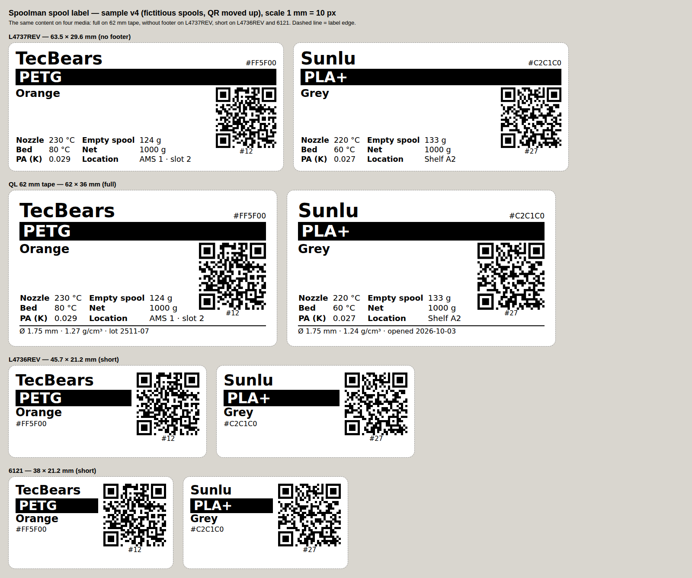

<!--
SPDX-FileCopyrightText: 2026 Björn Strausmann and Labelyard contributors
SPDX-License-Identifier: AGPL-3.0-or-later
-->

# Milestone 1.7.0 — Design

**Date:** 2026-11-14
**Status:** Draft; the maintainer ruled on Q1–Q6 on 2026-11-14 (issue comments 00:16–00:17Z), the rulings are applied
below. #316 joined the milestone at 00:18Z. Revised after the plan review of `c988990` (NEEDS_FIXES, corrections
C0–C18) and the controller's rulings on its open points.
**Milestone:** 1.7.0 (minor: `feat` commits allowed, no `!`, no `BREAKING CHANGE:` footer; two maintainer-ruled
exceptions, section 2)
**Branch:** `milestone/1.7.0`, created from `milestone/1.6.0` so the work starts with the Labelyard names
**Issues:** #296, #285, #284, #283, #282, #281, #255, #316 (read with `gh api repos/strausmann/Label-Printer-Hub/issues/<n>`
and `/comments`; `gh issue view` fails on this repo because of the Projects (classic) sunset)
**Plan:** `docs/superpowers/plans/2026-11-14-milestone-1-7-0.md`

Decisions that the issues, the code and the maintainer did not settle are recorded as **rulings** (R-numbers). The
maintainer's own decisions are marked "maintainer, 2026-11-14". Open points are in
[Questions for the maintainer](#questions-for-the-maintainer).

## 1. Intent

1.7.0 collects the features that the 1.5.x triage moved out of a patch release, plus the Grocy label printer webhook
that #27 split off. The common thread: the operator should see and finish more from the web UI, without scripts or
the admin API.

- An operator who sets up a tape printer only in the web UI gets its status, and the SNMP community is never shown
  back (#296).
- A cart catches a label that will not print before it is sent (#285), and the cart is always one tap away (#316).
- Webhook labels show the event's quantity in the hub's language (#284); Grocy prints its own labels on the hub and
  its codes can be scanned (#281).
- A sheet with many unconfirmed cells is settled in one step (#282).
- Failures and printer problems surface where the operator looks first (#255).
- Admin keys have one clear rule for printer restrictions (#283).

### Non-goals

- The print inbox (#27). The Grocy label endpoint prints directly; #27 later routes it through the inbox.
- Per-user server-side notification state. Read and cleared state stays per browser (#255, decided in the issue).
- A role between `print` and `admin` ("printer admin"). #283 makes `admin` mean the whole hub.
- Fixing Grocy. Grocy's own handling of webhook errors is upstream's (section 6, Q7).

### Anti-goals (a failure even if it technically works)

- A token that ends up in the hub's own logs, error bodies or events (#281).
- A webhook or bulk call that lets a key do more than its scope and printer list allow.
- An SNMP community readable through any API response (#296).
- A notification centre that hides an error behind colour alone, or whose panel the on-screen keyboard can cover.
- A release with an open issue in the milestone.

## 2. Constraints that bind every part

- **Names:** Labelyard in prose. Settings are `LABELYARD_*`; the `PRINTER_HUB_*` fallback from `app/config_legacy.py`
  keeps working. Browser storage keys keep the existing `lph.` prefix (`lph.cart`, `lph.theme`): renaming storage keys
  is 1.6.0's business (R-0-1).
- **Minor rule:** no removed or renamed response field, **except** the two maintainer rulings of 2026-11-14:
  `connection.snmp.community` is no longer returned (replaced by `connection.snmp.community_set`, #296), and
  `allowed_printer_ids` on a key with the admin scope is refused with 422 (#283). Both get an upgrade note in the
  release notes; neither carries `!` or a BREAKING footer.
- **Hard repo rules** (`CLAUDE.md`, `CONTRIBUTING.md`): TDD, Conventional Commits with the scopes in
  `commitlint.config.cjs`, the print queue is mandatory (ADR 0005), mypy strict, website pages in English and German in
  the same PR, glossary terms, generated screenshots for UI changes, `e2e/short-viewport.spec.ts` for new dialogs,
  popovers and fields that must stay in sight with the on-screen keyboard.
- **New API endpoints** come with their OpenAPI schema (ADR 0011) and `frontend/src/api/schema.gen.ts` regenerated
  with `pnpm gen:api`. `test_endpoint_count_in_range` (`backend/tests/api/test_openapi_completeness.py:139-161`,
  upper bound 88, 84 operations today) is raised to fit 1.7.0's routes.
- **Every new route** carries a recognised auth marker; `backend/tests/unit/api/test_route_auth_coverage_guardrail.py`
  must stay green.
- **Request bodies read raw** use the bounded read (`_read_bounded` in `backend/app/api/routes/sheet_types.py:161`,
  moved to `app/api/bounded_body.py`), never `await request.body()`.
- **Privacy:** no private addresses, host names or tokens in the repo; examples use `example.invalid`.

### The attacker model from the 1.5.x hardening (applies to #281, #282, #283, #284, #285, #296)

| Actor | What it holds | What it may do |
|---|---|---|
| Anonymous caller on the network | nothing | reach unauthenticated routes only; webhook routes answer 401/503 |
| Webhook caller | the shared webhook key (`LABELYARD_WEBHOOK_API_KEY`, ≥ 32 chars, `X-API-Key`) | print through `/api/v1/webhook/{spoolman,grocy}`, 120 calls/min per key (`LABELYARD_WEBHOOK_LIMIT_PER_MINUTE`) |
| API key `read` | key header `X-Label-Hub-Key` | read; sees only its own jobs (#294) |
| API key `print` | as above | read and print; marks and resolves sheet cells (#264); restricted to `allowed_printer_ids` when set |
| API key `admin` | as above | everything, on every printer: from 1.7.0 an admin key carries no printer restriction (#283) |
| Browser session | a session derived from a key | the key's scope, printer list and rate limit |
| Grocy user | can press "print label" in Grocy | when the hub answers with an error or Grocy times out after 2 s, Grocy's API answer carries the Guzzle message with the full webhook URL, **token included** (`WebhookRunner.php` catches an unimported `RequestException`; the controller returns `$ex->getMessage()`) |

Every key has its own per-minute bucket (`enforce_key_rate_limit`, applied after bcrypt verification). Error bodies
never carry `str(exc)` of an upstream or integration error (CWE-209). A job records `api_key_id` and `source_ip`.

## 3. #296 — SNMP status discovery in the printer form

### Findings in the code

- `SNMPConfig` (`backend/app/schemas/printer_admin.py:32-42`) has `discover: bool = False` and
  `community: str | None = "public"` (≤ 64 chars); the model validator requires a community when `discover` is true.
- `PUT /api/v1/admin/printers/{slug}` replaces `connection` as a whole (`printer_admin_service.py:294-300`). The form
  spreads the stored connection into what it sends (`PrinterForm.tsx:91`).
- The community is returned in plain text by the admin routes (`_row_to_read`, `admin_printers_api.py:210`) **and to
  every read caller** by `GET /api/v1/printers[/{id}]` (`_connection_view`, `printers.py:75-84`). Only the audit trail
  redacts it (`audit_redaction.py:15-19`).
- The print preflight ignores the stored community: `PrintService` calls `preflight_check()` without one and the
  backends are built without it (`backend_router.py:143-145`; `preflight_check` defaults to `"public"`), so a
  non-`public` community breaks printing. Only the status producer and the PJL query use `cfg.snmp.community`.
- Both tape drivers use SNMP; IPP printers have no SNMP block.

### Design

- **R-296-1:** the form shows a **Status discovery** switch and an **SNMP community** field for the drivers `ptouch`
  and `brother_ql`, never for `ipp`.
- **R-296-2 (write-only, maintainer 2026-11-14):** the community field is a password-type input with
  `autoComplete="off"`, never filled. Empty means "keep the stored community". With `community_set: true` the field
  description says "A community is stored. Leave the field empty to keep it."
- **R-296-3 (client validation):** discovery on, `community_set` false and an empty field is refused before sending
  ("Enter the SNMP community, or turn status discovery off."); over 64 characters is refused.
- **R-296-4:** the snmp object the form sends is computed by one pure function `snmpPayload(storedSet, draft)`; it
  omits `community` when the field is empty.
- **R-296-5 (backend, maintainer 2026-11-14):** every printer response (admin and read routes) replaces
  `connection.snmp.community` by `connection.snmp.community_set: bool`. On create and update, a `snmp` object
  **without** a `community` key (or with `null`) keeps the stored community (`"public"` on create); a non-empty string
  replaces it. The rest of `connection` is still replaced as a whole.
- **R-296-5a (security review of Task 1, 2026-11-14):** the stored community is kept only for the same SNMP target.
  When an update changes `connection.host` or `connection.port` (compared after normalisation: case and surrounding
  blanks; an IP address by value; a trailing dot is **not** ignored, because `printer` and `printer.` are different DNS
  names) and carries no `community`, the hub answers 422
  `snmp_community_required` and saves nothing; it never resets to `public` silently. Otherwise pointing a printer at a
  host of the caller's choice would send the stored community there. A row without a stored community gets `public`.
  A change of the print port alone is refused too, although SNMP always goes to port 161: that is the deliberate,
  stricter rule (the maintainer's requirement), not a leak path. The form (Task 2) therefore requires the community field when the host or port changes and a community is stored.
- **R-296-6 (backend, review F3):** the tape backends receive the stored community and use it for the preflight, so
  printing and discovery use the same community.
- Docs: `docs/getting-started.md` section 2 ("Turn on status discovery") uses the form; the `curl` example moves to
  "From a script" and no longer reads the community back. Website `install/printers.md` (en + de) gets the switch;
  `admin/upgrades` gets the upgrade note for `community_set`.

## 4. #285 — Preview every distinct content type in the cart

### Findings

- `CartPage.tsx` previews `cart.items[0]` only (`CartPreview`), via a client lookup plus `POST /api/v1/render/preview`.
- Whether a QR payload fits is not a fixed byte count: the fixed QR box depends on tape, orientation and preset
  (`build_box_qr` in `ql_layout.py:225-236` raises `QrPayloadTooLongError(length, max_bytes)`), and the QR payload of a
  cart item comes from the integration lookup. A client-side size check cannot be exact.
- Cart items are unique per `(app, id)` (`cart.ts:30`).

### Design

- **R-285-1 (previews):** one preview per distinct `content_type` in the cart, in cart order, using the first item of
  that type; at most `MAX_CART_PREVIEWS = 4`. Above that, a line "N more layouts are not shown." Each preview names
  its item ("Shows Cable 7 for the QR + 2 lines layout.").
- **R-285-2 (check every item):** a new read endpoint `POST /api/v1/render/check` validates items the way a print
  would render them, without a printer, queue or database:
  - Body: `{tape_mm, orientation?, layout_preset?, items: [{content_type, lookup: {app, identifier}}]}`, 1 to
    `MAX_RENDER_CHECK_ITEMS = 50` items; `lookup` is a `RenderCheckLookup` with `app ≤ 32` and
    `1 ≤ identifier ≤ 256` characters, `extra="forbid"`.
  - Answer 200: `{results: [{index, ok, error_code, error_detail}]}`, one per item, same order.
  - Per-item codes: `qr_payload_too_long` (with `length`, `max_bytes`), `content_type_data_mismatch` (with
    `missing_fields`), `app-lookup-not-found`, `integration_unknown_app` (caught before `LookupFailedError`, it is a
    subclass), `integration_not_configured`, `integration_lookup_failed`.
  - The request-level 409 `unsupported_tape` is decided **before** any lookup (tape geometry and orientation first).
  - Lookups run through `AppLookupService` with at most `MAX_BATCH_LOOKUPS` (8) at once; identical
    `(app, identifier, content_type)` items are looked up and rendered once (API callers can send duplicates; the cart
    cannot). Renders run in `asyncio.to_thread`. No `str(exc)` in any result. Scope `read`.
- **R-285-3 (cart UI):** the cart sends its items in chunks of 50 when a tape printer is selected and the tape is known;
  an item with a failed check gets an inline flag in its row ("The QR code does not fit this tape: 812 of at most 122
  bytes."), and the print section shows "N labels will not print. Remove them or change the layout." The print button
  stays enabled: the batch answer is binding, the flag is advice.

## 5. #284 — The webhook quantity on the label

### Findings

- `SpoolmanWebhookPayload.quantity` and `GrocyWebhookPayload.quantity` are accepted and ignored
  (`backend/app/schemas/webhook.py`); webhook labels print as `qr_two_lines`.
- The Spoolman lookup builds `"{grams}g remaining"` with half-up rounding (`spoolman/plugin.py:77-82`), which
  `qr_two_lines` never shows. `qr_three_lines` requires and shows `secondary[0]` (`layout_engine.py:35-43`).
- **Backend language source:** `general.language` (`en`/`de`, `backend/app/settings_store/registry.py:32`) read through
  `request.app.state.settings_store.get("general.language")`; label text is translated with a per-language dict and an
  `en` fallback, the pattern of `FEED_MARK_TEXTS` (`backend/app/sheets/planner.py:83-86`, used at `:243`). There is no
  gettext catalogue in the backend.

### Design

- **R-284-1:** with a quantity the label prints as `qr_three_lines` and the quantity line is `secondary[0]`; without
  one it prints as `qr_two_lines` exactly as today.
- **R-284-2 (Spoolman):** whole grams rounded half up. The webhook value wins over the lookup's remaining weight.
- **R-284-3 (Grocy):** the delta with an explicit sign, rounded half up to at most two decimals, trailing zeros
  removed, ASCII minus; an exact zero has no sign, `-0.001` prints `0`. Grocy's webhook carries no unit.
- **R-284-4 (bounds, no new refusals):** a quantity outside `[0, 1 000 000]` (Spoolman) or `[-1 000 000, 1 000 000]`
  (Grocy) is treated as absent and logged at INFO without the value.
- **R-284-5 (language, maintainer 2026-11-14):** the line follows `general.language`.

| | en | de |
|---|---|---|
| Spoolman | `851g remaining` | `851 g übrig` |
| Grocy | `Stock change: +2`, `Stock change: -1.5` | `Bestandsänderung: +2`, `Bestandsänderung: -1,5` |

  The strings live in `QUANTITY_TEXTS: Final[dict[str, dict[str, str]]]` in `backend/app/services/webhook_quantity.py`;
  an unknown language falls back to `en`.
- The stored job payload carries the label data with the quantity line, so a restart re-renders the same label.
- Mechanism: `PrintService.submit_print_job` gets an optional `label_transform` that runs on the resolved `LabelData`
  before render and persist.

## 6. #281 — Grocy's label printer webhook and Grocycode scanning

### What Grocy sends (from Grocy's source, commit `146f73af47fe65f806b6eea0ac5f3bee7cb62cb5`)

- `controllers/Api/{Stock,Chores,Batteries,Recipes}ApiController.php` build `$webhookData` and call
  `helpers/WebhookRunner.php`, which POSTs it with a **2.0 s timeout**, as JSON when `LABEL_PRINTER_HOOK_JSON` is true
  (default), else form fields. Grocy writes every webhook URL **and body** to its stderr, and returns the URL with the
  token to its user on an error answer or a timeout (attacker model, section 2).
- Fields per label type (then `array_merge` with `LABEL_PRINTER_PARAMS`, which can override any key):

| Label | Name field | `grocycode` | Extra |
|---|---|---|---|
| product | `product` | `grcy:p:<product_id>` | `details` |
| stock entry | `product` | `grcy:p:<product_id>:<stock_id>` | `details`, `stock_entry`, `due_date` = `"<localised DD>: <date>"` only with best-before tracking |
| chore | `chore` | `grcy:c:<chore_id>` | `details` |
| battery | `battery` | `grcy:b:<battery_id>` | `details` |
| recipe | `recipe` | `grcy:r:<recipe_id>` | `details` |

- **Grocycode:** `grcy` is Grocy's official magic. Grocy's `docs/grocycode.md` defines
  `grcy:<entity>:<id>[:<extra>…]` with the entities `p` (product), `b` (battery) and `c` (chore); for `p` an optional
  stock id follows. Grocy's code also has `r` for recipes (`helpers/Grocycode.php:23`) and prints recipe labels with it;
  the documented grammar does not list it.
- `details` carries the full product or recipe row; its description can hold pasted images as data URIs.

### Design: endpoint

- **Endpoint:** `POST /api/v1/webhook/grocy/label`, 202 `WebhookAcceptedResponse` (the existing schema). Request body
  documented with `openapi_extra`, like `import_sheet_type`.
- **R-281-1 (authentication, maintainer 2026-11-14):** an **API key** with the effective scope **`print`**; a `read`
  key answers 403 `insufficient_scope`, an `admin` key 403 `token_scope_too_wide`.
  - The key comes from the query parameter `token`, taken only from a literal `token=` parameter of the raw query
    string (`request.scope["query_string"]`), the same shape the log filter redacts; a percent-encoded parameter name
    is not a token. The `X-Label-Hub-Key` header is accepted too (header wins).
  - Every failure of the token itself (missing, malformed, longer than 128 characters, unknown, disabled, expired,
    wrong) answers the same **401 `invalid_token`** with one fixed message. A token over 128 characters is refused
    without a database lookup (bcrypt ≥ 5 raises on > 72 bytes).
  - The key's own rate limit applies (429 with `Retry-After`).
- **R-281-2 (the hub's logs):** a logging filter on `uvicorn.access` and `uvicorn.error` replaces the value of every
  literal `token=` query parameter with `***` in the record's args and message; the app installs it at start. The
  debug log line of an unknown key prefix (`dependencies.py:212`, 16 characters, not secret for `lh_` keys) stays; the
  ADR names it.
- **R-281-3 (body):** JSON only (`application/json`, parameters allowed), else 415 `json_required` with a hint to set
  `LABEL_PRINTER_HOOK_JSON=true`. At most **1 MiB** (`MAX_GROCY_LABEL_BODY = 1_048_576`), read with the bounded read:
  a declared `Content-Length` above the limit is refused before a byte is read, otherwise `request.stream()` stops at
  limit + 1; 413 `body_too_large`. Unknown fields are ignored; `details` and `stock_entry` are not read or declared.
- **R-281-4 (label type):** taken from `grocycode`, validated against
  `GROCYCODE_PATTERN = ^grcy:(p|b|c|r):[0-9]{1,10}(:[^:\s]{1,64}){0,3}$`: `p` with an extra part is a stock entry,
  `p` without is a product, `b` battery, `c` chore, `r` recipe (recipe accepted because Grocy's code sends it). The
  name field must match the type, else the content error `grocy_label_mismatch` (R-281-8).
- **R-281-5 (label data, no call back to Grocy):** `title` = the name, `primary_id` = the object id, `qr_payload` = the
  Grocycode, `secondary` = `(due_date,)` for a stock entry that carries one, else empty; `source_app = "grocy"`.
  Every text cleaned with `sanitise_text` and capped at `RAW_TEXT_MAX` (512).
- **R-281-7 (mapping on the Grocy settings page):** new runtime settings under **Settings > Integrations > Grocy**:

| Key | Kind | Default |
|---|---|---|
| `integrations.grocy.label.enabled` | bool | `false` |
| `integrations.grocy.label.product.content_type` | enum | `qr_two_lines` |
| `integrations.grocy.label.stock_entry.content_type` | enum | `qr_three_lines` |
| `integrations.grocy.label.chore.content_type` | enum | `qr_two_lines` |
| `integrations.grocy.label.battery.content_type` | enum | `qr_two_lines` |
| `integrations.grocy.label.recipe.content_type` | enum | `qr_two_lines` |
| `integrations.grocy.label.printer` | str (printer slug) | `""` = the first enabled tape printer |
| `integrations.grocy.label.<type>.printer` | str (printer slug) | `""` = the default target |
| `integrations.grocy.label.sheet_type` | str (sheet type key) | `""` |
| `integrations.grocy.label.<type>.sheet_type` | str (sheet type key) | `""` |

  A page printer target also needs a sheet type (R-281-13).

  Enum choices: `qr_only`, `qr_one_line`, `qr_two_lines`, `qr_three_lines`. `qr_three_lines` requires a secondary line
  (`REQUIRED_FIELDS`, `layout_engine.py:39`): a label mapped to `qr_three_lines` without one (every type but a stock
  entry with `due_date`) is printed as `qr_two_lines`; the stored job records the content type actually printed.
- **R-281-8 (order and outcome, controller ruling on the time budget):**
  1. token → rate limit → `label.enabled` (503 `grocy_label_disabled`) → content type (415) → bounded read (413);
  2. the target printer: from the code type's target, else the default target (R-281-13) (the `product` mapping when the code is unreadable),
     resolved to an id (unknown slug: 503 `grocy_label_printer_unavailable`; no enabled tape printer: the existing
     503) → `check_printer_access(auth, id, default_printer=True)` (403 `printer_not_allowed` with the fixed message,
     mapped or not: Grocy forwards the message to its user) → disabled printer: 503
     `grocy_label_printer_unavailable`; enabled page printer without a usable sheet type: 503
     `grocy_label_sheet_type_unavailable` (R-281-14);
  3. **content errors** (unparseable JSON, a schema failure, a code outside `GROCYCODE_PATTERN`, a text over 512:
     `grocy_label_invalid`; a name field that does not match the type: `grocy_label_mismatch`) answer **202
     with a job in state `failed`** on the target printer, with the error code as the job error: the request was
     accepted, the label could not be built, and the failure belongs where the operator looks (job page, #255);
  4. otherwise a job is accepted for deferred printing (a page target: R-281-16) and the route answers 202.
- **R-281-11 (time budget, controller ruling):** the route answers within **1.5 s**. It validates, records the job and
  returns 202; the preflight (SNMP, up to 3 s per try on PT/QL), render and queue hand-off run after the response.
  A later failure (offline, no tape, unsupported tape, QR too long) sets the job to `failed` with the same error code
  `POST /api/v1/print` would answer, and is visible on the job page and in the notification centre. Grocy therefore
  never waits for the printer, and a Grocy timeout no longer means "printed anyway".
  - Mechanism: `PrintService.accept_deferred_job(raw: RawLabelData, *, content_type, source_app, api_key_id,
    source_ip) -> UUID` stores a `queued` job with the label data and `payload.deferred = true` (no tape fields yet),
    then completes it in a tracked background task: preflight → tape → render (with the `qr_three_lines` fallback) →
    payload completed → `submit_with_id`. A deferred job still without tape fields at a restart ends as
    `failed_restart` and never prints twice.
- **R-281-9 (config block):** the settings page shows a ready-to-copy block for Grocy's `config.php`:

```php
Setting('FEATURE_FLAG_LABEL_PRINTER', true);
Setting('LABEL_PRINTER_WEBHOOK', '<public-url>/api/v1/webhook/grocy/label?token=<print-key>');
Setting('LABEL_PRINTER_RUN_SERVER', true);
Setting('LABEL_PRINTER_HOOK_JSON', true);
```

  `<public-url>` is filled from `general.public_url`; `<print-key>` stays a placeholder, with a link to
  **Settings > Access keys** and the warning: "Use a key with the print scope, restricted to the label printer. Grocy
  writes the address with the key to its own log, and shows it to the Grocy user when the hub refuses a label or does
  not answer within 2 seconds."
- **R-281-10 (ADR):** URL-token authentication for one route: a new ADR (next free number after 1.6.0's), `Proposed`
  in the first task, `Accepted` when the feature ships. Consequences include the Grocy user exposure, the reduction on
  our side (print-scope-only tokens, answer inside the budget, content errors as 202 with a failed job) and that a
  reverse proxy's access log is outside the hub.

### Design: Grocycode on the scan page (maintainer 2026-11-14)

- **R-281-12:** a scan resolver `grocycode` parses exactly the documented grammar
  `GROCYCODE_SCAN = ^grcy:(p|b|c):([0-9]+)(?::([^:]+))*$` (Grocy `docs/grocycode.md`), on the trimmed text; the scanner
  already reads QR, DataMatrix and Code 128 (`decoder.ts:16`).
  - `p` (with or without a stock id) opens the Grocy product in the hub's Grocy integration: route `/product/<id>`
    (`ProductPage`, lookup `grocy`).
  - `b` and `c` have no item in the hub's Grocy integration. They open a new route `/grocycode/$entity/$id` that says
    "Grocy battery 4" / "Grocy chore 4" and links to Grocy's own page (`<grocy url>/battery/<id>`,
    `<grocy url>/chore/<id>`, Grocy `routes.php:119,128` at `146f73af`) when the Grocy address is known, else names
    the code only.
  - Anything else (`grcy:r:…`, an unknown entity, a non-numeric id) is not claimed by this resolver.

### Design: targets (maintainer 2026-11-14)

- **R-281-13 (target model).** A Grocy label goes to a **target**: the default target for all label types plus an
  optional override per type (`product`, `stock_entry`, `chore`, `battery`, `recipe`). A target is a printer with its
  settings. New runtime settings, beside `integrations.grocy.label.printer` and `integrations.grocy.label.<type>.printer`:

| Key | Kind | Default |
|---|---|---|
| `integrations.grocy.label.sheet_type` | str (sheet type key) | `""` |
| `integrations.grocy.label.<type>.sheet_type` | str (sheet type key) | `""` |

  - Resolution is **per target as a unit** (planner's call): a type whose `…<type>.printer` is set uses its own
    `…<type>.sheet_type`; a type whose printer is `""` uses the default target, printer **and** sheet type. The two
    sheet-type keys are never mixed. The printer resolves exactly as `resolve_grocy_target`
    (`api/routes/grocy_label.py:121-132`).
  - A sheet-type key is read only when its target's printer is a page printer (`backend == "ipp"`).
  - **Layout on a sheet:** the per-type `content_type` (R-281-7) applies to page targets too — a sheet item has a
    content type (`SheetItem.content_type`, `schemas/sheet_print.py:80-88`), mapped for a sheet type without QR by
    `map_content_type` (`sheets/cell_render.py:163`), with the same `qr_three_lines` → `qr_two_lines` fallback. The
    **cell geometry of the sheet type** governs size; tape width, orientation and QL presets do not apply. No R-281-7
    setting is tape-only.
  - Room for 1.8.0 (#27, print inbox): a later enum key per target (`…label.target` / `…label.<type>.target`:
    `printer` | `inbox`, default `printer`). These keys keep their meaning; no migration (planner's call).
- **R-281-14 (validation).** The sheet type of a page target must exist and must not be archived. Checked **at
  request time**: the settings store has no cross-entity validation (`SettingDef` carries kind, default, env and
  choices only, `settings_store/registry.py:11-17`), and the printer slug is checked the same way. In R-281-8 step 2,
  after `check_printer_access`: an **enabled** page printer whose sheet type is `""`, unknown or archived answers
  **503 `grocy_label_sheet_type_unavailable`** ("The sheet type for Grocy labels is not set, unknown or archived in
  Labelyard."; no key in the message). A disabled page printer still answers 503 `grocy_label_printer_unavailable`.
  The settings UI offers only active types (R-281-18).
- **R-281-15 (which sheet).** One Grocy label takes **one cell**. Among the target type's sheets with state `active`
  and at least one free cell (free = not used, reserved or unconfirmed, `sheets/sheet_service.py:75-77`), all versions
  counted, the hub takes the one with the **fewest free cells**, ties by `(len(code), code)` — the same rule as the
  print page: `fittingFirst` sorts fitting sheets by fewest free (`frontend/src/features/sheets/print/plan.ts:68-73`)
  and keeps the server's code order for equal counts (`sheets/sheet_service.py:623-626`). The cell is the lowest free
  one (`cells: "first_free"`, `schemas/sheet_print.py:128-131`). No sheet with room → a **new sheet** of the type's
  current version with `id_placement: "margin"`, the default of `NewSheetModel` (`schemas/sheet_print.py:114`) and of
  the print page (`plan.ts:48`); the planner decides the margin ID (or `id_not_printed`). The cell is recorded with
  `source = "grocy"`, `ref` = the Grocycode cut to entity and id (`grcy:p:12`, ≤ 17 characters; `ref` max 120,
  `schemas/sheet_print.py:93`), purpose = default (title, else id); `label_data.source_app = "grocy"` as on tape
  (R-281-5). Default tray; calibration snapshot as for any sheet print (`sheets/print_service.py:1479-1481`).
  - **Refused sheet (reviews I-2, N-3):** every sheet a try was refused on stays out of the next choice, so sheets the
    planner cannot take (for example ones whose ID cell is still due and that have a single free cell) do not stop the
    labels of their type; the label ends on the next sheet that takes it or on a new one.
- **R-281-16 (deferred printing on a page target).** Fits R-281-11: the request does **one insert and no
  reservation**, then answers 202. It stores a `queued` job on the page printer with payload `{"deferred": true,
  "deferred_kind": "sheet_page", "label_data", "content_type", "sheet_type"}` (no `kind`). Jobs and sheets share one
  SQLite file, so that insert waits behind an open write transaction (`busy_timeout = 5000`, `db/engine.py:26`) like
  Task 8's tape insert; the budget holds against everything the hub does after the insert (sheet choice, the sheet
  write lock, planning, the hand-off). A tracked background task then: printer enabled and not held (#231, checked
  with the queue's `is_identity_held`, `api/identity_hold.py:36-38`, raising `PrinterIdentityMismatchError`) → choose
  the sheet (R-281-15) → `print_sheets` with the job's own id (reserve under the sheet write lock, payload, hand-off of
  the stored row). Cells turn `used` only when the page job completes (D15, `sheets/outcome.py:161-162`).
  - **Failure** sets the job `failed`; the job error is the `error_code` of any `SheetApiError` (`sheets/errors.py`),
    else `internal_error`; `job.state_changed` is published, as on Task 8's tape path. A job **cancelled** meanwhile
    is not a failure: the task returns quietly, with no failed mark and no `failed` event, as Task 8's tape path returns
    on `completed is False` (`services/print_service.py:396-398`).
  - **Cells after a failure:** the existing undo keeps the failing page's cells when its `jobs` row exists (ruling
    T7-1, `sheets/print_service.py:1323-1340`), and the stored row always exists. On the stored-row path the undo
    therefore **reads the row** (the exception type cannot tell whether the swap committed, e.g. a `CancelledError`
    from `cancel_for` during `set_queued_payload`): it **releases the job's reserved cells at once**
    (`reservation.release`, `sheets/reservation.py:620`) when the row is gone, no longer `queued`, or still carries
    `payload.deferred`; a `queued` row with a page payload keeps its cells (T7-1: the next recovery prints it onto them
    via `may_recover`); a failed lookup keeps the cells for the sweep, as `_job_row_exists` does
    (`sheets/print_service.py:1294-1302`). T7-1 stays unchanged for every other caller.
  - **Sheet filled meanwhile:** the sheet is chosen outside the lock and `reserve` plans `first_free` again under it
    (`sheets/reservation.py:387-461`). If that existing sheet has no free cell any more (`insufficient_cells`,
    `sheet_discarded`, `sheet_not_found`), the task chooses again without that sheet, until a sheet takes the label
    or the choice is a new sheet; a new sheet that fails is the job's error.
  - **Margin ID and feed mark in flight (C26):** between `reserve` and the hand-off the reservation has a `jobs` row
    without a `sheet_page` detail, so neither `unattached_reservation_sheets` (`repositories/sheets.py:147-161`) nor
    `_active_sheet_page_carries` (`sheets/reservation.py:157-170`) counts it. A `reserved` cell whose job is `queued`
    with `payload.deferred` true counts as unattached.
  - **Restart, re-wire or shutdown before the hand-off:** recovery ends the row **`failed` with
    `deferred_interrupted`** (not `failed_restart` as R-281-11 says for tape: the sweep maps `failed_restart` to
    `unconfirmed`, `sheets/outcome.py:233-234`, and this page was never sent) and calls the `sheet_page` outcome
    handler with `started=False`, which frees the cells (`sheets/outcome.py:164-175`). The deferred branch comes before
    the payload validation that today ends such a row `recovery_invalid_page_payload` (`services/print_queue.py:936`).
    A re-attach of the printer cancels and awaits its running Grocy sheet tasks before recovery runs, like
    `cancel_deferred` for tape (`services/printer_runtime.py:630-641`). After the hand-off the row has a valid page
    payload and `may_recover` (`sheets/outcome.py:180-195`) recovers it: printed once, never twice.
  - **Cancelled before the hand-off:** the hand-off registers the job in the queue's memory first (as
    `submit_with_id`, audit R3-1, `services/print_queue.py:1187-1198`), then swaps the payload only while the row is
    `queued` (`set_queued_payload`, `repositories/jobs.py:155`); a cancelled row raises, the registration is dropped and
    the cell is released. After the swap it checks `job.state != QUEUED` before `put`, as `submit_with_id` and
    `submit_page_job` do (`services/print_queue.py:1204-1205`, `:1865-1872`): a cancel between swap and `put` is settled
    by `cancel()` itself and nothing is enqueued.
  - The periodic sweep leaves the cells alone while the row is `queued` (`_decide` → `None`, `sheets/outcome.py:229-239`).
- **R-281-17 (concurrency).** Two webhooks never take the same cell: `reserve` plans and inserts under the sheet write
  lock, the transaction's first statement (`sheets/locking.py:44-69`), with the composite key as the last guard
  (`sheets/reservation.py:458-465`). Choosing and reserving run under an in-process `asyncio.Lock` per sheet type key,
  so two simultaneous labels do not open **two** new sheets; the hub is one process (ADR 0015; `uvicorn` without
  `--workers`, `backend/Dockerfile:245`). A UI print in parallel is handled by the re-plan under the lock and the
  re-choice; a UI print that sent `expected_cells` may get `plan_changed` (existing behaviour, documented).
- **R-281-18 (settings UI).** Settings > Integrations > Grocy, label section:
  - **Default target:** printer select with "First enabled tape printer", then enabled printers grouped "Tape
    printers" / "Page printers". With a page printer chosen, a **sheet type** select appears (active types, by name,
    key as description) and is required: save is disabled with the field error "Choose a sheet type for this page
    printer."
  - **Per type:** the printer select starts with "Same as default"; a page printer shows its own required sheet type
    select. "Same as default" hides it.
  - Choosing a tape printer or "Same as default" also clears that target's sheet type (sends `""`).
  - A stored sheet type that is archived or gone shows the warning "This sheet type is archived or no longer exists.
    Grocy labels for it are refused." (no silent fallback).
  - The content-type selects stay per type and apply to tape and page targets alike.
- **R-281-19 (out of scope).** The print inbox target (#27, 1.8.0); choosing a specific sheet or cells; `cell` or
  `manual` ID placement for Grocy sheets; save-time validation of slugs and sheet types; a tray per target; more than
  one cell per label.

## 7. #282 — Resolve all unconfirmed cells of a sheet

### Findings

- `resolve_cells` in `backend/app/sheets/sheet_service.py:464-515` settles a list of cells in one `write_transaction`,
  publishes one `sheet.updated` and logs the count. The route `POST /api/v1/sheets/{code}/cells/resolve` uses
  `PrintDep` and does not check printer access; #264 decided that a printer-restricted `print` key may resolve cells.

### Design

- **Endpoint:** `POST /api/v1/sheets/{code}/cells/resolve-all`, scope `print`, response `SheetRead`.
- **Body:** `{outcome: "printed" | "not_printed", expected_count?: int ≥ 1}`.
- **R-282-1:** when `expected_count` is sent and the number of unconfirmed cells at the server differs, the call
  answers **409 `unconfirmed_count_changed`** with `error_detail.unconfirmed` and changes nothing. The UI always sends
  it.
- **R-282-2:** nothing unconfirmed answers **409 `no_unconfirmed_cells`**.
- **R-282-3:** the per-cell settle logic moves into one private helper used by `resolve_cells` and
  `resolve_all_cells`, so `printed` keeps setting `id_printed` and `feed_mark_printed` exactly as today.
- One transaction; a failure part-way changes no cell. One `sheet.updated` event with all changed cell numbers.
- **UI:** in the "Unconfirmed cells" panel of `SheetDetail.tsx`, "Resolve all as printed" and "Resolve all as not
  printed", shown from two unconfirmed cells; each opens a `ModalDialog` naming the count ("Resolve 3 cells as
  printed?"); on 409 `unconfirmed_count_changed` the sheet reloads and the dialog says "The number of unconfirmed cells
  changed. Check the list and try again."

## 8. #283 — Admin keys and printer restrictions (maintainer 2026-11-14: option 1)

### Current state

- The admin printer routes call `check_printer_access` only in `resolve_identity` (`admin_printers_api.py:565`), but a
  restricted admin key **is** restricted on the print, batch, job-list and identity routes, because
  `_validate_api_key` and `_session_context` pass the stored `allowed_printer_ids` on (`dependencies.py:298-307`,
  `:358`).
- `create_api_key` (`admin_api_keys.py:158`) accepts `allowed_printer_ids` with any scope; `update_api_key` changes it
  (`:238`), but not the scopes (`:213`).

### Decision and design

- **R-283-1:** admin keys ignore printer restrictions. `create_api_key` with the admin scope and a non-empty
  `allowed_printer_ids`, and `update_api_key` setting a non-empty list on an admin key, answer **422
  `admin_key_not_restrictable`**.
- **R-283-2:** `_validate_api_key` and `_session_context` give an admin-scope key `allowed_printer_ids=[]`. An existing
  restricted admin key keeps working, unrestricted; the key list shows its stored list as "ignored for admin keys".
- Docs: `website/src/content/docs/admin/api-keys.md` (en + de) states the rule; the release notes carry the upgrade
  note (existing restricted admin keys lose their restriction; a new restricted admin key is refused).

## 9. #255 — Notification centre in the top bar (design approved by the maintainer, 2026-11-14)

### Decided in the issue (binding)

Button with a severity dot and an unread count next to the scan button; panel newest first; click opens the job or
printer page; every print job with its live state; printer problems while they last; "Mark all as read" keeps
entries, "Clear all" hides them up to the newest one present when clearing; full-height sheet on a phone; focus trap
and Escape; entries come from the server and stay live over SSE; read and cleared state per browser in local storage;
the overview card "Needs attention" uses the same source, and a failed job that was retried successfully or dismissed
leaves it.

### Source of entries

- **R-255-1 (no new endpoint):** entries are derived in the browser by one pure function
  `deriveNotifications({jobs, printers, statuses, sheets, firstSeen, now})` from data the server already serves and
  keeps live: `GET /api/v1/jobs?since=<now − 24 h>&limit=200&order=newest` — a new optional query parameter
  `order: Literal["oldest", "newest"] = "oldest"` (default unchanged), because the list is sorted oldest first
  (`repositories/jobs.py:50`) and would otherwise drop the newest jobs above 200 — the printer list and statuses, and
  `GET /api/v1/sheets`. These queries are invalidated by the existing SSE events and re-read after a reconnect
  (`events.ts:98-140`, `:217-223`). A read key sees only its own jobs (#294).
- **R-255-2 (retried jobs):** every retry stores `retry_of: "<id of the job being retried>"` in the new job's payload,
  overwriting a copied one: the tape path (`retry_job`), the page path (`_retry_page_job`, `PagePayload.retry_of`) and
  the sheet page path (`retry_sheet_page` in `backend/app/sheets/print_service.py`). A failed job with a later `done`
  job in its retry chain counts as resolved: it stays in the centre as information and leaves "Needs attention".

### What counts as an entry, and its severity

| Source | Entry | Severity | Target |
|---|---|---|---|
| Job `queued`, `printing` | "Cable 7 is printing on PT-P750W" | info | job page |
| Job `done` | "Cable 7 printed" | success | job page |
| Job `cancelled` | "Cable 7 was cancelled" | info | job page |
| Job `failed`, `failed_restart` (not resolved by a retry) | "Cable 7 failed: <error text as on the job page>" | **error** | job page |
| Job failed, resolved by a retry | "Cable 7 failed, printed on retry" | info | job page |
| Printer offline, error, stopped with a blocking or error reason | `describePrinter` kind and detail | **error** | printer page |
| Printer answered as another device (#231) | "Different device at the address of …" | **error** | printer page |
| Printer paused, stopped without a serious reason | kind label | warning | printer page |
| Printer status stale or not polled (#227) | "Status unknown" / "Not monitored" | warning | printer page |
| Tape or label roll empty, toner or ink low or empty | the status's own words | warning | printer page |
| Sheet with unconfirmed cells | "3 unconfirmed cells on sheet AB-12" | warning | sheet page |

- Entry ids: `job:<id>:<state>`, `printer:<id>:<kind>`, `sheet:<code>:unconfirmed`. Printer and sheet entries exist
  while the condition lasts; their time is the moment this browser first saw the condition (kept in storage).
- At most 100 entries, newest first.

### Button and badge

- An icon button (bell) in `TopBar.tsx`, between the search and the cart icon (#316); on a phone in the top bar too.
- The dot shows the highest **unread** severity: red dot for error, yellow **diamond** for warning (the shape rule of
  `StatusBadge`), green dot for success/info only, nothing when all is read. Next to it the unread count, `99+` above
  99.
- Accessible name: "Notifications, 3 unread, the most severe is an error" (de: "Benachrichtigungen, 3 ungelesen, die
  schwerste ist ein Fehler").

### Panel

- Desktop: a popover under the button, 24 rem wide, at most `min(70vh, var(--vvh) − 5rem)` high, scrolls inside.
- Phone (< 640 px): a full-height sheet sized with `var(--vvh)` and `var(--vv-top)`, with a close button in its header.
- Header: title, "Mark all as read", "Clear all". Each entry: severity shape and word, one-line text (two lines on a
  phone), relative time (absolute in the title attribute), printer or source; unread entries in bold with a "new"
  marker. The entry is a link to its target and closes the panel.
- States: loading ("Loading notifications…"), empty ("Nothing new."), every source failed ("Notifications could not be
  loaded." with a retry button), live stream down ("Live updates paused; the list may be out of date.").
- Keyboard: opening focuses the first action; Tab stays inside; Escape and the close button return focus to the bell.
  react-aria `DialogTrigger` + `Popover`/`Modal`.
- Motion: a 150 ms fade and lift on open; none with `prefers-reduced-motion`.
- On-screen keyboard rule: in `e2e/short-viewport.spec.ts`, at 1280x500 and 390x400 with a visual-viewport keyboard
  (search focused), the header actions and the first entry lie in the visible area.

### Read, clear, dismiss, persistence

- Storage key `lph.notifications`, value `{v: 1, read: string[], clearedAt: string | null, dismissed: string[],
  firstSeen: Record<string, string>}`; `read` and `dismissed` keep the newest 500 ids each.
- "Mark all as read": every visible id goes into `read`. "Clear all": `clearedAt` = the newest entry time present.
  "Dismiss" (overview card): adds the id to `dismissed`; it leaves the card and the centre.
- A missing or broken storage falls back to an in-memory state for the tab; nothing throws.
- "Needs attention" shows the unresolved error and warning entries that are neither cleared nor dismissed, each with a
  "Dismiss" button.

### Design skills

`taste-skill:design-taste-frontend` and `emil-design-eng`, `mobile-native` for the sheet, `impeccable:impeccable` for
acceptance. Screenshots light and dark at 1280 px and 390 px.

## 10. #316 — Permanent cart icon with a count in the top bar

- **R-316-1 (what the badge counts):** the number of **entries** in the cart (the rows on the cart page, the issue's
  "Cart, 3 items"), not the sum of copies; the cart page shows the copies sum on its print button ("Print 7 labels"),
  and the badge stays a measure of what the list shows.
- **R-316-2:** the icon is always in `TopBar.tsx`, on desktop and phones, after the bell and before the about link;
  empty cart: no badge, still a link to `/cart`. The existing in-page "Cart" links stay.
- The count comes from the cart state the cart page uses (`useCart()`, `lph.cart`), live within the tab and across
  tabs through the `storage` event. Accessible name "Cart, 3 items" / "Cart, empty"; badge `99+` above 99; the badge
  never overlaps a neighbouring control at 320 px width.
- Short-viewport case and the top bar screenshot. Same design skills as #255.

## Change to section 10 (#316) and section 9 (#255)

- **R-316-2** reads: "…after the bell and, **on desktop**, before the about link; on a phone (below 1024 px) the about
  link lives in the phone menu (R-319-4)."
- Breakpoints: below **1024 px** the app has the phone shell (tab bar, Menu, magnifier). Task 14's full-height
  notification sheet applies below **640 px**; between 640 and 1023 px the phone shell shows the bell's panel as a
  popover. The two numbers answer different questions (shell vs. panel form) and both stay.

## 10a. #319 — Every area reachable on a phone

Findings: below 1024 px the sidebar (`frontend/src/shell/Sidebar.tsx:36`, `hidden … lg:flex`) is gone and the tab bar
(`TabBar.tsx:37-55`) offers Overview, Printers, Scan, Jobs, Sheets. Sheet archive, calibration, the integration pages
(`/integrations/$app`), Paperless ASN, Kept, Settings and its sections (printer admin is **Settings > Printers**,
`router.tsx:233-240`) are reachable only by typing the address. The sidebar shows **Settings** to every session; the page
itself refuses non-admins (`SettingsPage.tsx:16-23`).

- **R-319-1 (placement; maintainer confirmed 2026-11-14 — QU2):** a **Menu** button at the left edge of
  the top bar below 1024 px opens a sheet from the left (a modal dialog, react-aria `ModalOverlay`/`Modal`/`Dialog`).
  Not a sixth tab: the tab bar keeps five fixed slots with Scan in the middle (`TabBar.tsx:27-29`). Desktop keeps the
  sidebar and has no Menu button.
- **R-319-2 (contents, one source):** the menu lists the sidebar's groups in the sidebar's order — Main, Material,
  Integrations (the configured integration pages, as in `IntegrationNav.tsx`), System — including the entries the tab bar
  already has, so one place reaches everything. In the System group an admin session sees the six settings sections
  (General, Printers, Integrations, Access and keys, Jobs, System) as direct entries, so every destination is two taps away
  (open the menu, tap the entry). Below the groups: Reload (R-331-6), About and licences, the theme switch, Sign out, and
  the connection status the sidebar shows (`Sidebar.tsx:29-33`), as the menu's last line and with the running version
  („Connected · v1.7.0“ / „Verbunden · v1.7.0“; the update note when a newer version waits) — the same component as the
  sidebar, not a copy (maintainer, 2026-11-15: a phone shows the version nowhere today). Groups and entries come from one pure function used by
  the sidebar and the menu; the settings sections from one list used by the menu and `SettingsLayout`.
- **R-319-3 (role rule; maintainer confirmed 2026-11-14 — QU1):** entries that need the admin scope
  (Settings and its sections) are shown only to a session with `scope === "admin"`, in the menu **and in the desktop
  sidebar** (one rule everywhere; the Settings page keeps its own gate). Hiding an entry is navigation, not access
  control: the API enforces admin on every settings and printer-admin route (`require_admin`, `settings_api.py:36`),
  unchanged. The desktop change gets one line in the 1.7.0 upgrade notes (en + de).
- **R-319-4 (top bar on a phone):** below 1024 px the top bar holds Menu, the search button (R-320-1), the bell (Task 14)
  and the cart (Task 15). About, theme and Sign out move into the menu there; on desktop they stay in the top bar. At
  320 px no two controls overlap.
- **R-319-5 (behaviour):** the trigger's accessible name is "Menu" / „Menü“, it carries `aria-expanded`; the sheet's
  heading is the same word. It closes by its × button, a press on the dim area (`useBackdropClose`, #318), Escape and by
  choosing an entry; focus returns to the trigger. The sheet is the visible area's height (`--vvh`, `--vv-top`) and
  scrolls inside itself. The active entry is marked as in the sidebar (`data-status=active`, not by colour alone).
  Opening animates in ≤ 200 ms (`translate-x` + fade), instant under `prefers-reduced-motion`.

## 10b. #320 — Search as a magnifier on phones

Findings: `GlobalSearch.tsx:101` takes `flex-1` of the phone top bar; the results already follow the visible area on a
phone (`GlobalSearch.tsx:128`). The shortcut `/` focuses the field (`GlobalSearch.tsx:42-53`). Escape on open results only
calls `preventDefault()` (`GlobalSearch.tsx:80-86`).

- **R-320-1:** below 1024 px the top bar shows a magnifier button named "Search" / „Suchen“; the inline field is **not
  rendered**. At 1024 px and above the inline field stays as it is.
- **R-320-2:** the button opens a search dialog at the top of the visible area, full width, field focused on open,
  results listed inside the dialog below the field. It closes by ×, the dim area, Escape and by choosing a result; focus
  returns to the magnifier. Escape with open results closes the results only and does not reach the dialog
  (`stopPropagation`); the next Escape closes the dialog.
- **R-320-3 (one search):** inline field and dialog share the query state, the ranking and the result list: the combobox
  logic moves out of `GlobalSearch.tsx` into one hook and one list component; both shells render them. Same results for
  the same text.
- **R-320-4 (keyboard):** `/` focuses the inline field at 1024 px and above (unchanged) and opens the dialog below. With
  the on-screen keyboard open the field and the first result stay in sight (short-viewport, 390 × 400 and the covered
  phone mode).

## 10c. #323 — Select popovers follow the visible area

Findings: `SelectField` (`frontend/src/features/settings/controls.tsx:174-245`) leaves placement to React Aria's
`Popover`, which measures against the window. `SheetTypeCombobox` measures against `window.visualViewport` with
`listRoom` and re-measures while open (`SheetTypeCombobox.tsx:105-114`, `193-202`); the measuring is inline in the
component. `SelectField` is used in eleven files, among them the calibration readings helper (`ReadingsHelper.tsx:61-62`)
and the Grocy labels panel, where #323 was found.

- **R-323-1:** every `SelectField` list is placed and sized against the visible area: below the trigger unless that leaves
  room for fewer than four options and above has more; height clamped to the room; the phone tab bar limits the room
  outside a dialog — the same rule as `SheetTypeCombobox` (`listRoom`, `LIST_MAX = 384`, `LIST_GAP = 12`, option 44 px).
- **R-323-2 (shared logic):** the measuring (anchor rectangle, tab bar outside dialogs, re-measure on visible-area changes
  while open) moves into one hook; `SheetTypeCombobox` and `SelectField` both use it. The combobox keeps its own
  scroll-reopen logic (`SheetTypeCombobox.tsx:116-185`), which is about closing, not placement.
- **R-323-3:** short-viewport e2e: with the keyboard stand-in covering the screen, a select whose trigger sits in the lowest
  60 px of the visible area shows its trigger and its first option inside the visible area, tablet (1280 × 800, visible
  420) and phone (390 × 800, visible 380). It fails against the current placement (counter-test).

## 10d. #331 — Pull to refresh

Findings: `frontend/src/index.css:65` sets `overscroll-behavior: none` on `html`, which turns off the browser's own
pull-to-refresh in a tab. The manifest asks for `display: standalone` (`src/build.test.ts:86`); an installed app has no
browser pull-to-refresh of its own (to be confirmed against Chrome for Android's and Safari's documentation in the task and
cited in the commit body). Inner scroll areas already carry `overscroll-contain` (`controls.tsx:220`, `364`,
`SheetGrid.tsx:304`, `print/SheetPicker.tsx:116`, `SheetTypeCombobox.tsx:349`, `PrintToasts.tsx:278`,
`GlobalSearch.tsx:128`). Every write of the app goes through TanStack Query's `useMutation` (`settings/api.ts`,
`lookup/api.ts`, `sheets/api.ts`, `calibration/api.ts`, …). The service worker registers with `registerType: "prompt"`,
`skipWaiting: false` (`pwa.config.ts:19,40`).

- **R-331-1 (browser tab):** the root locks only horizontal overscroll (`overscroll-behavior-x: none`); vertical stays
  `auto`, so the browser's pull-to-refresh works. Inner scroll areas keep `overscroll-contain`. When `isStandalone()` is true (the same check as R-331-2, so iOS
  versions that only report `navigator.standalone` are covered) the app sets `data-standalone` on `<html>`, and
  `html[data-standalone]` sets `overscroll-behavior-y: none`, so the own gesture does not fight a bounce or glow. No
  `display-mode` media rule: one source for "is this the installed app".
- **R-331-2 (installed app, own gesture):** active only when the app runs standalone
  (`matchMedia("(display-mode: standalone)")` or `navigator.standalone === true`). In standalone mode a pull starts at
  `touchstart` only when the five conditions below hold:
  - the page is scrolled to the very top (`scrollY === 0`),
  - the touch begins outside every inner scroll area (an element between the target and `<body>` whose computed
    `overflow-y` or `overflow-x` is `auto` or `scroll` and which can scroll on that axis: `scrollHeight > clientHeight`
    or `scrollWidth > clientWidth`),
  - no dialog is open (`[role="dialog"], [role="alertdialog"]` in the document),
  - the on-screen keyboard is closed (no focused text field: `input` other than checkbox/radio/button/submit/reset/file
    types, `textarea`, `contenteditable`),
  - no write is in flight (`useIsMutating() === 0`).
  The **first** `touchmove` then locks the direction: more downward than sideways (`dy > |dx|`) → pull; otherwise the
  gesture is abandoned for this touch and the page scrolls normally. Later moves only change the distance.
- **R-331-3 (distance and threshold):** shown distance = `min(PULL_MAX, max(0, 0.5 × downward finger travel))`,
  `PULL_MAX = 112` px; release at or past `PULL_THRESHOLD = 72` px reloads, release before it (or a `touchcancel`, or a
  second finger) cancels and the indicator returns. While a locked pull is under way the page does not scroll
  (`touchmove` `preventDefault`).
- **R-331-4 (what reload means):** a **full page reload** (`window.location.reload()`), in the gesture and in the menu
  entry — the same as the browser's own gesture in a tab, so tab and app behave alike, and a reload also re-opens a
  stalled live connection. Not a query refetch. A reload does **not** activate a waiting service worker (`skipWaiting:
  false`); updates stay with the existing update prompt. Accepted risk, as with the browser's own gesture: an unsaved
  form draft is lost. Not accepted: losing a write in flight — neither the gesture nor Menu › Reload acts while
  `useIsMutating() > 0` (the gesture does not start; the menu entry is disabled with the description "Wait until the
  current action has finished." / „Warte, bis die laufende Aktion fertig ist.“).
- **R-331-5 (indicator):** a round indicator under the top edge (`top: calc(var(--vv-top) + 8px)`) that follows the
  distance and turns its arrow at the threshold; `aria-hidden` (the reload itself is the outcome). Under
  `prefers-reduced-motion` it does not follow the finger: it appears at a fixed position once a pull is locked and
  changes only its arrow at the threshold; no spring back.
- **R-331-6 (menu entry):** the phone menu (R-319-2) has **Reload** / „Neu laden“ below the groups, in tab and app, with
  the guard of R-331-4. Device check on an Android phone and tablet, tab and installed app, by the maintainer (QU3);
  #331 stays open until he reports it.

## 10e. #337 — The calibration reading guide, in the app and on labelyard.app

Findings: step 2 of the calibration page (`CalibrationPage.tsx:230-258`) has the readings helper (only when a type is
chosen, `:231`) and the direct form; the only explanation is one hint line (`ReadingsHelper.tsx:158`) and the
schematic's legend (`CalibrationSchematic.tsx:75-88`). The schematic names the type with `typeLabelWithKey(type)`
(`CalibrationPage.tsx:202`). The website has no calibration page; `try/index.mdx:55` shows the `calibration` screenshot
rendered from the e2e fixtures. #337 pulls part A of #240 forward; the rest of #240 stays there.

- **R-337-1 (in the app):** step 2 starts with a collapsible "How to read the calibration page" / „So liest du die
  Kalibrierseite ab“ (react-aria `Disclosure`), collapsed by default. Inside: two inline SVG figures and the steps
  (R-337-3). Without a chosen sheet type the guide shows figure 1 and the steps; figure 2 appears once a type is chosen.
- **R-337-2 (figures):** black only (`currentColor`), lines told apart by style and number, never by colour — like the
  printed page. Figure 1, one crossing: the two gap edges, the middle of the gap, the row cut, the printed S line and Z
  line, the ±2 mm scale with ticks every 0.2 mm and labels 0, ±1, ±2 (the value to enter: left of and above 0 is `+`, right of and below 0 is `−`). The
  scale labels carry the only sign in the drawing; there are no arrows. Figure 2, the sheet schema: the grid of the chosen sheet type with the five crossings to read marked — the four of
  `suggestedCrossings(cols, rows)` (`model.ts:20-30`) plus the centre one, S `ceil((cols−1)/2)`, Z `ceil((rows−1)/2)`.
  The drawings carry only numbers and signs; every word is in the legend text below each figure (translatable, read by a
  screen reader). In the app each figure is `role="img"` with an accessible name: "How to read one crossing" / „So liest
  du eine Kreuzung ab“ and "The crossings to read on ${typeName}" / „Die abzulesenden Kreuzungen auf ${typeName}“,
  `typeName = typeLabelWithKey(type)`. At 390 px wide a figure fits the panel without horizontal scrolling. Ids inside an
  SVG (markers, clip paths) come from `useId`, so two figures on one page never share an id.
- **R-337-3 (steps, the content of #337):** print on a real sheet of the type; number the cells row by row (optional,
  helps with photos); read at least the four outer crossings and the one in the centre; how to read a scale (where the
  printed line meets it, to 0.1 mm by eye between ticks); signs: across `+` = the ink lies right of the gap middle, down
  `+` = the ink lies below the cut — the same as `ReadingsHelper.tsx:158`; a sheet without a row gap: the Z line sits on
  the cut, peel every other label (checkerboard) only if the cut is hard to see; enter the values; the check print;
  within ±0.5 mm everywhere is done. Then "printer or sheet type?": deviations that grow evenly across the page are the
  printer (scale, offset, rotation — the fit handles them); a jump between neighbouring gaps is the sheet type's
  geometry, fix the type first. Below: a link "More on labelyard.app" / „Mehr auf labelyard.app“ to the page of R-337-4 in
  the UI language; it opens in a new tab (`target="_blank" rel="noopener noreferrer"`), so the installed app is not left.
- **R-337-4 (website):** a new page **Calibrate a page printer** at `using/calibration` (en) and
  `de/using/calibration` („Seitendrucker kalibrieren“), in the sidebar after `using/sheets`, with the same steps, both
  figures and the screenshot of R-337-6. Glossary terms from `docs/glossary.toml` (`calibration`); German with „du“.
- **R-337-5 (one drawing, two places):** the React figure components are the source. The website's SVG files are
  rendered from them (the sheet schema for a 4 × 12 sheet) **without** `role` and `aria-label` — the Astro page sets the
  localised ones — and a test fails when the files and the components differ.
- **R-337-6 (screenshot; maintainer, #337 comment 2026-11-14 22:21Z):** the website page shows a screenshot of the real
  installation's calibration page — the maintainer's own, unmarked screenshot (QU5) — as one plain image (Astro `<Image>`, the same file for en and de, light theme only;
  `<Screenshot>` needs four variants and is not used for it). Allowed in it: exactly what the maintainer cleared — the
  printer name and the real calibration values. Not allowed: host names, addresses, the hub's display name of that
  installation, key names, user names, anything outside the calibration panel (cropped to it). Metadata stripped
  (EXIF/XMP/PNG text chunks). The fixture `calibration` shot stays where it is (`try/index.mdx`, README) and is not
  needed on the new page. The optional photo of a real test sheet stays out of 1.7.0 (QU4, left to #240).

## 10f. #338 — Add to cart from the sheet section of an item

Findings: the item view's left panel has **Add to cart** (`ItemView.tsx:218-224`, `cart.add(asItem)`), the sheet section
below has only the print (`SheetSection.tsx:353`). The section's choices (sheet type, target sheet or new sheet, tray) live
in component state (`SheetSection.tsx:106-109`); only the type is remembered per printer (`print/lastType.ts`,
`lastType.set` on a choice, `SheetSection.tsx:237`, read back at `:136`). The printer choice is shared by item view and
cart (`lph.printer`, `PrinterPicker.tsx:11`). `/cart?sheet=<code>` already preselects a sheet (`router.tsx:164-172`,
`CartPage.tsx:64-65`); `cart.add` sums the copies of an entry already in the cart (`cart.ts:103-110`).

- **R-338-1:** on the item view the sheet section has a secondary button **Add to cart** / „In den Warenkorb“ beside the
  print button. It adds the item with the item view's copies through `cart.add` — exactly once per press — and is
  available to every session (adding to the cart is local; the print still needs a print key). The cart page's own sheet
  section has no such button. Why two buttons with one name: the left panel's adds the item only; the section's adds it
  **and** keeps the sheet choices (R-338-2). They are told apart by their region — the left one sits in the region
  "Print" (`ItemView.tsx`, `aria-labelledby="print-h"`), the new one in the region "Print onto a sheet"
  (`SheetSection`, `aria-labelledby="sheet-section-h"`); the new button's `aria-describedby` points at that heading,
  so a screen reader announces the difference.
- **R-338-2 (keeping the choices):** on add, the chosen sheet type is remembered with `lastType.set(printer.id, key)` (also
  when it is the default the section picked), and the link carries the rest in the address: `/cart?sheet=<code>` when the
  target is an existing sheet (no `sheet` for "a new sheet") and `&tray=<key>` when the printer has more than one enabled
  tray. The printer is already shared (`lph.printer`). The cart route accepts `tray` as text of at most 64 characters, any
  other value is dropped (the same rule as `type`); the cart's sheet section derives its tray as `trays.find(trayChoice) ?? trays.find(preselectedTray) ?? default ??
  first` on every render (the trays arrive with the status after mount, so the address tray applies whenever they
  do), and an address tray the printer does not have is ignored. While the section's target is not known yet (sheets
  still loading) the button is disabled.
- **R-338-3 (feedback):** after adding, a status line "Added to the cart." / „In den Warenkorb gelegt.“ with a link **Open
  cart** / „Warenkorb öffnen“ to the address of R-338-2; the cart count in the top bar (Task 15, #316) follows by itself
  (`useCart`). The status line goes away when a choice in the section changes (the link would be stale).
- **R-338-4 (scope):** no server-side cart (#27); chosen cells ("Choose cells") are not carried — the cart prints onto the
  first free cells.

## 10g. #344 — Calibrate the tray that sheets actually use

Findings: the calibration page preselects the address tray, else the printer's **default** tray from the IPP
capabilities, else the first (`defaultTray`/`tray` in `CalibrationPage`), and writes it into the address on first load
(the address `useEffect` in `CalibrationPage`). The workbench is keyed by printer and tray (the `<Workbench key=…>`), so the tray of step 1's print and of step 2's save is one value in a
session; the mismatch of #344 comes from the default tray not being the tray sheets are printed from, and a page printer
pulling from another tray when the requested one is empty. The sheet print dialog keeps its own tray choice in component
state (`SheetSection.tsx:109,187-188`). Sheet and calibration jobs store the tray in `payload.tray` (`PagePayload.tray`,
`services/page_jobs.py:77-86`, kinds `sheet_page` / `calibration_page`); a stored tray is always a configured tray key
(validated before the job is written). `get_printer_status` returns early on several branches of `_cached_status`
(never probed, not polled, stale) and `_page_status`; `jobs` has indexes on `state`, `api_key_id` and the page sheet only
(`models/job.py`, `Job.__table_args__`).

- **R-344-1 (where "last used" comes from; planner's decision):** from the **jobs the hub already stores**, read on the
  server, not from a new column and not from the browser. The status response of a page printer
  (`GET /api/v1/printers/{id}/status`, `PrinterStatus`) gains two fields:
  `last_sheet_tray: str | None` — `payload.tray` of the newest `sheet_page` job of that printer in state `queued`,
  `printing` or `done`; `last_calibration_print: { tray: str; at: datetime } | None` — tray and `created_at` of the
  newest such `calibration_page` job. `null` when there is none, and always `null` for tape printers. Both are computed
  in `get_printer_status` for every IPP printer **on every branch** (never probed, not polled, stale, fresh): the jobs do
  not depend on the probe. Why this source:
  - a new `printer_trays` column would be wiped on every printer save (the rows are replace-all,
    `models/printer_tray.py:5-6`) and needs a migration;
  - `localStorage` would not know the tray chosen on another device;
  - the client-side job list cannot answer it: read and print keys see only their own jobs (#294), it has no kind
    filter, and a page of 200 jobs may hold no sheet print. The server query has none of these limits; it returns a tray
    key, no job content, so it does not widen what a key can read.
  - Limit, accepted: jobs older than `jobs.retention_days` (default 30) are gone, then the default tray applies again.
  Failed and cancelled jobs do not count (a tray that failed is no evidence of the tray in use).
- **R-344-6 (cost):** both fields come from **one** SQL statement (two scalar subqueries, each `ORDER BY created_at DESC
  LIMIT 1`) served by a new index `ix_jobs_printer_kind_created` on `(printer_id, PAGE_KIND_EXPR, created_at)`, where
  `PAGE_KIND_EXPR = json_at("$.kind")` is one literal shared by model, migration and query (as `PAGE_SHEET_EXPR` is).
  The state filter runs on the few index rows walked from the newest; the payload is parsed only for those rows; no
  sort step (no `id` tiebreak, a tie on `created_at` is harmless). Without
  the index the query sorts every `done` row of all printers (measured in the check: about 11 ms per lookup at 30 000
  rows, linear in retention), and the status is fetched for every printer on every invalidation.
- **R-344-2 (preselection):** the tray is the address tray when it is a calibratable tray; else `last_sheet_tray` when it
  is one; else the capabilities default; else the first — derived from the trays loaded at that moment. Without an
  address tray the tray stays **undefined** until the status has been fetched **after this mount**
  (`status.isFetchedAfterMount && !status.isFetching`, or the fetch failed) and the capabilities are loaded: no
  Workbench, no print button, a "Loading…" status as for `calibration.isPending`. A status cached by another view does
  not count, so an old `last_sheet_tray` cannot decide. So that this fetch always happens, the calibration page's own
  status observer uses `staleTime: 0` and `refetchOnMount: "always"` and is enabled once the printer is known (the
  app default `staleTime: 15_000` would otherwise start no fetch for a status another view loaded moments ago, and the
  wait would never end). A **failed** fetch ends the wait too: the tray falls back to the default, then the first, and
  cached data of the failed refetch is not used for `last_sheet_tray`. Then the tray is chosen and written into the
  address once. **The wait applies only before a tray is chosen:** once the address carries a tray, later status
  fetches (after a print, R-344-5) never unmount or hide the Workbench, so typed values stay.
- **R-344-3 (the tray, prominently):** step 1 and step 3 each show "Prints from: ${tray}" / „Druckt aus: ${tray}“, step 2
  "Saves for: ${tray}" / „Speichert für: ${tray}“ — the tray label, in body text weight bold, next to the step heading.
- **R-344-4 (before saving):** above the save button the form names the tray it saves for and the tray the calibration
  page was last requested from (`last_calibration_print.tray`, "not known" when null). A warning (`text-warn`, opened by the bold words "Check the tray:" /
  „Fach prüfen:“, so it does not rest on colour alone) appears when the calibration page was requested from another tray: "The calibration page was
  requested from ${requested}. Measure on a page printed from ${tray}, or switch to ${requested}." — only while that
  calibration print is **recent**: created within the last `CALIBRATION_PRINT_WINDOW_H = 24` hours **and** after the
  stored values of the save tray (`stored.updated_at`, none stored counts as older). An old calibration print of another
  tray (last month's) says nothing about the values typed now, so it shows no warning; the line naming the tray stays. A second warning when
  sheets print from another tray: "Sheets on this printer last printed from ${sheetTray}." Saving stays possible (the
  person may mean it); the warnings are not dismissable while the condition holds.
- **R-344-5 (fresh values):** a calibration print and a sheet print invalidate the printer's status query in
  `onSettled` (a partial sheet print, `print_interrupted`, has queued jobs too), so the fields follow without a reload.

## 10h. #346 — Swatch-style Spoolman label

The issue's layout, data mapping and scaling were approved by the maintainer on 2026-11-15. **Mockup v4 is binding**
(approved 2026-11-15): the QR sits top-aligned directly under the bar, beside the colour line and the value columns,
and is much larger than in v3; on the short tier the hex codes print below the colour name. Mockup v3 is
**superseded** (kept for the record); the tab stop per column comes from the real-data mockup approved the same day:



Superseded: [mockup v3](assets/346-spoolman-swatch-mockup-v3.png).

Controller rulings (binding, 2026-11-15): location prints when set; footer fields print only with a value; field
labels in the hub language; reference medium the L4737REV cell (below), the 62 × 36 mm QL tape at full content; drop
order footer → column 2 → column 1, vendor, bar, colour name and QR always stay; it fits sheet cells down to L4736REV
and 6121 (short tier); remaining weight and price are never printed; no third-party logos; the spool's
`flowdynamics`/`flowrate` override the filament's; the extra-field keys are configurable, with the maintainer's
Spoolman keys as defaults; field labels „PA (K)“ for pressure advance and "Location"/„Ort“ for the location; the swatch
ignores every orientation (stored or sent), the UI hides the layout picker for it, and a mixed cart never fails
because of it. Correction from live data (coordinator, 2026-11-15): in the maintainer's Spoolman `filament.name` is
the colour („Grau“, „Weiß“, „Grün Transparent“) and `filament.material` the product line („PLA+“, „PETG“); there is no
colour-name extra field. The bar therefore shows the material and the colour line the filament name, with one setting
to swap them (R-346-3, R-346-5).

**Reference medium (maintainer, 2026-11-15):** the **L4737REV sheet cell, 63.5 × 29.6 mm**. On it the label shows
vendor, bar, colour line, QR and both value columns; the footer drops (tier `no_footer`). L4736REV and Avery Zweckform
6121 (38.1 × 21.2 mm) print the short tier `core` (vendor, bar, colour, QR; the values are behind the QR). The 62 × 36 mm
QL tape stays a supported form at full content, footer included. L4737REV is not in
`backend/app/seed/sheet_types.json`; 6121 is seeded by Task 15i (section 10i, label 38.1 × 21.18 mm, verified). Their
content boxes follow the engine's rule for a rectangle with unknown corner radius (`content_box`, inset 160 hmm per
side, `cell_render.py:78,143-151`): **L4737REV 6030 × 2640 hmm**, **6121 3490 × 1798 hmm**; L4736REV (seed, radius
unknown) 4250 × 1800 hmm.

Findings: the Spoolman lookup builds `title = "{vendor} {name}"`, `primary_id = "#{id}"`, `qr_payload =
"{base}/spool/show/{id}"` and the English `"{g}g remaining"` as `secondary` (`integrations/spoolman/plugin.py:66-93`);
nothing else of the spool reaches `LabelData` (`schemas/label_data.py`). A lookup error becomes
`LookupFailedError(f"{source_app} lookup failed: {e}")` (`services/lookup_service.py:73-74`), 502 for every content
type. A label is chosen by `ContentType` (`schemas/content_type.py`), one required-field table for tape and sheets
(`REQUIRED_FIELDS`, `services/layout_engine.py:37-45`); tape renders through `LayoutEngine.render` (62 mm across/along
in `services/ql_layout.py`, orientation from `resolve_layout`; the QL backend turns every image of a batch with
`ROTATE_270` when the batch flag is `along`, `printer_backends/brother_ql_backend.py:98-103`), sheet cells through
`CellRenderer` (`sheets/cell_render.py`), which maps QR types to text types on a type without QR (`_MAPPED_WITHOUT_QR`)
and decides "has a QR" by the prefix `qr_` in five places (`cell_render.py:419`,
`sheets/print_service.py:654,1130,1151,1835`) plus `ql_layout._has_qr` (`ql_layout.py:404-405`). `check_required`
(`cell_render.py:361-371`) calls `len()` on every required field. The cell text uses `load_cell_font` = DejaVu Sans or
`LABELYARD_PDF_FONT` (`page_render/pdf.py:64-89`), the tape layouts Atkinson Hyperlegible Next through the private
`ql_layout._font` (`ql_layout.py:258-265`). The tape preview is drawn from the browser's copy of the lookup
(`POST /api/v1/render/preview` with raw data built from `LookupResult`, `frontend/src/features/lookup/api.ts:41-56`;
`LookupResult.extra` carries `secondary` today, `api/routes/lookup.py:106-117`); the frontend sends the stored layout
default as an explicit `orientation` (`features/layout/ql.ts:37-44,66-79`, `ItemView.tsx:130`, `CartPage.tsx:37,49`).
A raw print builds `LabelData` field by field (`services/print_service.py:499-507`). A print job looks the item up
again on the server and stores `label.model_dump()` in its payload (`services/print_service.py:241`), a sheet cell
`label.model_dump(mode="json")` (`sheets/print_service.py:1253`). The sheet preview sizes and places the QR of a QR type
from the box's short side at the cell origin (`_render_cell`, `_qr_fits_at`, `build_qr_preview`,
`sheets/print_service.py:623-672`). The render check catches only `ContentTypeDataMismatchError` and
`QrPayloadTooLongError` per item; anything else is logged with a stack trace as `render_failed`
(`services/render_check.py:102-133`). Text in a sheet cell never goes below a cap height of 1.6 mm
(`MIN_CAP_HEIGHT_MM`, OC-27). Language and time zone are `general.language` and `general.time_zone`
(`settings_store/registry.py:89-90`).

- **R-346-1 (a content type of its own):** a new `ContentType.SPOOL_SWATCH = "spool_swatch"` with
  `REQUIRED_FIELDS = ("qr_payload", "swatch")`. `LabelData` gains `swatch: SpoolSwatch | None = None`
  (`app/schemas/spool_swatch.py`). One helper `has_qr(ct)` (`qr_` prefix **or** `spool_swatch`) replaces the five
  prefix checks; the engine dispatches `spool_swatch` before `resolve_layout`, so `ql_layout._has_qr` never sees it.
  `check_required` treats a value without `len()` as present (the guard `LayoutEngine._validate_data` already has). On a
  sheet type without QR, `spool_swatch` maps to `text_two_lines` (title `"{vendor} {name}"`, primary id `#{id}`),
  flagged as mapped like every QR type (spec 12.5). Other integrations never fill `swatch`; a lookup of another app
  with `spool_swatch` is refused by the required-field check (422 `content_type_data_mismatch`, missing `swatch`).
- **R-346-2 (layout, mockup v4):** inside the content box. **Every element has an absolute position in hmm** relative
  to the content box (`SwatchLayout`, R-346-8), converted to device pixels once per element with `round(hmm × dpi /
  2540)` — never a sum of rounded heights. Text lines are drawn baseline-anchored (`anchor="ls"`), with the baseline at
  a fixed distance above the line's bottom (R-346-7), so descenders stay inside their line at every resolution.
  - **Tiers `full`, `no_footer`, `first_column`:** at the top, full width, the **vendor line** and the **bar**. The
    vendor line holds the vendor name (bold, left) and the colour hex codes (right-aligned, upper case `#RRGGBB`, in up
    to two rows of the vendor block; every code is shown, several per row joined with ` · ` when there are more than
    two). The hex block is at most **box width − 1.0 − 20.0 mm** wide, so the vendor always keeps a slot of at least
    **20.0 mm**; the vendor gets the box width − the hex block's drawn width − 1.0 mm. What does not fit follows the
    text rule (R-346-7a). The bar is black, full width,
    with the title (the material by default, R-346-3) in white bold, inset 0.6 mm inside the bar. Below the bar the
    **lower region**, down to the box bottom (`no_footer`, `first_column`) or to the footer rule (`full`): on the right
    the **QR column** — the QR **box** (square, quiet zone inside) starts **directly at the bar's bottom edge**; the
    symbol's ink starts **2 modules** under the bar (the white under the black bar is part of the quiet zone); the
    caption `#{id}` is centred under the box. On the left of it the **colour line** (0.2 mm under the bar) and the
    **value columns** (column 1 print settings, column 2 spool), stacked upward from the region's bottom. On `full` the
    **footer** follows: a 0.2 mm rule across the full width and one line.
  - **Tier `core` (short):** the **QR column** spans the box height from the top on the right (the QR box at the box
    top, caption under it); on the left of it, top to bottom: vendor, bar (only as wide as the left part), colour
    line, and the **hex codes** (row font, joined with ` · `, wrapping onto further rows while the left part has room;
    R-346-7a).
    The top-right hex block of the other tiers is not drawn.
  - **QR quiet zone: 2 modules** on every side, inside the QR box (maintainer ruling 2026-11-15, replacing the 4
    modules of `build_qr`); the symbol is drawn with whole-pixel modules of `module = floor(box_px / (modules + 4))`,
    its ink top-aligned at `box top + 2 modules` and centred horizontally in the box. The maintainer's real print on
    L4737REV is the scan check (acceptance item).
  - Each column row is a bold field label and a regular value. **Each column has one tab stop** = the widest label
    **line** among that column's shown rows + 0.8 mm; every value of the column starts at that tab stop (left-aligned);
    a value that does not fit follows the text rule (R-346-7a) (real-data mockup, maintainer 2026-11-15). A row
    without a value is left out (rows move up; nothing prints "—"). The columns keep their slots whatever rows have
    data (R-346-8: the QR box is fixed per tier). Bed is one value (`settings_bed_temp` is a single integer in
    Spoolman), not the range mockup v3 drew. Fonts: Atkinson Hyperlegible Next (weight 700 for labels, vendor, bar,
    colour; 400 for values, hex codes, caption, footer) from the bundled variable font, for tape **and** sheets,
    independent of `LABELYARD_PDF_FONT`; black on white, thresholded like the tape layouts. No logo, no image.
- **R-346-3 (data mapping):** the Spoolman plugin builds `SpoolSwatch` from `GET /api/v1/spool/{id}`:

  | Field | Source | Fallback / rule |
  |---|---|---|
  | vendor | `filament.vendor.name` | none: the line stays empty (its height is kept) |
  | bar (title) | `filament.material` (setting `title_source` = `material`, default) or `filament.name` (= `name`) | empty: `#{id}` |
  | colour line | the other of the two: `filament.name` by default, `filament.material` with `title_source` = `name` | empty: the line stays empty (height kept); never the bar's text twice |
  | colour hexes | `filament.multi_color_hexes` (comma-separated) | `filament.color_hex`; 6 or 8 hex digits, alpha dropped |
  | Nozzle | filament extra `nozzle_temperature` (integer_range) | `filament.settings_extruder_temp` |
  | Bed | `filament.settings_bed_temp` (one integer) | — |
  | PA (K) | spool extra `flowdynamics`, else filament extra `flowdynamics` (float) | — |
  | Flow ratio | spool extra `flowrate`, else filament extra `flowrate` (float) | — |
  | Drying | filament extra `drying_condiftions_temp` (integer) and `drying_condiftions_time` (float_range, hours) | either alone prints alone |
  | Empty spool | `spool.spool_weight` | `filament.spool_weight` |
  | Net | `spool.initial_weight` | `filament.weight` |
  | Location | `spool.location` | — |
  | Footer | `filament.diameter`, `filament.density`, `spool.lot_nr`, `spool.first_used` | each part only with a value |
  | Caption, QR | `spool.id`; `{base}/spool/show/{id}` as today | — |

  **Each field is read and validated on its own; a bad field drops only its own row.** Plain fields are coerced
  defensively (a number where a number belongs, a string where a string belongs, an object where an object belongs);
  a wrong type or a value out of range leaves that field out. Extra-field values are JSON text: a value longer than
  1024 characters is dropped before `json.loads`, `json.loads` errors including `RecursionError` are caught, and the
  value is accepted only in the shape of its field type (integer, float, two-element list for a range; a range with
  one `null` end prints the other end). A dropped field is logged at DEBUG with the field name or the configured key
  (through `sheets.text.log_value`), never the value. `build_swatch` never raises; should the final `SpoolSwatch`
  still fail validation, the lookup returns `swatch=None` with an INFO log naming only the spool id and the exception
  type, and every other content type prints as before. `first_used` without an offset counts as UTC. Remaining weight,
  used weight and price are never read into `SpoolSwatch` (anti-goal: they change; the QR leads to the live values).
  The lookup's `title`, `primary_id`, `qr_payload` and `secondary` stay as they are.
- **R-346-4 (bounds):** `SpoolSwatch` is frozen, `extra="forbid"`, every text ≤ 64 characters after
  `sanitise_text` (longer is cut at the lookup, refused with 422 on raw input), at most 16 hex codes, temperatures
  0–600 °C, weights 0–100 000 g, K 0–10, flow ratio 0–10, drying time 0–1000 h, diameter 0–10 mm, density 0–30 g/cm³,
  all floats finite, the opened date as ISO text `YYYY-MM-DD` (the tape job payload stores `label.model_dump()` in a
  JSON column, so the model holds no `date` object). The same model is accepted as `RawLabelData.swatch` and reaches
  the renderer on both raw paths: `/render/preview` and the raw print (`_resolve_label_data` copies it); the job
  payload stores it and a restart re-renders from it.
- **R-346-5 (configurable keys):** five settings, kind `str`, no environment lock, read at every lookup:

  | Setting | Default |
  |---|---|
  | `integrations.spoolman.label.nozzle_field` | `nozzle_temperature` |
  | `integrations.spoolman.label.pressure_advance_field` | `flowdynamics` |
  | `integrations.spoolman.label.flow_ratio_field` | `flowrate` |
  | `integrations.spoolman.label.drying_temp_field` | `drying_condiftions_temp` (Spoolman's spelling) |
  | `integrations.spoolman.label.drying_time_field` | `drying_condiftions_time` |

  One more setting, kind `enum`, choices `material` / `name`: `integrations.spoolman.label.title_source`, default
  `material`, locked by `LABELYARD_SPOOLMAN_LABEL_TITLE_SOURCE` (`Settings.spoolman_label_title_source`). `material`:
  bar = material, colour line = filament name (the maintainer's Spoolman); `name`: bar = filament name, colour line =
  material, for setups that keep the product in the name.

  The pressure-advance and flow-ratio keys are read on the spool first, then on the filament. An empty key reads
  nothing. A key is only ever a dictionary lookup in the response, never part of a URL. The settings page shows the
  five key fields and the title source under **Settings > Integrations > Spoolman**, in a collapsed group **Label
  fields** / „Etikettenfelder“; they are saved with the Spoolman card and are not part of its connection-test
  signature.
- **R-346-6 (texts and numbers, hub language):** `SpoolSwatch.language` is `general.language` at lookup time (an
  unknown value becomes `en`), stored with the label, so a re-render after a restart prints the same words (as R-284).
  Field labels live in `SWATCH_TEXTS: Final[dict[str, dict[str, str]]]`, fully written out (maintainer, QU16: no
  abbreviations). A label may break only at a space or at a soft hyphen (`\u00ad`, drawn as `-` at the line end);
  the wrap rule is in R-346-7:

  | key | en | de | reference value (width test) |
  |---|---|---|---|
  | nozzle | Nozzle | Düse | `210–230 °C` |
  | bed | Bed | Bett | `60 °C` |
  | pressure_advance | PA (K) | PA (K) | `0.025` / `0,025` |
  | flow_ratio | Flow ratio | Fluss\u00adrate | `0.96` / `0,96` |
  | drying | Drying | Trock\u00adnung | `60 °C · 6–8 h` |
  | empty_spool | Empty spool | Leer\u00adspule | `140 g` |
  | net | Net | Netto | `1000 g` |
  | location | Location | Ort | `AMS slot 9` (10 characters; a longer location follows R-346-7a) |
  | lot | Lot {v} | Charge {v} | — |
  | opened | opened {v} | geöffnet {v} | — |

  Numbers: decimal point in en, decimal comma in de, no thousands separator. Temperatures `210–230 °C` (en dash; equal
  ends print one value), K and flow ratio at most three decimals with trailing zeros removed (`0.025`, `0,96`),
  drying `60 °C · 6–8 h` (time at most one decimal), weights whole grams rounded half up (`140 g`), diameter
  `Ø 1.75 mm` (two decimals, trailing zeros removed), density `1.24 g/cm³`, opened date from `spool.first_used`
  converted to `general.time_zone` at lookup: en `2026-11-03`, de `03.11.2026`. Footer parts joined with ` · `.
- **R-346-7 (metrics):** all sizes in mm, two metric sets; the sheet set keeps OC-27 (QU10, settled):

  | | Tape (QL 62) | Sheet cell |
  |---|---|---|
  | Row cap height / pitch / baseline above the row bottom (rows, caption, hex codes, footer) | 1.25 / 1.9 / 0.55 | 1.6 / 2.4 / 0.75 (OC-27) |
  | Vendor block (cap 2.9, baseline 0.95 above its bottom) V | 4.8 | 4.8 |
  | Bar (white text cap 2.0, baseline 0.75 above the bar bottom) B | 3.4 | 3.4 |
  | Colour line (cap 1.9, baseline 0.65 above its bottom), starting 0.2 under the bar C | 3.0 | 3.0 |
  | Column 1 / column 2 width | 16.6 / 19.5 | 21.0 / 24.7 |
  | Margin per glyph run (R-346-7) | 0.085 (1 px at 300 dpi) | 0.085 |
  | Column gap, gap to the QR box | 1.0, 0.8 | 1.0, 0.8 |
  | Footer (rule 0.2 + gap 0.4 + one row) F | 2.5 | 3.0 |
  | QR box minimum (2-module quiet zone inside) `Q_MIN` | 8.0 | 7.0 |
  | QR box needed beside the footer `Q_FULL` | 13.0 | 13.0 |
  | QR box maximum `Q_MAX` | 15.5 | 15.5 |
  | Colour line / left part minimum width `C_MIN` | 12.0 | 12.0 |

  **The layout is resolution-independent (maintainer rulings 2026-11-15).** Every width, column, threshold, wrap
  decision and the QR box come from mm geometry alone; pixels appear only when a finished layout is drawn.
  - *Text engine pinned, glyphs placed from design units (maintainer ruling 2026-11-15):* `swatch_font` loads with
    `layout_engine=ImageFont.Layout.BASIC` everywhere (the shipped image has no `libfribidi` and runs BASIC; a CI host
    with `libfribidi0` would pick RAQM). Text is **drawn glyph by glyph**: each glyph at the position the design units
    give — the sum of the preceding glyphs' design advances, computed in mm and converted to pixels **once per glyph**
    with `round` (round half to even) — never as one `draw.text` string, whose hinted, rounded advances add up
    (measured with Pillow 13: „Location“ drawn whole at 300 dpi ends 2 px past its design width, „Trock-“ at 150 dpi
    5 px). The font has no `kern` table and BASIC does not apply `GPOS`, so there is **no kerning**, consistently in
    measurement and drawing. Drawn glyph-wise, the ink stays within the design width **+ 1 px** at 300 and 600 dpi on
    Pillow 11.3 and 13.0 alike (measured over start offsets 0–30 hmm: on 13.0 at 300 dpi the `+ 1` is used — „Nozzle“
    at 2.0 hmm, „Düse“ at 4.5 hmm —, on 11.3 never), and the drawn widths of the two versions differ by at most 1 px.
    The Pillow version therefore no longer matters: no upper bound; the floor rises to `pillow>=11.3`, the oldest
    version the measurements cover. Tests use `tobytes()`/`getbbox()`, not `Image.getdata` (removed in Pillow 14).
  - *Text normalisation:* every text is NFC-normalised before `text_mm` and `draw_glyphs`, and default-ignorable code
    points (U+200B–U+200F, U+2060–U+2064, U+FE00–U+FE0F, U+00AD outside a chosen break …) are dropped; BASIC does no mark
    positioning, so an NFD „Grün“ would put the diaeresis on the „n“. A soft hyphen in a label is a break point only:
    removed from an unbroken line (`text_mm("Fluss\u00adrate")` then equals `text_mm("Flussrate")` = 10.381 mm on
    sheets) and drawn as `-` at a break. A character the font lacks prints the `.notdef` box, measured and drawn alike.
  - *Font size* from the font file's design cap height: `font_size(cap_mm, dpi) = cap_mm × dpi / 25.4 / 0.668`
    (`OS/2.sCapHeight` 668 / `unitsPerEm` 1000), a **float** (sheet rows 28.290 px at 300 dpi, 56.580 at 600; tape rows
    22.101 at 300). A rendered `H` bbox is never used.
  - *Text extent in mm* from design units: `text_mm(text, weight, cap_mm)` = the sum of the glyphs' design advances
    (BASIC at 1000 px = `unitsPerEm`, no kerning) up to the last glyph, plus max(advance, ink right edge) of the last
    glyph, × (cap_mm / 0.668) / 1000 („q“ draws 0.16 mm past its advance).
  - *Margin per glyph run:* **1 px at the rendered resolution** — the run's span is `[to_px(start), to_px(start +
    text_mm) + 1]`. The geometry reserves it at the coarsest rendered resolution, 300 dpi (the preview renders at the
    job's resolution, so no layout happens at 150 dpi): **0.085 mm per run**, sheet and tape.

  **Column widths from design units** (label run + 0.8 + value run, each run = widest design extent + 0.085, rounded
  up to the next 0.1 mm):

  | | widest label line | widest value | runs + 0.8 | width |
  |---|---|---|---|---|
  | Sheet column 1 | „Nozzle“ 7.631 | `210–230 °C` 12.350 | 7.716 + 0.8 + 12.435 = 20.95 | **21.0** |
  | Sheet column 2 | „Location“ 9.612 | `60 °C · 6–8 h` 14.060 | 9.697 + 0.8 + 14.145 = 24.64 | **24.7** |
  | Tape column 1 | „Nozzle“ 5.962 | `210–230 °C` 9.648 | 6.047 + 0.8 + 9.733 = 16.58 | **16.6** |
  | Tape column 2 | „Location“ 7.509 | `60 °C · 6–8 h` 10.984 | 7.594 + 0.8 + 11.069 = 19.46 | **19.5** |

  `Q_FULL`: the footer goes first as space shrinks, so it is printed only where the QR box still gets 13 mm beside it.

  **Baselines from the accent height and the descender:** Atkinson's „Ü“ reaches 866 units, its descenders ≤ 0.32 em
  (measured ink of `gpyqj`). Each line's baseline sits so that both stay inside the line: rows 0.75 mm (sheet) /
  0.55 mm (tape) above the row bottom; the vendor line at cap 2.9 (Ü top 3.76 mm, descender 0.93) 0.95 above its
  4.8 mm block; the bar text at cap 2.0 (Ü 2.59, descender 0.64) 0.75 above the bar bottom inside the 3.4 mm bar; the
  colour line at cap 1.9 (Ü 2.46, descender 0.61) 0.65 above its bottom, so its accents stay 0.09 mm under the bar.
  At 300 dpi these accent margins are 0–1 px (bar „GRÜN“, vendor „ÜBERSEE“, colour „Ölgrün“ measured), at 600 dpi 2 px:
  the baselines must not move closer to the line tops.

  **The L4737REV case, worked in the ruled order (QU16: labels fully written out, no abbreviations):**
  1. *Smaller row font:* nothing to gain on sheets — the rows sit at the OC-27 floor (design cap exactly 1.6 mm).
  2. *Wrap long labels, decided in mm:* a column's **label slot** = column width − 0.8 − value run − label margin
     (sheet 21.0 − 0.8 − 12.435 − 0.085 = **7.680** and 24.7 − 0.8 − 14.145 − 0.085 = **9.670** mm; tape 16.6 − 0.8 −
     9.733 − 0.085 = **5.982** and 19.5 − 0.8 − 11.069 − 0.085 = **7.546** mm). `label_lines` compares the label's
     `text_mm` with the slot — never at render size — so the decision is the same at every resolution. Exactly these
     wrap, on both media: „Flow ratio“ (11.241) → „Flow / ratio“, „Flussrate“ (10.381) → „Fluss- / rate“, „Empty
     spool“ (14.034) → „Empty / spool“, „Trocknung“ (11.799) → „Trock- / nung“, „Leerspule“ (11.032) → „Leer- /
     spule“ (sheet values). „Nozzle“ (7.631 in 7.680), „Location“ (9.612 in 9.670), „PA (K)“ and the rest stay on one
     line, and when drawn glyph-wise they keep their 1 px. A label without a break point that is wider than its slot
     cannot occur with `SWATCH_TEXTS` (a test pins it); it would follow R-346-7a. Worst case (all rows present): column
     1 has **5** lines, column 2 **5** in en and **6** in de; the thresholds count 6 lines for the two-column tiers and
     5 for `first_column`.
  3. *The rest decides the QR:* the QR box on L4737REV is min(2640 − 820 − 240 = 1580, 6030 − 2100 − 100 − 2470 − 80 =
     **1280**, 1550) = **12.8 mm** (R-346-8).
- **R-346-7a (text that does not fit, maintainer ruling 2026-11-15):** for **all** text on the label — field labels and
  values — the order is: (1) **wrap** onto a further line where the element's slot has room for it; (2) **shrink** the
  font, not below the medium's minimum (the row cap: 1.6 mm sheet, 1.25 mm tape); (3) only then **cut** with `…`, as
  the last resort, and set `truncated`. A job or preview with a cut says so: the cell list's existing
  „gekürzt“/"shortened" mark (1.6.0) is driven by `truncated`. Per element:

  | Element | Wrap | Shrink | Last resort |
  |---|---|---|---|
  | Field label | onto a second line at a space or soft hyphen (above) | no (rows at the minimum) | `…` |
  | Value | onto the next line of its column, while the column uses fewer lines than the tier counts (6 / 5) | no (rows at the minimum) | `…` |
  | Vendor | onto a second line at a space: at cap 2.9 where the box has ≥ 4.8 mm more height than the tier needs (the block grows by 4.8 mm and everything below moves down; on the reference media only the QL tape, 8.35 mm spare), otherwise as two rows of the row cap inside the 4.8 mm block | the two-row case is already the minimum (row cap) | the second line ends with `…` |
  | Bar title | no | 2.0 → 1.6 mm cap (tape 1.25) | `…` |
  | Colour line | onto a second line at cap 1.9, its baseline 3.0 mm under the first, when the left part has ≥ 3.0 mm free under the colour line (unused counted lines × pitch + the box's spare height) | 1.9 → 1.6 mm cap (tape 1.25), one line | `…` |
  | Hex block (upper tiers) | codes per row = as many as fit the hex block's maximum width (L4737REV 39.3 mm: three, 34.78 mm), joined with ` · `, in up to two rows | no (rows at the minimum) | the last slot of the second row becomes `+N` for the remaining codes |
  | Hex line (`core`) | further rows of as many codes as fit the left part (L4736REV 26.2 mm: two, 21.99 mm), while the left part has room down to the box bottom | no | the last slot becomes `+N` |
  | Footer | no (one line) | no | `…` |
  | Caption `#{id}` | no; it may use the 0.8 mm gap left of the QR box (`#8888` is 7.45 mm at cap 1.6; up to 7 digits fit the 12.3–15.5 mm boxes of the reference media, 3 at `Q_MIN`) | no (row minimum) | `…` |

  Where a vendor is wrapped, the split is the most balanced one whose two lines both fit (on L4737REV
  „Shenzhen Example“ / „Filament Corp“, not „Shenzhen Example Filament“ / „Corp“); only when no split lets
  both lines fit is the first line the longest that fits and the second cut. Field labels, values and the
  colour line break at the last break point that lets the first line fit; a value prefers the break after
  its ` · ` separator (implementation, review 2026-11-15).

  The 64-character cap on lookup text (R-346-4) stays: it is input validation, not layout.
- **R-346-8 (drop tiers, exact thresholds, QR box):** the tier is the **first** of the list whose width **and** height
  the content box meets (both ≥, compared in hundredths of a millimetre); thresholds are fixed per metric set, not per
  spool, so all cells of a sheet print the same tier. The tier is decided **once** from the content box in hmm
  (`swatch_tier(box_w_hmm, box_h_hmm, metrics)`) and handed to the renderer, never re-derived from rounded pixels.
  Below `core`, `check_item_fits` refuses the item (`ItemContentMismatchError(index, ("label_size",))`, before any
  reservation) and the engine and cell-renderer dispatch refuse the render
  (`ContentTypeDataMismatchError(content_type="spool_swatch", missing_fields=("label_size",))`):

  | Tier | Shows | Sheet cell w × h ≥ | Tape metrics w × h ≥ |
  |---|---|---|---|
  | `full` | everything | 60.5 × 28.8 | 50.9 × 25.6 |
  | `no_footer` | without the footer | 54.5 × 25.8 | 45.9 × 22.8 |
  | `first_column` | without footer and column 2 | 28.8 × 23.4 | 25.4 × 20.9 |
  | `core` | vendor, bar, colour, hex line, QR + caption | 19.8 × 13.8 | 20.8 × 13.3 |
  | — | refused | below `core` | below `core` |

  Heights (rows counted with wrapped label lines, R-346-7): left part = V + B + 0.2 + C + lines (6 for the two-column
  tiers, 5 for `first_column`); QR column = V + B + QR box + caption pitch; `full` = max(left, QR column with
  Q_FULL) + F; `no_footer`, `first_column` = max(left, QR column with Q_MIN); `core` = max(V + B + 0.2 + C + one row,
  Q_MIN + caption pitch). Widths: `full` = col 1 + 1.0 + col 2 + 0.8 + Q_FULL; `no_footer` = col 1 + 1.0 + col 2 +
  0.8 + Q_MIN; `first_column` = col 1 + 0.8 + Q_MIN; `core` = C_MIN + 0.8 + Q_MIN.

  **QR box per tier, independent of the spool's data:** `full`, `no_footer`: min(lower region − caption pitch, box
  width − col 1 − 1.0 − col 2 − 0.8, Q_MAX); `first_column`: min(lower region − caption pitch, box width − col 1 − 0.8,
  Q_MAX); `core`: min(box height − caption pitch, box width − C_MIN − 0.8, Q_MAX). Empty rows or an empty column never
  change it, so `check_item_fits`, the preview and the print use one box. Ink = modules × floor(box px / (modules + 4))
  (2-module quiet zone); for the sample URL `https://labels.example.org/spool/show/12` (version 3, 29 modules):

  | Medium | Content box (hmm) | Tier | QR box | Ink at 300 dpi | Ink at 600 dpi |
  |---|---|---|---|---|---|
  | L4737REV | 6030 × 2640 | `no_footer` | min(1580, 1280, 1550) = **12.8 mm** | 151 px box, 4 px modules → **9.8 mm** | 302 px box, 9 px modules → **11.1 mm** |
  | QL 62 × 36 | 5690 × 3395 | `full` | min(3395 − 820 − 250 − 190 = 2135, 5690 − 1660 − 100 − 1950 − 80 = 1900, 1550) = **15.5 mm** | 183 px, 5 px → **12.3 mm** | — (tape is 300 dpi) |
  | L4736REV | 4250 × 1800 | `core` | min(1560, 2970, 1550) = **15.5 mm** | 183 px, 5 px → **12.3 mm** | 366 px, 11 px → **13.5 mm** |
  | 6121 | 3490 × 1798 | `core` | min(1558, 2210, 1550) = **15.5 mm** | 183 px, 5 px → **12.3 mm** | 366 px, 11 px → **13.5 mm** |

  L4737REV's margins: width **5.8 mm** over the `no_footer` threshold (6030 − 5450), height **0.6 mm** (2640 − 2580);
  `full` fails on both (6030 < 6050, 2640 < 2880). The 0.6 mm hold at every resolution because positions are absolute
  and baselines fixed (R-346-2): the lowest ink row is at most `height − 2` px. On `core` the QR box and caption take
  17.9 of 18.0 mm on L4736REV and of 17.98 mm on 6121; the caption has no descender. The strict order means a narrow but tall box drops the footer before it drops column 2, as
  the ruling orders. A payload whose symbol does not fit the box with modules of at least one device pixel is refused
  with `QrDoesNotFitError` on sheets (422 `content_type_data_mismatch`, `qr_payload`) and `QrPayloadTooLongError` on
  tape (422 `qr_payload_too_long`, with the byte capacity of the largest version that fits). On tape this is defence in
  depth: `QR_PAYLOAD_MAX = 512` (`schemas/print_request.py:51`) keeps such payloads off the API.
- **R-346-9 (tape and orientation):** `spool_swatch` prints only on 62 mm endless as a fixed across image of 696 ×
  425 px (62 × 36.0 mm at 300 dpi). Margin `round(1.0 × 300 / 25.4) = 12` px per side, content box 672 × 401 px =
  **5690 × 3395 hmm** (`round(px × 2540 / 300)`) → tier `full`, footer included (maintainer, 2026-11-15). **The swatch
  ignores every orientation and preset, on every path:**
  - a single job (`submit_print_job`) stores and queues the swatch with `orientation: "across"`, whatever the request
    or the stored default name; an explicit `along` is ignored, never refused;
  - in a batch the swatch takes no part in choosing the batch's flag (the other items decide it, R-258); when that flag
    is `along`, the swatch's across image is handed to the backend turned with `Transpose.ROTATE_90`
    (`swatch_for_batch`), so the backend's `ROTATE_270` restores it and the printed bitmap equals the across image;
  - re-renders read the stored job: `_rerender_from_db_payload` (`services/print_queue.py:1076-1106`, used by recovery,
    the queue's re-send and retry) renders the swatch across and applies `swatch_for_batch` with the stored
    `options.orientation`, so a recovered or retried swatch of an `along` batch prints like the first try. The stored
    payload carries what the renderer needs: `content_type`, `label_data` (with the swatch), `rendered_tape_mm` and the
    batch's `options.orientation`.
  A mixed cart is never refused because of a swatch. Another tape width answers 409 `unsupported_tape` (preview and
  print) and, in the render check, the item verdict `unsupported_tape` ("This layout is not available for this
  tape.") without an exception log.
- **R-346-10 (sheets):** `RasterCellRenderer` draws `spool_swatch` with the sheet metrics into the content box.
  Examples from the seed types (thresholds above): L4736REV, Herma 4097, 4606, Avery 8651, L4732, 8195, 5160, 5161,
  Herma 4607, Avery Zweckform 6021 → `core`; Avery Zweckform 4780 → `first_column`; Avery 7164, Herma 4098, Avery
  5195 → `no_footer`; Avery 7160, 7162, 7165, Herma 4103, 4614, Avery Zweckform 3474 → `full`; Avery 5167, Avery Zweckform
  L4731REV, Herma 10001 → refused. `check_item_fits` refuses before anything is reserved with the same rule (tier from
  the hmm box, QR box of the tier at the job dpi), so a refused item names its index (`label_size` or `qr_payload`)
  and the sheet print reserves no cell.
- **R-346-11 (preview equals print):** one function draws the swatch (`render_swatch`) for the tape job, the tape
  preview, the raw print, the sheet job and the sheet preview. The lookup route returns `extra.swatch` (the
  `SpoolSwatch` as JSON) next to `secondary`; the item view and the cart send it back as `data.swatch` with
  `qr_payload = url` and **no** orientation or preset to `/render/preview`, so for unchanged Spoolman data the preview
  PNG and the job's image are pixel-identical (the job looks the spool up again, so a spool changed in between prints
  its new values — the same rule as every lookup label). The browser's preview cache key includes the swatch. The
  **preview renders at the job's print resolution and is downscaled for display** (maintainer ruling 2026-11-15): the
  sheet preview draws each swatch cell with `render_swatch` at the job's `render_dpi` — the same call the job makes —
  and the job's QR mask search — and reduces it with one function, `downscale_to_preview`: convert `1` → `L`, resize
  with `Image.Resampling.BOX` to exactly `(to_px(box_w, 150), to_px(box_h, 150))`, then the ink threshold. It never
  lays out at 150 dpi on its own and draws no QR placeholder for the swatch; preview and print are identical by
  construction. Cost (measured, one thread, 600 dpi): 1.3–2.4 s per page with a short URL, 6–21 s with 500-byte
  payloads, within the 60 s render timeout; accepted. The downscaled cells are cached in-process by a content hash
  (SHA-256 of the swatch JSON, payload, tier, box in hmm, `render_dpi` and a layout version), so re-opening a preview
  or a second copy of one spool does not render again. The tape preview already renders at the tape's 300 dpi.
  `POST /api/v1/render/check` (#285) checks `spool_swatch` through the same engine call.
- **R-346-12 (UI):** the item view, the cart and the integration page's "add to cart" offer **Spool label** /
  „Spulenetikett“ only for Spoolman items, as the first choice and the default for them (QU7, accepted); other items
  keep the existing list and default. With the spool label chosen, the item view hides the layout picker (direction
  and arrangement); the cart hides it when every item is a spool label. A preview on a tape without a spool label
  (R-346-15) shows the existing "not available for this tape" message. The settings group of R-346-5 is a react-aria
  `Disclosure` with five key fields and the title source.
  **Default refined (maintainer, 2026-11-15):** a Spoolman item starts on the spool label only when it has swatch
  data and goes to a sheet printer or a QL with a tape the spool label is drawn for (R-346-15); otherwise (P-touch,
  other tape, no printer, no swatch data, a recent entry added from the integration page) it starts on `qr_two_lines`.
  The default is picked again when printer or tape change, never over the user's own choice.
- **R-346-13 (scope):** the Spoolman webhook keeps `qr_two_lines`/`qr_three_lines` with the remaining-weight line of
  R-284 (QU8, accepted); the vendor stays text. Other DK widths: R-346-15.
- **R-346-15 (other DK widths, maintainer 2026-11-15, after mockups):** `SWATCH_TAPES` in `spool_swatch/draw.py`:
  62 mm across `full` (R-346-9, unchanged), 54 mm across `no_footer`, 50 and 38 mm along `full`, 29 mm across `core`
  (left part 11.8 mm so the reference QR keeps 4 px modules). Across labels are as long as the tier's minimum height
  (54 mm: 350 px, 29 mm: 238 px). Along labels are an upright band as high as the tape's printable dots, the tier's
  box (3040 hmm high) centred in it, so the rows sit under the colour line; their length is trimmed to the texts:
  the QR column and the right edge slide left while no text changes and nothing reaches into the QR, never below
  30 mm. Each width prints in its own direction: a single job stores it, an all-swatch batch takes it, and in a
  batch of the other direction `swatch_for_batch` turns the image so the backend's rotation prints it upright
  (recovery and retry alike). The engine and the render check accept these widths for the spool label only; the
  other layouts get them with #258: a batch with other labels on 29–54 mm is refused before any lookup with
  `SpoolLabelOnlyTapeError` (409 `unsupported_tape`, "Only the spool label prints on N mm tape …",
  `error_detail.content_types` naming the other layouts); the render check gives each other label its own
  `unsupported_tape` verdict with `spool_label_only: true`, the spool labels pass. QR modules for the reference URL:
  29/38/50 mm 4 px, 54 mm 3 px, 62 mm 5 px. **Minimum enforced on every tape width (review 2026-11-15):** a payload
  that would need modules below the planner's 0.25 mm (`MIN_QR_MODULE_HMM`, 3 px at 300 dpi) is refused with
  `QrPayloadTooLongError` (422 `qr_payload_too_long`, `max_bytes` = the most the box holds at 3 px): 62 mm 213
  bytes, 50/38 mm 122, 29 mm 84, 54 mm 62. Decision: refuse, not fall back to a tier with a larger QR — the label
  of a roll looks the same for every spool, as for the other tape layouts (#258); a typical Spoolman URL (~45
  bytes) fits every width. This also applies to 62 mm, where a long payload used to print with 2 px modules.
- **R-346-14 (sample image, maintainer 2026-11-15):** the README and the website page `integrations/spoolman` (en and
  de) show one static mockup image of the four media (L4737REV, QL 62 × 36, L4736REV, 6121), built from fictitious
  spools (TecBears PETG Orange, Sunlu PLA+ Grau; no real location or lot). The coordinator provides it as
  `docs/screenshots/spoolman-swatch-samples.png` (layout v4, QR codes match the captions #12 and #27; covered by the
  REUSE block for `docs/screenshots/*.png`); the
  website uses a byte copy at `website/src/assets/spoolman/spoolman-swatch-samples.png`. The website copy and its REUSE glob (`website/src/assets/spoolman/*.png`) are added together in Task 15h (a glob without a tracked file fails `test_reuse_toml_globs_match_tracked_files`). No generator script or test.
  It is a mockup and differs from the print in details (it writes „Empty spool“ on one line, „Grey“ for the colour,
  „lot“ in lower case, and a larger QR); that is accepted (coordinator, 2026-11-15).

## 10i. #334 (part 1) — Ship the verified 6121 and 3490, correct L4731REV

Approved by the maintainer on 2026-11-15. #334 ships three measured sheet types; 1.7.0 ships two of them, Avery Zweckform
6121 and 3490, both verified by him on 2026-11-15, and corrects the shipped L4731REV, whose top margin he measured 1 mm
too large the same day. L4737REV follows after his test prints, so #334 stays open.

Findings: the seed file `backend/app/seed/sheet_types.json` carries `seed_revision` 1 and 36 types; 6121 is not among
them. The seeder (`app/seed/sheet_seed.py`, run in the lifespan at `app/main.py:305`) keeps no state: a missing key is
inserted with `origin="seed"`; an existing key gets a new version only when every version came from the seeder
(`created_by == "system:seed"`), no sheet uses it, the row was not edited and the seed's version number is not lower
than the current one — otherwise it is left alone and logged at INFO. A seed whose prefix belongs to another type is
skipped (`prefix_taken`). Versions are immutable rows; a sheet pins its version for life (`Sheet.type_version_id`, D14)
and a new sheet takes the type's current (highest) version. `SheetType.origin` is `seed` / `custom` / `imported`;
"shipped" means `origin="seed"`. There is no general audit table (only `printers_audit`); `app_settings` rows whose key
the settings registry does not know are ignored by the store (`settings_store/store.py:278-281`). The website has no
list of shipped sheet types (`using/sheets.md` describes sheet types in general).

- **R-334-1 (the seed entries):** `seed_revision` 2 adds, each as version 1:

  | Field | Value |
  |---|---|
  | key / prefix | `avery-zweckform-6121` / `A6121` |
  | vendor / product codes | `Avery Zweckform` / `6121`, `6121-65` |
  | description | `Universal labels` |
  | geometry | A4, label 38.1 × 21.18 mm, 5 × 13, pitch 38.1 / 21.18, margin left 9.9, top 10.8, corner radius unknown (`null`), rectangle |
  | allow_qr / verified | `true` / `true` |
  | source_name / source_url | `Avery Zweckform Word template 6121` / none |
  | notes | "Verified on real sheets 2026-11-15: HP Color LaserJet, tray 1, check print within +0.3 / ±0.2 mm. 5 columns of 38.1 mm with no horizontal gap (190.5 mm), rows 21.18 mm (275.34 mm); left edge 9.9 mm from the template, top 10.8 mm confirmed by the calibration print. Corner radius unknown. 65 labels per sheet; `-65` is the pack of 65 sheets." |

  | Field (3490) | Value |
  |---|---|
  | key / prefix | `avery-zweckform-3490` / `A3490` |
  | vendor / product codes | `Avery Zweckform` / `3490` |
  | description | `Universal labels, 70 x 36 mm, square cut` |
  | geometry | A4, label 70 × 36 mm, 3 × 8, pitch 70 / 36, margin left 0, top 4.5, corner radius unknown (`null`), rectangle |
  | allow_qr / verified | `true` / `true` |
  | source_name / source_url | `Labelplanet LP24/70SS; glabels-qt Zweckform 3490` / `https://www.labelplanet.co.uk/label-templates-for-square-cut-rectangle-labels/label-templates-24-per-sheet-lp24-70ss/` |
  | notes | "Verified on real sheets 2026-11-15: HP Color LaserJet, tray 1, check print within −0.33 to −0.50 mm across and ±0.3 mm down. Square-cut labels edge to edge, no side margin, top margin 4.5 mm. No usable margin: the sheet code is not printed in the margin (until #350)." |

  Both geometries fit A4 (6121: 9.9 + 190.5 = 200.4 ≤ 210, 10.8 + 275.34 = 286.14 ≤ 297; 3490: 0 + 210 = 210, 4.5 + 288
  = 292.5 ≤ 297) and pass `validate_geometry`. The 3490 metadata is the one the maintainer's instance holds (2026-11-15).
- **R-334-6 (3490 has no usable margin):** its bands are 4.5 mm (top), 4.5 mm (bottom) and 0 mm (sides); after the
  printer's hardware margin (5 mm when unknown) no band reaches `MIN_MARGIN_TEXT_HMM` (4 mm), so
  `choose_margin_placement` returns `None` and a new sheet's margin ID is not printed — as for every such type today.
  Printing the sheet code elsewhere (back side, reserved cell) is #350; 1.7.0 changes nothing there.
- **R-334-2 (new installs):** inserted by the existing rule — version 1, `origin="seed"`, `verified=true`. If another
  type already holds the prefix `A6121`, the existing rule applies: skipped and logged (`prefix_taken`).
- **R-334-3 (adoption of an existing key):** the seed file gains a top-level `adopt` map, read by the seeder only:
  `{"avery-zweckform-6121": {…}, "avery-zweckform-3490": {…}}`, each `{"revision": 2, "change_note": "Verified geometry
  shipped with Labelyard 1.7.0"}`. For a
  key in that map whose type already exists and that was not adopted at that revision yet, the seeder — inside the
  entry's savepoint and the write lock — does:
  - **same geometry** (the current version's `geometry_hash` equals the seed's): no new version;
  - **different geometry:** adds the seed geometry as the next version (`add_version_locked`, actor `system:seed`, the
    change note above), whatever the origin, the existing versions' authors, the sheets that use the type and the
    seed's own version number — the adoption rule replaces the "left alone" rule for this key only. Old versions are
    never deleted or changed; sheets keep their pinned version, new sheets take the new current one;
  - in both cases sets `origin="seed"`, `verified=true`, `source_name`, `source_url` and `notes` to the seed's values
    and keeps the local `prefix` (sheet codes depend on it, OC-5), `vendor`, `product_codes`, `description` and
    `allow_qr`; a local prefix other than `A6121` / `A3490` is therefore fine.
  - Then it records the adoption in `app_settings` under `internal.seed.adopted` (`{key: revision}`), so a second run
    does nothing, and a later local edit of the type is again governed by the ordinary rules.
- **R-334-4 (audit entry and notice):** each adoption writes a WARNING log line `sheet type adopted as shipped` with
  key, previous origin, previous and new current version and geometry hash (no other data), and appends a notice to
  `app_settings` `internal.notices`: `{"id": "sheet-type-verified:<key>:2", "kind":
  "sheet_type_verified" | "sheet_type_updated", "key": …, "at": …}` (`updated` when a version was added). The added
  version row itself (`created_by`, `created_at`, `change_note`) is the persistent record of a geometry change. `GET
  /api/v1/info` gains `notices: list[InfoNotice]` (notices of the last 30 days). The notification centre (#255) shows
  each as an info entry once per browser (its read/cleared state, R-255), with `{code}` the type's first product code
  without a pack-size suffix `-<digits>` („6121“, „3490“, „L4731REV“ from `L4731REV-25`):
  `sheet_type_updated` → "{code} dimensions updated (verified)" / „Maße von {code} aktualisiert (geprüft)“;
  `sheet_type_verified` → "{code} marked as verified" / „{code} als geprüft markiert“ (QU17, accepted); the entry links
  to the type in the sheet archive.
- **R-334-5 (scope):** L4737REV is not part of 1.7.0; #334 stays open. `using/sheets.md` (en + de) gains one
  sentence: shipped types marked verified were measured on real sheets, 1.7.0 adds Avery Zweckform 6121 and 3490 (3490
  without a printed sheet code, #350) and corrects L4731REV. No other website list exists to extend.
- **R-334-7 (correcting a shipped seed type: L4731REV):** the seed entry `avery-zweckform-l4731rev` changes its geometry
  to margin top **12.5** mm (was 13.5; label 25.4 × 10, 7 × 27, pitch 27.9 / 10.0, margin left 8.6, corner radius 1.5,
  rectangle, A4 — 12.5 + 270 = 282.5 ≤ 297), its seed `version` to 2, `verified` to `true` and its notes to the
  evidence ("Verified on real sheets 2026-11-15: HP Color LaserJet, tray 1, check print with correction, all corners
  within +0.42 mm across and +0.3 mm down. The earlier 13.5 mm top margin put every row line 0.7–1.3 mm low." followed
  by the earlier source notes). This is a shipped type whose shipped geometry changes, not an adoption, so it has its
  own top-level map in the seed file, `corrections`:
  `{"avery-zweckform-l4731rev": {"revision": 2, "previous_geometry_hash":
  "6bd4184640be593fc62e1f994173d53156f1494e99536b391510626916035033", "previous_notes_sha256": "<SHA-256 of the
  revision-1 notes>", "change_note": "Verified geometry shipped with Labelyard 1.7.0 (top margin 13.5 → 12.5 mm)"}}`
  (`previous_geometry_hash` is `geometry_hash` of the revision-1 geometry, computed from the revision-1 seed file).
  For a key in `corrections` whose type exists, the seeder decides, before the ordinary rules and inside the entry's
  savepoint:
  - **already corrected** (current version's hash = the new seed hash) or the correction already recorded in
    `internal.seed.corrected` (`{key: revision}`): nothing;
  - **still on the old shipped geometry** (`origin == "seed"` and the current version's hash = `previous_geometry_hash`):
    add the new geometry as the next version (actor `system:seed`, the change note above) **whatever sheets use the
    type** — they keep their pinned version, new sheets take the new one; set `verified=true`; replace `notes` (and
    `source_name`/`source_url`) with the seed's only where the row still holds the revision-1 values (notes compared by
    `previous_notes_sha256`); record `internal.seed.corrected`; WARNING log `seed type corrected` (key, old and new
    version, old and new hash); notice `sheet_type_updated` → "L4731REV dimensions updated (verified)" / „Maße von
    L4731REV aktualisiert (geprüft)“;
  - **locally edited geometry** (any other current hash) or `origin != "seed"`: left alone, INFO log `seed correction
    skipped: geometry edited locally`, no version, no notice — a local measurement wins over the shipped one.
  A fresh install inserts the corrected geometry as version 1, verified. The `version: 2` in the seed entry keeps a
  downgraded hub (revision 1, version 1) from ever adding the old geometry back (the existing "older seed" rule).

## Additions to "11. Rulings index"

| ID | Ruling |
|---|---|
| R-316-2 (amended) | On phones the about link is in the phone menu |
| R-319-1…5 | Menu button in the phone top bar opening a side sheet; every sidebar entry plus the settings sections; admin entries for admins only, menu and sidebar (navigation, not access control); About/theme/Sign out move into the menu on phones; close and focus rules |
| R-320-1…4 | Magnifier below 1024 px, no inline field; search dialog at the top of the visible area; Escape closes results before the dialog; one search logic for both; `/` opens the dialog on phones |
| R-323-1…3 | Select lists measured against the visible area like the sheet type combobox; one shared hook; covered-keyboard e2e |
| R-331-1…6 | Only horizontal overscroll locked; own pull gesture in standalone with five start conditions incl. no write in flight; `data-standalone` on the root from the same check; direction locked on the first move; 0.5 resistance, 72 px threshold, 112 px cap; full page reload, no service-worker activation; reduced-motion indicator; guarded Reload in the phone menu |
| R-337-1…6 | Collapsible guide in step 2; two black-only inline SVG figures with text legends; the #337 steps; website page en + de; website SVGs rendered from the app's components without accessible names; the real installation's screenshot as cleared by the maintainer, metadata stripped |
| R-338-1…4 | Add to cart in the item view's sheet section; type via `lastType`, sheet and tray via `/cart?sheet=&tray=`; status line with Open cart; no cells, no server cart |
| R-344-1…6 | `last_sheet_tray` and `last_calibration_print` on every page-printer status branch, from stored jobs (queued/printing/done); preselect address > last sheet tray > default > first, only after a status fetched after mount; the tray named in every step; warnings before saving, the requested-tray one only for a calibration print of the last 24 h newer than the stored values; status refreshed in `onSettled`; one statement on a new index |
| R-346-1…14 | `spool_swatch` content type with `LabelData.swatch`, one `has_qr`, `check_required` accepts the model; layout of mockup v4 (QR under the bar beside colour and columns, hex line on the short tier) with one tab stop per column, Atkinson fonts on tape and sheets; data mapping with spool-over-filament overrides, every field validated on its own, `build_swatch` never fails the lookup, no remaining weight or price; bounded `SpoolSwatch` on preview and raw print; five extra-field keys and a title source (material or name); labels written out (PA (K), Location/Ort; long labels wrap at a space or soft hyphen onto a second line), number format in the hub language; tape and sheet metrics with column widths from the tab-stop rule and wrapped label lines counted in the heights (OC-27 kept); four tiers decided once from the hmm box, `Q_FULL` for the footer and `Q_MAX` 15.5 mm, L4737REV → `no_footer` with a 12.8 mm QR box, L4736REV and 6121 → `core`, QL 62 × 36 → `full` with a 15.5 mm QR box; a resolution-independent layout (BASIC text engine pinned, design-unit text extents, float font size from the design cap height, glyphs drawn at their design positions with a 1-px run margin, wrapping decided in mm), the text rule wrap → shrink → cut with `truncated` (R-346-7a), absolute hmm positions with fixed baselines; the preview at the job's print resolution, downscaled, cached by content hash; QR box fixed per tier, 2-module quiet zone, ink 2 modules under the bar; `QrPayloadTooLongError` on tape; the swatch ignores every orientation: a single job is `across`, an `along` batch turns it, and recovery and retry do the same from the stored job; `unsupported_tape` render-check verdict; preview QR sized and placed from the swatch box; picker hidden for the swatch; static sample image of four media |
| R-334-1…7 | Avery Zweckform 6121 and 3490 seeded verified (seed revision 2); L4731REV corrected (top margin 12.5 mm, verified) for installs still on the old shipped geometry hash, locally edited geometry left alone, applied once (`corrections` map, `internal.seed.corrected`); 3490 has no usable margin, no margin ID until #350; an existing key is adopted once (`adopt` map, `internal.seed.adopted`): same geometry → no version, other geometry → new current version with the shipped note, old versions and pinned sheets kept, local prefix kept; WARNING log and a one-time notice in the notification centre via `/api/v1/info`; #334 stays open |

## Additions to "Questions for the maintainer"

| # | Question | Status |
|---|---|---|
| QU1 | R-319-3 also hides **Settings** in the desktop sidebar for non-admin sessions (today they see it and get "You need an admin key"). | **Answered 2026-11-14: yes.** |
| QU2 | R-319-1 puts the phone menu in the top bar (left), not as a sixth tab; Scan stays the centre tab. | **Answered 2026-11-14: yes.** |
| QU3 | Device check of #331 on Android phone and tablet, browser tab and installed app. | Before the fix: done on 1.6.0-rc.4, fails in both modes (comment on #331, 22:49Z) — confirms the issue. **Still open: the same check on a build with 15c**; #331 stays open until he reports it, Task 16 does not start the release without it. |
| QU4 | #337's optional annotated photo of a real crossing. | **Answered 2026-11-14: ok** — left out of 1.7.0, stays in #240. |
| QU5 | The real-installation screenshot file (R-337-6). | **Answered 2026-11-14: his real, unmarked screenshot may be used.** The controller puts the file into the 15e clone at task start; 15e Step 4 crops and strips it. The fixture fallback stays only for the case the file is not in hand. |
| QU6 | #346: where the colour name comes from. | **Settled 2026-11-15 (live data):** `filament.name` is the colour, `filament.material` the bar; setting `title_source` swaps them (R-346-3, R-346-5). No colour-name extra field. |
| QU7 | #346: is the swatch the default layout for Spoolman items in the item view and cart? | **Accepted 2026-11-15** as recommended: yes, first and default for Spoolman only (R-346-12). |
| QU8 | #346: the Spoolman webhook prints the remaining weight (R-284), the swatch must never. Keep the webhook on `qr_two_lines`/`qr_three_lines`? | **Accepted 2026-11-15** as recommended: yes, unchanged in 1.7.0 (R-346-13); a webhook layout setting is a follow-up. |
| QU9 | #346: the mockup shows the caption `SP-0042`; the hub's spool id is `#42` everywhere else. | **Accepted 2026-11-15** as recommended: `#{id}` (R-346-2). |
| QU10 | #346: sheets keep the 1.6 mm cap floor (OC-27)? | **Settled 2026-11-15 (maintainer):** yes. |
| QU11 | #346: Net and Empty spool read the spool's own `initial_weight`/`spool_weight` first, then the filament's. | **Accepted 2026-11-15** as recommended: yes, the same "the spool wins" rule as for `flowdynamics`/`flowrate` (R-346-3). |
| QU12 | #346: "62 × 36 mm" as the image length (36.0 mm) or as the cut label? The QL keeps about 3 mm feed at each end (`ql_layout.py` docstring). | **Accepted 2026-11-15** as recommended: the image is 36.0 mm; the real print (acceptance) decides whether to shorten it to 30 mm. |
| QU13 | #346: the smallest QR box is 7.0 mm (sheets) / 8.0 mm (tape) with a 2-module quiet zone inside (maintainer ruling 2026-11-15). | **Accepted 2026-11-15**; the maintainer's real print on L4737REV (12.8 mm box, 11.1 mm ink at 600 dpi) is the scan check. |
| QU14 | #346: the reference medium. | **Settled 2026-11-15 (maintainer):** the L4737REV cell (63.5 × 29.6 mm, both columns, no footer); L4736REV and 6121 short tier; QL 62 × 36 stays at full content. |
| QU15 | #346: L4737REV and 6121 are not in `seed/sheet_types.json`. Add them as seed sheet types? | **6121: settled 2026-11-15** — seeded verified by Task 15i (section 10i). L4737REV follows after the maintainer's test prints (#334). |
| QU16 | #346: abbreviate labels to fit the v4 QR on L4737REV? | **Settled 2026-11-15 (maintainer):** no abbreviations. Worked instead: font floor (no gain), long labels wrap onto a second line (decided in mm), the layout in mm from design units, glyphs drawn at their design positions with a 1-px run margin, the preview at print resolution; the QR box on L4737REV is 12.8 mm (R-346-7/8). |
| QU17 | #334: the notice text when a type is adopted without a geometry change. | **Accepted 2026-11-15:** "{code} marked as verified" / „{code} als geprüft markiert“; „Maße von {code} aktualisiert (geprüft)“ only when a version was added (R-334-4). |
| QU18 | #334: there is no general audit table; the audit entry is the WARNING log line, the notice record and, for a geometry change, the version row. A table of its own? | **Accepted 2026-11-15:** no new table in 1.7.0. |

---


## 11. Rulings index

| ID | Ruling |
|---|---|
| R-0-1 | Browser storage keys keep the `lph.` prefix |
| R-296-1…6 | Discovery switch for tape drivers; write-only community; client validation; one payload function; `community_set` on every printer response with keep-on-omit; preflight uses the stored community |
| R-285-1…3 | Up to 4 previews; `POST /api/v1/render/check` with bounded identifiers and tape checked first; inline flags, button enabled |
| R-284-1…5 | `qr_three_lines` with a quantity line; Spoolman grams; Grocy signed delta; out-of-range treated as absent; de/en from `general.language` |
| R-281-1…19 | Print-scope key as literal `token=`; log filter; JSON, 1 MiB bounded read; type from Grocycode; data from the body; mapping with `qr_three_lines` fallback; check order, content errors as 202 + failed job; config block and warning; ADR; 1.5 s budget with deferred printing; Grocycode scan resolver; default and per-type targets; page targets print onto the fullest started sheet of a sheet type, else a new one, deferred, under the sheet lock |
| R-282-1…3 | `expected_count` guard; 409 when nothing is unconfirmed; one settle helper |
| R-283-1…2 | 422 for a restricted admin key; admin auth contexts carry no printer list |
| R-255-1…2 | Entries derived client-side, jobs newest first; `retry_of` on every retry path |
| R-316-1…2 | Badge counts entries; icon always in the top bar |

## Questions for the maintainer

| # | Question | Status / recommendation |
|---|---|---|
| Q1 | #283 rule for admin keys | **Ruled 2026-11-14:** option 1 (section 8) |
| Q2 | #296 stop returning the community | **Ruled 2026-11-14:** `community_set`, the value no longer returned |
| Q3 | #255 UI design | **Ruled 2026-11-14:** approved |
| Q4 | #284 label language | **Ruled 2026-11-14:** hub language (de/en) |
| Q5 | #281 Grocycode scanning | **Ruled 2026-11-14:** in 1.7.0 |
| Q6 | #281 admin keys as URL token | **Ruled 2026-11-14:** refused, 403 `token_scope_too_wide` |
| Q7 | Grocy returns the full webhook URL, token included, to its user on any non-2xx answer or timeout (`WebhookRunner.php` catches an unimported `RequestException`, the controller returns the exception message). Report it to Grocy? | A foreign security finding, your call. Recommendation: report it privately to the Grocy maintainers. Not a task in this milestone. |
| Q8 | `grcy:r:` (recipe) is in Grocy's code but not in `docs/grocycode.md`. The webhook accepts recipe labels; the scan resolver ignores `r`. Agreed? | Recommendation: agreed; scanning recipes needs a hub target first. |
| Q9 | Wording for scanned battery and chore codes ("Grocy battery 4" with a link to Grocy). | Recommendation: as written in R-281-12. |
