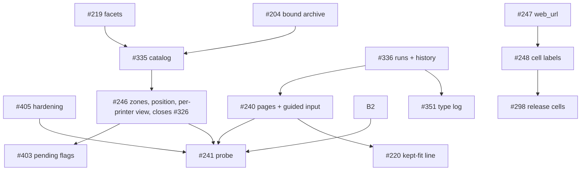

<!--
SPDX-FileCopyrightText: 2026 Björn Strausmann and Labelyard contributors
SPDX-License-Identifier: AGPL-3.0-or-later
-->

# Milestone 1.8.0 — Design: sheets and calibration

**Date:** 2026-11-21
**Status:** Draft for the maintainer's review. Decisions the issues and the code did not settle are marked
**Design call** with a one-line reason; questions only the maintainer can answer are in
[section 13](#13-questions-for-the-maintainer).
**Milestone:** 1.8.0 (minor: `feat` and `fix` commits, no `!`, no `BREAKING CHANGE:` footer)
**Branch:** `milestone/1.8.0`, created from `main` after v1.7.1 (it does not exist yet)
**Code base read:** `main` at `40bb6566`. Every statement about existing behaviour below names the file and line it was
read from; line numbers refer to that commit.
**Issues (20):** sheet ID #326, #246, #403 · sheet types #335, #342, #219 · calibration #240, #241, #336, #351, #220 ·
cells and archive #248, #298, #204 · fixes and hardening #407, #405, #401, #247, #256, #395. Read with
`gh issue view <n> --repo strausmann/labelyard --json body,comments` (plain `gh issue view` fails on the Projects
(classic) sunset).
**Plan:** to be written after this design is accepted (`docs/superpowers/plans/2026-11-21-milestone-1-8-0.md`).

## 1. Intent

1.7.x made sheets and page printers dependable. 1.8.0 makes them *checkable*: the operator can see, before wasting a
sheet, where the sheet ID and every label will land on a given printer, can tell every calibration print apart and
trace any correction back to the print and the readings it came from, and can keep the sheet-type list down to the
types actually in use. The thread through all 20 issues is the same: what the hub decided and why must be visible on
paper, in the UI and through the API, and a wrong decision must be undoable.

- The sheet ID lands in a free spot, never on the vendor's logo, and the type page says on which printers it fits
  (#246, which takes over the remainder of #326); a client learns when the ID or the feed mark is still waiting (#403).
- Sheet types come from a catalog one click away instead of being installed wholesale; unused types can go (#335);
  labels near a printer's unprintable edge were confirmed fine on paper (#342, closed with evidence); the vendor filter keeps working on
  a long list (#219).
- Every calibration, check and probe page carries a run number, identifies itself in every cell, and every save of a
  correction is kept as history that can be restored (#240, #241, #336, #351, #220).
- A sheet remembers what was printed in each cell (#248), an admin can free the cells of a failed page job without a
  restart (#298), and the sheet archive cannot grow without bound (#204).
- Smaller fixes: one way to the cart (#407), the open hardening notes of the 1.7.x audit (#405), a visible state for a
  printer that could not be wired (#401), public links for integrations (#247), the QL hardware check (#256) and the
  split of the tape backend (#395).

## 2. Goals, non-goals, anti-goals

### Goals

1. Every acceptance criterion of the 20 issues and their maintainer comments is met, or a deviation is named and
   reasoned in [section 14](#14-deviations-from-the-issue-text). The checklist in [section 15](#15-requirement-checklist)
   is the review list.
2. A running 1.7.x installation upgrades without losing a type, a sheet, a cell, a calibration or a job, and without a
   manual step.
3. Every new API surface is additive: no response field removed or renamed, no existing request rejected that 1.7.1
   accepted, except where [section 3.2](#32-api-compatibility) names it.

### Non-goals

- Calibration from photos (#333, milestone 1.9.0). 1.8.0 prepares it (cell QR codes, run records, the sheet-type log
  read API) but writes no image analysis and no prompt.
- "Open <integration>" buttons and deep links in the UI (#243, 1.9.0). 1.8.0 adds the `web_url` setting they build on.
- Per-row or per-column printer corrections (the reserved `printer_calibrations.corrections` column,
  `backend/app/models/printer_calibration.py:39-40`). The fit stays affine.
- A queue cap per printer or key (#402, 1.10.0).
- Photo attachments for the sheet-type log (#351 "attach photos"): left to #333, which owns photo storage.

### Anti-goals (a failure even if it technically works)

- A sheet ID printed on the vendor's preprint, or a label whose text is cut by the printer's unprintable edge, while
  the preview said it fits.
- A calibration value lost because it was overwritten: every correction ever saved stays restorable.
- A QR code on a calibration page that a phone opens as a mail address, URL, phone number or Wi-Fi configuration
  (maintainer, #240 comment of 2026-11-15).
- An installed type changed by an upgrade without the operator pressing a button (#335: catalog updates are offered,
  never applied silently).
- A sheet code issued twice, also after purging and deleting (#204, #335).
- An internal integration address in any response a non-admin key receives (#247).
- A cell freed by the admin action while the page may have printed onto it (#298).
- A release with an open issue in the milestone.

## 3. Constraints that bind every part

### 3.1 Versioning and commits

- Everything ships in **1.8.0**, a minor release: `feat` for new capability, `fix` for defects, `refactor` for #395,
  `chore`/`ci` for the CI items of #405. No `!`, no `BREAKING CHANGE:` footer.
- Feature branches from `milestone/1.8.0`, PRs into it (squash). The milestone PR into `main` is merged with a merge
  commit and the standard subject `Merge pull request #N from strausmann/milestone/1.8.0` (the release guard recognises
  only that).
- Scopes from `commitlint.config.cjs:26-62`. There is **no `calibration` scope** (the list ends at `spoolman`); the
  calibration work uses `sheets` (or the builder adds `calibration` to the list in a `chore(ci)` commit first —
  **Design call:** add the scope, because a third of the milestone is calibration and `sheets` hides that in the
  changelog).
- Author `Björn Strausmann <projects@strausmann.ch>`; no AI trailers in this public repository.
- Every commit body ends with `Refs #<issue>`.

### 3.2 API compatibility

- No response field is removed or renamed. Where a field's meaning would change, a new field is added and the old one
  keeps its meaning with a description that points to the new one (`SheetTypeRead.sheets_in_use`, section 6.1).
- Pagination is **opt-in or bounded with a `Link` header**, never a change of the body shape (section 8.3).
- Three deliberate loosenings, each with an upgrade note in `website/src/content/docs/admin/upgrades/to-1-8-0.md`
  (en + de, created by the first task that needs it, linked from both `index.md`):
  1. `DELETE /api/v1/sheet-types/{key}` deletes a seeded or imported type without sheets (today 409
     `seed_type`/`imported_type`, `backend/app/sheets/type_service.py:455-457`) (#335).
  2. A fresh installation starts with no sheet types (#335).
  3. `GET /api/v1/sheets` returns at most 500 rows per request and a `Link: <…>; rel="next"` header when more exist
     (#204).
- One tolerated request change: `POST /api/v1/render/preview` ignores `data.qr_payload` when the new `item` field names
  an integration item; the server's payload is used (#247, section 9.4). Clients that send no `item` keep today's
  behaviour.
- Three deliberate tightenings, each a `fix` with an upgrade note: `source_url` and integration URLs with user info are
  refused (#204 note 2, #247); free text loses invisible format characters on write (#204 note 1); `corner_radius`
  larger than half the shorter label side is refused on write (#204 note 4).
- New endpoints come with their OpenAPI schema (ADR 0011), `frontend/src/api/schema.gen.ts` is regenerated with
  `pnpm gen:api`, every route carries an auth marker
  (`backend/tests/unit/api/test_route_auth_coverage_guardrail.py`), and the upper bound of
  `test_endpoint_count_in_range` (`backend/tests/api/test_openapi_completeness.py:142-170`, today 104 with about 102
  operations) is raised to fit the new routes.
- The sheet-type exchange format stays readable by 1.7.x where nothing new is used: export writes the new keys only
  when they are not the default, as it already does for the placement keys (`backend/app/sheets/exchange.py:104-106`).
  A document that uses a new key is `format_version: 3`.

### 3.3 Database migrations

Alembic, linear from the current head `20261118a2` (`backend/alembic/versions/2026_11_18_0002-20261118a2_printer_print_confirmation.py`).
One migration per feature task, each with a downgrade. All lengths stay integer hundredths of a millimetre (D16),
scales in ppm, rotation in micro-degrees, as in `backend/app/models/printer_calibration.py:1-10`.

| Migration | Task | Change |
|---|---|---|
| A1 | #246, #326 | `sheet_types`: `id_margin_band`, `id_margin_align`, `id_margin_offset_hmm`, `preprint_zones`, `preprint_preset_id`; new table `preprint_presets` |
| A2 | #335 | `sheet_types`: `catalog_key`, `catalog_revision`, `catalog_fields_hash` |
| A3 | #335 | data: pending `adopt`/`corrections` of seed revision 3, then catalog provenance for every `origin="seed"` type |
| C1 | #336, #240 | new tables `calibration_runs`, `calibration_run_counters`, `calibration_history` (filled with one `imported` entry per existing `printer_calibrations` row), `calibration_check_sheets`, `calibration_check_sheet_passes` |
| C2 | #351 | new table `sheet_type_log` |
| D1 | #248 | `sheet_cells`: `label` (JSON), `printed_at` |
| E1 | #405 | data: rewrite free-text `jobs.error` rows to the fixed text of their code |

Settings without a migration: `sheets.max_active`, `sheets.max_active_per_type` (#204), `integrations.<name>.web_url`
(#247), `integrations.lookup_batch_deadline_s` (#405).

### 3.4 Existing data on running installations

| Data | What happens on upgrade |
|---|---|
| The 39 seeded types (`backend/app/seed/sheet_types.json`, `seed_revision` 3) | Stay installed; they get catalog provenance (section 6.1.4). |
| Sheets, cells | Unchanged. Cells printed before 1.8.0 have no stored label and show "not recorded" (#248). |
| `printer_calibrations` rows | Each becomes the first history entry of its tray, action `imported`, with the values, `measured_on`, `updated_at` and `updated_by` it has; no readings (#336). |
| Calibration pages printed before 1.8.0 | Have no run number; the run counter of every tray starts at 1. |
| Job rows with free-text errors from before 1.7.x | Scrubbed once by a data migration (#405). |
| Integration settings | `web_url` is empty; the "Open in …" link disappears until it is set (#247, see section 9.4). |

### 3.5 Repository rules that apply to every task

TDD with a counter-test for every new regression test (run once against the unfixed code; it must fail for the stated
reason), mypy strict, the print queue for every print (ADR 0005), website pages in English and German in the same PR
(German with „du“, terms from `docs/glossary.toml`), generated screenshots for UI changes (`pnpm screenshots`), new
dialogs, popovers and fields covered by `frontend/e2e/short-viewport.spec.ts`, no `str(exc)` of a device, upstream or
integration error in a response, event or stored row (CWE-209), no private hostnames, addresses or real item names
(`example.invalid`). Frontend logic with state gets Vitest + jsdom tests. UI tasks load the design skills
(`taste-skill:design-taste-frontend`, `emil-design-eng`, `mobile-native` for phone layouts, `impeccable:impeccable` for
acceptance).

### 3.6 Architecture decisions

Two ADRs, `Proposed` until they ship:

- **ADR 0028 — Sheet-type catalog instead of seeding.** Replaces the seeding part of OC-14 (spec 9.5,
  `backend/app/seed/sheet_seed.py:4-41`) and the delete rule OC-10 (`type_service.py:455-457`) (#335).
- **ADR 0029 — Calibration history and run records.** A save never overwrites; runs are numbered per printer and tray
  (#336, #240, #351).

## 4. What the code does today (findings that shape the design)

| Area | Finding | Evidence |
|---|---|---|
| Sheet ID placement | A type stores `id_placement` (`auto/margin/back_side/cell`) and `id_cell`; the margin band is chosen automatically (largest band after hardware margin, `|offset|` and 1 mm safety; QR bands first; tie-break top, bottom, right, left). No side or offset can be set. | `models/sheet.py:47-48,70-78`; `sheets/planner.py:65-82,187-210,284-343` |
| Margin check | `GET /api/v1/sheets/margin-check?type=&printer=&tray=` already answers per printer and tray: bands, chosen band, corner, QR, `printable`, `reason`. The type page does not call it for every printer. | `api/routes/sheets.py:204-245`; `sheets/print_service.py:2289` |
| Preprint | Only the **back** of the liner knows vendor print (`backing_designs`, strips in mm). The front has no keep-out zones. | `models/sheet.py:77-79`; `sheets/exchange.py:83-102` |
| ID waiting | The planner holds the margin ID back while another job carries it (`margin_id_in_flight`) and the mark while `feed_mark_in_flight`; the responses carry only `id_not_printed` and `feed_mark`. | `sheets/planner.py:94-125,376-387`; `schemas/sheet_print.py:192-280` |
| Seed | 39 types (not 36 as in #335), installed into every installation at every start, with `adopt` and `corrections` maps that change installed types automatically. | `seed/sheet_types.json`; `seed/sheet_seed.py:4-41`; `main.py:314-316` |
| Delete | Only `origin == "custom"` without sheets. | `sheets/type_service.py:452-463` |
| Usage numbers | `sheets_in_use` counts **all** sheets of every version, any state. | `api/routes/sheet_types.py:132`; `repositories/sheet_types.py:46-69` |
| Sheets page | Already filters by type (`search.type`), but used-up and back-missing filters run in the browser. | `frontend/src/features/sheets/SheetsPage.tsx:244-266` |
| Hardware margin | Cells that reach into the printer's hardware margin are flagged (`hw_margin`), never insetted; their content is drawn in the normal content box. | `sheets/planner.py:421-435`; `sheets/cell_render.py:135-155`; `schemas/sheet_print.py:186-188` |
| Vendor filter | The options come from a second, unfiltered list query. | `frontend/src/features/archive/ArchivePage.tsx:123-126` |
| Sheet-type list | `GET /api/v1/sheet-types` returns the full array, not paginated. | `api/routes/sheet_types.py:143-166` |
| Reading guide | **Shipped** with #337 (1.7.0): collapsible guide, crossing drawing, sign rules, which crossings to read, "still off" card. | `frontend/src/features/calibration/guide/ReadingGuide.tsx` |
| Readings input | Free text fields for across/down, gap chosen from selects. No stepper, no direction picker. | `frontend/src/features/calibration/ReadingsHelper.tsx:57-69` |
| Mini scale | ±2 mm with a tick every **0.5 mm** (changed from 0.2 mm in `a8d18d49`, #348, because a colour laser filled in the white). The issue's 0.2 mm step predates this. | `calibration/scale.py:13-16` |
| Corner marks | Every label already gets an L at each corner (1.5 mm legs), left out next to a tick. | `calibration/page.py:65,293-308,343-357` |
| Footer | Type, version, printer, tray, date, with/without correction; no run number, no time, no correction values. | `calibration/page.py:83-129` |
| Calibration storage | One row per printer and tray, overwritten on save. | `models/printer_calibration.py:26-48`; `calibration/service.py:128` |
| Kept fit | The fit's type is kept in `draft.fit` and saved as `measured_on`, but the screen does not say so. | `frontend/src/features/calibration/CalibrationPage.tsx:193-198` |
| Cells | `sheet_cells` stores state, job id, source, purpose, ref; not what was printed. The job payload has `content_type` and `label_data` per cell. | `models/sheet.py:150-172`; `sheets/sheet_page.py:93-110`; `sheets/print_service.py:1448-1468` |
| Stuck reservations | A periodic sweep (every 300 s) settles cells of ended jobs, but spares every job the queue still holds in memory, and a row that still says `queued` after a failed end write is never decided. | `sheets/sweep.py:1-23`; `sheets/outcome.py:233-243`; commit `30838c3e` |
| Archive growth | No sheet cap, no purge route, `GET /api/v1/sheets` unpaginated and sorted in Python. | `sheets/sheet_service.py:611-645` |
| Free text | `sanitise_text` keeps format characters (`Cf`), no NFC; `check_http_url` accepts user info. | `sheets/text.py:1-58` |
| `job_id` on cells | `/api/v1/jobs/{id}` already answers 404 for a job outside the key's printers. | `api/routes/jobs.py:122-145` |
| Imported new version | Keeps `verified=true` on the type. | `sheets/exchange.py:412-416`; `type_service.py:402-417` |
| Cart link | "Cart (N)" next to the heading on two pages. | `IntegrationPage.tsx:83-85`; `ItemView.tsx:165-169` |
| Integration links | The lookup `url` **is** the label's `qr_payload`, built from the internal base URL. | `api/routes/lookup.py:119`; `integrations/snipeit/plugin.py:170` |
| Not wired | A printer that fails to wire is logged and skipped; nothing is stored or returned. | `services/printer_runtime.py:149-160` |
| brother-ql | `brother-ql-next>=0.12.0,<0.13` is already the dependency. | `backend/pyproject.toml:38` |
| Tape backend | `ptouch_backend.py` has **603** lines (the issue says 554). | `printer_backends/ptouch_backend.py` |
| Audit notes | All open items of #405 are confirmed open (probe reads unbounded, calibration download keeps the session, `retry_job` exists, release marker, dependabot step output). Notes 4 and 6 of run 30 (`fullmatch`, missing-row veto) are already fixed. | `settings_store/probes.py:40-41`; `api/routes/calibration.py:286-297`; `services/print_queue.py:2332`; `.github/workflows/release.yml:340`; `.github/workflows/dependabot-auto-merge.yml:52`; `repositories/printer_status_cache.py:78`; `repositories/jobs.py:101-116` |

### 4.1 Prior work per issue: done, partly done, open

Checked against closed issues of 1.5.0–1.7.x (`gh issue list --state closed`) and the commit log. Nothing below is
designed again; the sections build on it.

| Issue | State | Evidence | What remains for 1.8.0 |
|---|---|---|---|
| #326 | **closed as superseded by #350** (operator, 2026-11-21), remaining criteria moved to #246 | #350 (1.7.0): placement `auto/margin/back_side/cell`, `id_cell`, `id_placement_resolved`/`_auto` (`schemas/sheets.py:111-150`, `sheets/id_placement.py`); margin check per printer (`api/routes/sheets.py:204-245`) | side/offset inside the margin and the per-printer view on the type page → #246 (section 5) |
| #246 | open | no `preprint` anywhere in `backend/app` or `frontend/src`; the band is chosen automatically (`planner.py:284-343`) | the core of group A |
| #403 | open | #212 (1.7.x) handed over this finding only; responses carry `id_not_printed` and `feed_mark` (`schemas/sheet_print.py:202,272`) | two additive flags (5.6) |
| #335 | partly done | type filter on the sheets page in the URL (`SheetsPage.tsx:244-266`); export/import exist (`exchange.py`) | catalog, delete rule, usage, links both ways |
| #342 | **done, close with evidence** | hardware-margin cells are flagged since Plan 3 (OC-44, `planner.py:421-435`); the content box keeps a 1.0 mm + radius inset (`cell_render.py:135-155`); the operator's test prints on 6121 and 3490 were fine, text complete (operator, 2026-11-21) | nothing; the 1 mm safety distance stays |
| #219 | open | `ArchivePage.tsx:123-126` | facet (6.3) |
| #240 | partly done | A (guide) shipped in #337 (1.7.0, `guide/ReadingGuide.tsx`); scale changed to 0.5 mm in #348 (1.6.0, `a8d18d49`); check print as next step in #349 (1.6.0); corner marks per label already drawn (`calibration/page.py:293-357`) | B guided input, C run number, the comment requirements (cell QR, margins, passes, geometry suggestion) |
| #241 | open | no probe kind in `PageKind` (`page_jobs.py:41-50`) | all |
| #336 | partly done | #344 (1.7.0): preselects the tray sheets use, warns when saved and requested tray differ (`fcc5fa0d`), printer status reports the trays of the newest sheet and calibration jobs (`42b3fe45`) | history, revert, runs, the **printer-reported** actual media source |
| #351 | open | — | log (7.6) |
| #220 | open | `draft.fit` is kept but not shown (`CalibrationPage.tsx:193-198`); the tray lines of #344 (`CalibrationPage.tsx:359-363`) name the tray, not the type | the line (7.7) |
| #248 | open | `sheet_cells` has no label (`models/sheet.py:150-172`) | all |
| #298 | partly done | the periodic reservation sweep (266-04, `sheets/sweep.py`; `dd1d4d49`, `30838c3e`) settles cells of ended jobs within 300 s; it spares jobs the queue holds in memory (up to `KEEP_FINISHED_S` = 3600 s, `job_retention.py:23`) and never decides a row still `queued` after a failed end write | the admin action for exactly those cases (8.2) |
| #204 | partly done | bidi controls already removed (`text.py:7-11,20`); `/api/v1/jobs/{id}` already enforces the key's printers, which settles note 3 (`jobs.py:122-145`) | cap, purge, pagination, notes 1, 2, 4–7 |
| #407 | open | `CartButton` shipped with #316 (1.7.0) | remove the two links |
| #405 | partly done | run-30 notes 4 (`fullmatch`, `printer_status_cache.py:78`), 6 first half (DB store vetoes a missing row, `repositories/jobs.py:101-116`) and the `licence_snapshot.py` vetting (`scripts/licence_snapshot.py:105-116`) are fixed; they are not in the issue's list | the listed items (9.2) |
| #401 | partly done | #166 (1.7.x): the hub starts and logs a printer that cannot be wired (`af6f0328`, `131679d9`, `printer_runtime.py:149-160`) | the response field and UI state |
| #247 | open | lookup `url` = internal `qr_payload` (`lookup.py:119`) | `web_url` |
| #256 | **code done** | switch to brother-ql-next in 1.7.x (`b6508f5c`, `pyproject.toml:38`) | the maintainer's device check only |
| #395 | open | 603 lines | split |

## 5. Group A — the sheet ID (#246, with the remainder of #326, and #403)

**Already shipped, built on here, not designed again** (1.7.0, #350, closed; maintainer rulings of 2026-11-17 in its
comments): the per-type placement `auto|margin|back_side|cell` with `id_cell`
(`models/sheet.py:70-79`), its resolution `resolve_type_placement` (`sheets/id_placement.py:44-51`) and the
`id_placement`, `id_cell`, `id_placement_resolved` and `id_placement_auto` fields of `SheetTypeRead`
(`api/routes/sheet_types.py:133-136`); backing designs with free strips on the liner (`models/backing_design.py`,
`api/routes/backing_designs.py`); the back-side flow and the `SheetCodePanel`; the per-printer margin check
(`GET /api/v1/sheets/margin-check`, `api/routes/sheets.py:204-245`). #212 (1.7.x, closed) moved only its waiting-ID
finding to #403; its other findings are done (`97dbd88d`, `90a43a66`).

**#326 folds into #246.** What #326 still asks beyond #350 is (a) seeing per enabled page printer whether and where the
margin ID fits — `id_placement_resolved` is computed without a printer (`id_placement.py:44-51`) — and (b) choosing
side and offset inside the margin. Both are the placement problem #246 solves with keep-out zones: the zones decide
where a free rectangle is, the position rule picks among the free rectangles, and the per-printer view shows the
result. #326 is therefore **not a separate feature**: its open acceptance criteria (per-printer fit view; side/offset
validated against grid and unprintable area; exchange JSON carries it; tests fits / does not fit / overlaps a cell)
are criteria of the #246 task (sections 5.1–5.4). **Operator, 2026-11-21:** #326 is closed as superseded by #350; the
controller copies the four criteria into #246.

### 5.1 Model: a placement rule per type, keep-out zones, presets

**Sheet type gains** (migration A1):

| Column | Type | Default | Meaning |
|---|---|---|---|
| `id_margin_band` | `auto/top/bottom/left/right` | `auto` | Which band the margin ID goes into. `auto` keeps today's choice. |
| `id_margin_align` | `start/end` | `start` | Which end of the band the ID starts from: `start` is left (top/bottom bands) or top (side bands). |
| `id_margin_offset_hmm` | int, ≥ 0 | 0 | Distance of the ID's start edge from the grid's start (or end) along the band. |
| `preprint_zones` | JSON list, ≤ 16 | `[]` | Rectangles `{x, y, w, h}` in hmm on the front of the sheet, plus `note` (≤ 120 chars), where nothing is printed. |
| `preprint_preset_id` | FK, nullable | null | A shipped or imported vendor preset the type uses. |

**New table `preprint_presets`** (key, name, page size, zones, origin `seed/imported/custom`), the front-side twin of
`backing_designs`. **Design call:** mirror `backing_designs` (table, admin routes under `/api/v1/preprint-presets`,
exchange embedding as `PreprintPresetDoc`) because the same import, export and delete rules already exist and are tested
there.

The effective zones of a type are its preset's zones plus its own (`preprint_zones`), each zone of its own
**overriding** nothing: the union is used. To switch a preset zone off, the type unlinks the preset and copies the zones
it wants. **Design call:** union, no per-zone override, because a partial override list is hard to show and to export.

### 5.2 Placement algorithm (one function for the plan, the preview, the margin check and the probe print)

`choose_margin_placement` (`planner.py:284`) becomes a choice of a **rectangle**, not a band:

1. Bands are computed as today (`margin_bands_hmm`, `planner.py:187-210`): hardware margin, `|offset|` per axis,
   1 mm safety.
2. Each band is cut into free rectangles: the preprint zones (grown by `SAFETY_HMM`) are subtracted. The feed mark is
   placed **after** the ID, in what is left (section 5.7). A rectangle is kept if it is at least `MIN_MARGIN_TEXT_HMM`
   deep.
3. With `id_margin_band = auto` the candidates are all free rectangles; otherwise only those of the chosen band. With an
   offset or `align = end`, the candidate is the rectangle that contains the requested start point, clipped to it.
4. The content degrades to fit the chosen rectangle, in this order (#246): QR + code + type text → QR + code → code
   only. The thresholds stay `MIN_MARGIN_TEXT_HMM` (4 mm) and `MIN_MARGIN_QR_HMM` (9 mm) and the 10 mm text run beside a
   QR (`planner.py:75-80`).
5. Order of candidates: a rectangle that takes the QR beats one that does not; then the larger usable area; then the
   band order of today. **Design call:** area instead of depth, because after cutting out zones a deep but short corner
   piece would otherwise win over a long free strip.
6. Nothing fits: as today, `id_not_printed` on the page and the existing fallbacks (cell ID or back side, by the type's
   `id_placement`) with a visible note in the print dialog.

`MarginPlacement` (`planner.py:176-184`) gains `x_hmm`, `y_hmm`, `w_hmm`, `content` (`qr_code_type/qr_code/code`). The
stored job payload (`MarginIdPayload`, `sheet_page.py:112`) keeps the full decision so the preview, the job and a retry
read the **same** stored decision (#246 acceptance); a payload without `x_hmm` renders exactly as today (backward
compatible, as OC-50 did for `band`).

### 5.3 Validation per sheet type and the per-printer view (remainder of #326)

- A write of `id_margin_*` or zones is validated against the **geometry**: the ID's minimal box (4 mm deep, 10 mm long)
  must not overlap a label cell (pitch and margins) and must lie on the page; zones must lie on the page and must not
  cover a label cell (a zone over a cell is refused with 422 `preprint_zone_overlaps_cell`: a label there would be
  printed on the preprint). **Design call:** refuse zones over cells rather than skip those cells, because vendor
  preprint is always in the margins and a zone over a cell is a typo.
- Against a **printer** the validation is not a write rule (printers change); it is a read: the extended margin check.
- `GET /api/v1/sheet-types/{key}/id-placement` (read scope) returns, for every **enabled page printer** the key may use,
  with its default tray: `fits`, the chosen rectangle (side, offset, size in mm), the content level, and a reason code
  when it does not fit (`outside_printable`, `overlaps_preprint`, `too_small`, `no_margin_band`). A `tray` query
  parameter evaluates one other tray. **Design call:** one row per printer with its default tray, because one row per
  tray multiplies the table for little gain; the tray selector covers the rest.
- The type detail page ("Sheet code" section, `IdPlacementSection.tsx`) shows the result as a small table and the chosen
  rectangle in the type diagram.

### 5.4 Editing and checking

- "Edit details" (admin) gets a **"Sheet code position"** block: band (`Automatic`, `Top`, `Bottom`, `Left`, `Right`),
  start from (`Left/Top`, `Right/Bottom`), offset in mm (stepper, 0.5 mm step), and a **"Preprinted areas"** list
  (add / edit / remove rectangle with x, y, w, h in mm and a note; a preset picker above it).
- The geometry diagram (`frontend/src/features/sheets/GeometryDiagram.tsx`) and the print preview draw zones as hatched
  areas and the chosen ID rectangle as an outline.
- The probe print (#241, section 7.3) draws the zones hatched and the ID rectangle outlined, so the operator checks
  both on plain paper.
- The pre-filled feedback issue of #230 (`frontend/src/features/archive/feedbackLink.ts`) includes the zones in mm.
- Import and export carry `id_margin_band/align/offset_mm`, `preprint_zones` and an embedded `preprint_preset`
  (format version 3 only when one is set).

### 5.5 Vendor presets and the Avery Zweckform default

- The catalog (section 6.1) ships presets; a preset becomes the default of a shipped type **only when measured on that
  real sheet** (#246: "confirm it on at least two different Avery Zweckform sheets before the preset becomes the
  default"). Unmeasured types ship without a preset.
- For the Avery Zweckform preset the free rectangle for the ID is in the top band, **right of the product description
  and left of the size text** (maintainer, #246 comment of 2026-11-09): the preset zones cover the logo, the product
  description and the size text, and the type sets `id_margin_band = top`, `align = end` with the offset that puts the
  ID before the size text.
- **The measurements come from a measurement sheet (operator, 2026-11-21).** A probe-print option `grid: true` (section
  7.3) adds a millimetre grid over the whole page (thin lines every 1 mm, labelled every 10 mm, origin at the page's
  top-left corner, black only), drawn without calibration so the grid is the page's own coordinates. The operator prints
  it on a real L4736REV and a real L4731REV sheet and photographs it; the zones (the Avery logo, the format text, the
  product description, the bottom line) and the free gap top right before the format text are read from the photo and
  committed as the Avery Zweckform preset, with the photo's date as evidence.
- **Blocked on the photo:** the preset task (task 10c in section 10) waits for the operator's photos; the preset ships
  only for the sheets measured. This is an operator step in the release checklist (section 10).

### 5.6 The waiting signal (#403)

`PreviewPage` and `PrintedPage` (`schemas/sheet_print.py:192-280`) gain:

- `id_pending: bool` — the sheet's ID is not printed yet and is not on this page because another job carries it (the
  margin ID in flight, an ID cell `reserved` or `unconfirmed`), not because there is no room (`id_not_printed` stays for
  that).
- `feed_mark_pending: bool` — the feed mark is due but not on this page: another job carries it
  (`feed_mark_in_flight`, `feed_mark_reason: "in_flight"`) or no zone-free place is left after the ID
  (`feed_mark_reason: "no_free_place"`, section 5.7). `feed_mark_reason` is `null` when the mark is printed or not due.

Both are computed from `SheetView` (`planner.py:94-125`) in `decide_margin_and_mark`, which returns them in
`MarginDecision`. The print dialog shows "The sheet code will be printed with the page that is still in the queue." for
`id_pending`.

### 5.7 Edge cases

- A type with `id_margin_band = top` on a printer whose top band is too small: no ID on that page (`id_not_printed`),
  even if another band would fit. **Design call:** the setting is a rule, not a preference, because the maintainer sets
  it to avoid a known preprint; `auto` keeps the fallback to other bands.
- **Design call (controller):** the feed mark is subject to the keep-out zones too, and the **ID is placed first, the
  mark second** (this reverses OC-57's "mark first" order for the top band; **operator approval 2026-11-21**). Reason: the ID identifies the sheet; the
  mark is a convenience. The mark takes the top band's top-right end if that is free of zones and of the ID's rectangle,
  else the top-left end, else nothing: the mark is **not printed** on this page, `feed_mark_pending` (section 5.6) is
  true with `feed_mark_reason: "no_free_place"`, and the preview shows "Feed mark: no free place on this sheet". The
  mark stays due (its flag is not set), so a later page on a printer with more room still prints it.
- A calibration offset that pushes the ID into a zone: zones are grown by `|offset|` per axis like the bands.
- Round labels and cells: unchanged; the validation uses the cell rectangles.

## 6. Group B — sheet types (#335, #342, #219)

### 6.1 The catalog (#335)

#### 6.1.1 In the image

- `backend/app/catalog/sheet_types/<key>.json`: one exchange document per type (the existing `ExportDoc`,
  `exchange.py:134`), plus `catalog/presets/<key>.json` for preprint presets and backing designs.
- `backend/app/catalog/index.json`: generated by a script (`scripts/catalog_index.py`), one entry per type: key,
  vendor, product codes, page size, grid, label size, `verified` with date and evidence, provenance (`source_name`,
  `source_url`), catalog revision of the entry, geometry hash. A CI test fails when the index and the documents
  disagree.
- The 39 entries of `sheet_types.json` move into the folder; the file and its `adopt`/`corrections` maps stay only to
  migrate installations that never ran them (section 6.1.4).
- Every entry has a `revision` (integer). A new geometry version of an entry raises it.

#### 6.1.2 API

| Route | Scope | Purpose |
|---|---|---|
| `GET /api/v1/sheet-catalog` | read | The index, filterable (`q` on vendor, product code, key; `page`, `w`, `h`, `verified`), with `installed: bool` and `update_available: bool` per entry; paginated with `limit`/`offset` and the facets in the response (section 6.3). |
| `GET /api/v1/sheet-catalog/{key}` | read | One entry with its geometry (for the grid preview). |
| `POST /api/v1/sheet-catalog/{key}/install` | admin | Installs the type like an import, `origin="seed"` kept for shipped types, catalog provenance stored. 409 `type_exists` if the key or prefix is taken. |
| `POST /api/v1/sheet-types/{key}/catalog-update` | admin | Applies the newer catalog revision as the next version (refused with 409 `locally_edited` when the type was edited; section 6.1.3). |
| `DELETE /api/v1/sheet-types/{key}` | admin | Now any type without sheets (section 6.1.5). |
| `POST /api/v1/sheet-types/delete-unused` | admin | Body: the list of keys to delete; each must be in state `unused`; all or nothing. |

#### 6.1.3 Provenance and updates

Sheet type gains `catalog_key`, `catalog_revision` (installed), `catalog_fields_hash` (hash of the catalog's type fields
at install). A type is **locally edited** when its current version was not written by the catalog actor (`system:catalog`
or the legacy `system:seed`) **or** its type fields' hash differs from `catalog_fields_hash`.

- Unedited and the catalog has a higher revision → `update_available: true`; the archive offers "Update to catalog
  version N" with the geometry diff (old → new). Never applied by itself (#335 point 3).
- Edited and the catalog has a higher revision → `catalog_newer: true` shown as "The catalog has a newer version"
  without the button; the operator can export, compare, or delete and re-add.
- An update adds a new version; sheets stay pinned to theirs (D14).

#### 6.1.4 Upgrade of existing installations

- The seeder no longer inserts types on start. A one-time migration step (data migration A3, idempotent, recorded in
  `app_settings` as `internal.catalog.migrated`) runs the remaining `adopt`/`corrections` of `seed_revision` 3 that an
  installation has not applied yet, then gives every `origin="seed"` type `catalog_key = key`, the revision of its
  entry, and the fields hash **of the entry** — so an installation that edited a seeded type's description is
  "edited" afterwards.
- From then on, shipped geometry changes reach installed types only through the offered update.
  **Design call:** run the pending 1.7.x corrections once before switching, because they are fixes the maintainer
  already decided to apply, and stopping them half-way would leave some installations on known-wrong geometry.
- A fresh installation starts with no types: the seed is empty, existing installations keep theirs, and new types come
  from the Catalog tab (#335 acceptance; confirmed by the operator, 2026-11-21). The Grocy label sheet-type settings and the calibration
  page handle "no types" with an empty-state link to the catalog.

#### 6.1.5 Deleting and usage

- Any type without sheets can be deleted (catalog, imported, custom): versions, its own zones; a linked backing design
  or preset is kept (other types may use it). With sheets: 409 `has_sheets`, the UI offers Archive. The prefix counter
  row (`sheet_id_counters`) is **never** deleted, so a re-added type with the same prefix continues its numbering
  (anti-goal: no code issued twice; this also covers sheets removed by the purge of #204).
- Usage per type, computed in SQL in one query for the list:
  `sheets_with_free_cells` (active and not used up), `free_labels` (sum of free cells on those),
  `sheets_total` (any state, purged ones not counted), `last_used_at` (newest `sheets.last_used_at`),
  `usage_state` (`in_use` / `used_before` / `unused`). `sheets_in_use` keeps its old meaning (all sheets) and its
  description says so and points to the new fields (section 3.2).
- The archive list sorts by these (`sort=usage|last_used|key`) and filters by `usage_state` and "not used since"
  (`unused_since` date).
- "Remove unused types" opens a dialog listing exactly the types in state `unused`, none preselected.

#### 6.1.6 Navigation between sheets and types (maintainer comment of 2026-11-14)

- Sheet detail and each sheet row name the type as a link to `/sheets/archive?type=<key>` with the version the sheet
  was created with.
- The type detail lists its sheets: in use first, then used up, discarded behind a toggle; code, used/free cells, last
  use, each row linking to `/sheets/<code>`; plus "Show in the sheets list" (`/sheets?type=<key>`, which already works,
  `SheetsPage.tsx:255`).
- The list comes from a new `GET /api/v1/sheets?type=<key>&state=all` page (section 8.3), not from the full list.

#### 6.1.7 Catalog view

In the sheet archive, a second tab **Catalog** next to **Installed**: search (vendor, product code, size), filter
"verified only", per entry the state badge (`verified` with date, or "not yet validated"), the grid preview (the
existing `GeometryDiagram`), and "Add". An installed entry shows "Installed" and, when available, "Update". Mockup M4.

### 6.2 Labels in the unprintable margin (#342) — no code change

**Operator, 2026-11-21:** the test prints on Avery Zweckform 6121 and 3490 were fine, the text was complete, and the
1 mm safety distance stays. Today's behaviour is therefore kept: cells reaching into the hardware margin are flagged
(`hw_margin`, `planner.py:421-435`, `schemas/sheet_print.py:186-188`), not refused (OC-44), and their content keeps the
content-box inset (`cell_render.py:135-155`); the edge-to-edge 3490 gets its sheet code on the back side (`auto`,
`id_placement.py:36-41`). #342 is closed with this evidence and needs no task. The content inset designed in the first
draft of this spec is dropped.

### 6.3 Vendor facet and long lists (#219)

- The installed-types list gets optional `limit` (≤ 200) and `offset`; without them it returns the full array as
  today (API compatibility). With them, the body is the same array and a `Link` header carries `next`.
- `GET /api/v1/sheet-types/facets` (read) returns `vendors` (distinct, sorted, with counts) and `page_sizes`, under the
  same `include_archived` and `usage_state` filters as the list, **without** the vendor filter itself, so choosing a
  vendor never hides the others. The catalog response carries the same facets inline.
- `ArchivePage.tsx` takes its vendor options from the facet query and drops the second list query
  (`ArchivePage.tsx:123-126`). **Design call:** a separate facet endpoint for installed types and inline facets for the
  catalog, because the installed list must keep its bare-array body.

### 6.4 Edge cases

- Installing a catalog entry whose prefix is taken by a custom type: 409 `prefix_taken`; the dialog offers a new prefix
  (the import's `as_new_key` path, `exchange.py:418-429`).
- Deleting a type that is the Grocy label webhook's configured sheet type: refused with 409 `type_in_settings` naming
  the setting. **Design call:** refuse rather than clear the setting, because a silent change would make the next
  webhook print fail with a less clear error.
- A catalog entry removed from a later image: installed types keep working; the entry shows as "no longer in the
  catalog".
- Usage numbers on a type with thousands of sheets: one grouped query, covered by a test with 2000 sheets and a time
  bound.

## 7. Group C — calibration (#240, #241, #336, #351, #220)

### 7.1 Runs: one number for every calibration, check and probe page (#240 C, #336 comment)

**New table `calibration_runs`:** id, printer id, tray key, `run_no` (per printer and tray, from 1, never reused), kind
(`calibration_page`, `check_page`, `probe_page`), job id, sheet type version id, correction applied (the snapshot, null
for a calibration page), check sheet id and pass number (section 7.2), requested tray, actual media source (when the
printer reports it), actor, created at. **Counter table `calibration_run_counters`** (printer, tray, `next_run`), taken
under the sheet write lock in the same transaction as the job's submit. **Design call:** a counter row instead of
`MAX()+1`, so run numbers stay monotonic after retention deletes old runs.

- The number and the local time (`HH:MM`) go into the payload at submit time (`calibration/page.py:410-458` builds it),
  so a retry prints the same number. **Design call:** a retry keeps the run number, because it is the same run on
  paper; it is shown as `#7 (retry)` in the run list.
- **Actual tray:** after the job ends the runner asks the printer for the job's `media-col-actual`/`media-source` (IPP
  Get-Job-Attributes, `printer_backends/ipp/client.py:320-340`); when the answer names a source and it differs from the
  requested one, the run stores it and the calibration page shows "Printed from <actual>, requested <requested>". When
  the printer does not report it, the run says "not reported". **Design call (controller):** build the check for every
  IPP page printer and show "not reported" when the printer gives no media source; no operator input needed.

### 7.2 The calibration and check pages (#240, comments of 2026-11-14 and 2026-11-15)

Layout as agreed (mockups C/C2, comment of 2026-11-14 23:08Z):

- **Margins only:** the run information (date and time, run number, printer, tray, sheet type and version, correction
  applied or not, correction values, sheet-type values that differ from the shipped ones) is written in the top and
  bottom margin; nothing across the grid. The existing footer (`fit_footer_text`, `page.py:99-129`) becomes a two-line
  margin block with a defined degrade order: printer name, then type key, then tray shorten first (as today); the run
  number, date, time, version and the correction values never shorten. It must fit A4 and Letter widths.
- **Every cell** carries its cell number and an about 8 mm QR (the short cell code below), centred, clear of the crossing scales and corner marks.
  A type with `allow_qr` off, or a cell too small for the QR at 0.25 mm modules, prints the number only.
- **Corner marks:** inner legs (next to a crossing) 0.9 mm, outer legs 1.8 mm (today 1.5 mm for all,
  `page.py:65`); the existing rule that drops a mark next to a tick stays (`page.py:304-307`).
- **Page QR codes** in the four 15 mm corner squares (today reserved and empty, `page.py:14-18`), carrying the page
  payload. **Design call:** use the corner squares, because mockup C2 put the page codes in the page corners, the
  operator test-printed it, and the photo calibration (#333) can use the QR finder patterns as its registration marks.
- **Check pages reuse one sheet** (comment of 2026-11-15 10:51Z; pass content ruled by the operator on 2026-11-21).
  Passes are disjoint crossing sets that never touch (no two crossings of different passes adjacent, diagonals
  included): pass 1 = four outer corners + centre, the next passes shifted by one column and two rows, as far as the grid
  allows. Every pass prints its crosses with mini scales and `K<pass>` labels, never gap lines or edge rulers.
  - **Pass 1 prints the full check page:** cell numbers, cell QR codes, the four page QR codes, the two-line margin
    blocks (top and bottom), and its `K1` crosses.
  - **Passes 2 and 3 print only their `K2`/`K3` crosses with mini scales and one short run line of their own**: run
    number, date and time, pass, correction applied yes/no (e.g. `#14 · 2026-11-21 14:05 · K2 · with correction`). The
    line sits at a free margin spot that pass 1 does not use and that the other passes do not use either — bottom left
    for pass 2, bottom right for pass 3; the exact spot is the builder's call within that rule. **No** cell numbers, no
    cell or page QR codes and no margin block on passes 2 and 3 (operator, 2026-11-21): printed again after a correction
    they would land offset over pass 1's and both would become unreadable.
  - **New tables `calibration_check_sheets`** (id, printer, tray, sheet type version, `passes_total` computed from the
    grid, created, closed) **and `calibration_check_sheet_passes`** (check sheet id, `pass_no`, run id; unique on
    check sheet + pass and on run). Each pass is linked to its run here; `passes_used` is the count of these rows.
    Before a check print the UI offers "Print on the same sheet? (pass 2 of 3)" and picks the next free pass; "New
    sheet" starts pass 1 of a new check sheet. A grid that allows fewer than three passes says so ("This sheet takes 2
    check passes"); a grid that allows none (fewer than five crossings) prints the single full check page as today.
  - **Readings of pass 2 and 3 are attributed through the stored check sheet, not through codes on the paper:** the run
    picker of section 7.4 lists the passes of the open check sheet ("Check sheet of run #12 — pass 2, run #14") and
    the readings are stored against that pass's run.
  - **Effect on #333 (photo calibration):** a photo identifies the **sheet** by the pass-1 codes (cell and page QR) and
    the **pass** by the `K` labels next to the crosses; the hub resolves sheet + pass to the run through
    `calibration_check_sheet_passes`. A photo that shows no pass-1 code cannot be assigned automatically.
  - **Design call:** passes are computed by a pure function `check_passes(cols, rows) -> list[list[Crossing]]`,
    deterministic, tested for disjointness and non-adjacency on every catalog grid; the run-line spot of each pass is
    chosen by a pure function that is tested to avoid pass 1's margin blocks, the page QR squares and every other
    pass's spot.

**QR payloads `LYC1`** (comment of 2026-11-14 23:08Z, corrected by 2026-11-15 10:05Z): QR alphanumeric mode, only
`0-9 A-Z : -`.

**Design call (controller):** the geometry and correction fields go **only into the page QR codes** (the four corner
squares); a cell carries only the short check number. Reason: the full payload does not fit an 8 mm cell QR at a
scannable module size once the prefix is 10 characters and every optional field is present (math below), and a cell
code that sometimes drops fields would be a silent truncation.

```
page:  LYC1:<run>:0:<PREFIX>:<version>:<dx_hmm>:<dy_hmm>:<sx_ppm_dev>:<sy_ppm_dev>:<rot_udeg>[:K1][:PX<pitch_x_hmm>][:PY<pitch_y_hmm>][:MT<margin_top_hmm>][:ML<margin_left_hmm>]
cell:  LYC1:<run>:<cell>
```

- **Design call:** cell codes carry **no** pass suffix, page codes carry `:K1` on a check page and nothing on a
  calibration page. Reason: codes are printed only on a calibration page and on pass 1 of a check sheet (above), so a
  pass number in a cell code would always be 1 or absent and adds nothing the run record does not hold; the page code's
  `:K1` tells a photo reader that the sheet is a check sheet whose later passes are found through the hub.

- `<cell>` is `0` in a page code. `<PREFIX>` is the type's sheet prefix (`PREFIX_PATTERN` `^[A-Z][A-Z0-9]{1,9}$`,
  `sheets/naming.py:13`), not the product code. **Design call:** the prefix plus a separate version field instead of
  `L4736REV1`, because prefixes end in digits (`A7160`, `L4736`) and `A71601` would be ambiguous; it also follows the
  2026-11-15 rule "the sheet type version as a separate field".
- All correction fields are `0` on a page printed without correction. Optional geometry fields appear only when the
  type differs from its catalog revision (section 6.1.3).
- A photo of a single cell identifies the run (calibration page or pass 1 of a check sheet) and the cell; the run record (section 7.1) and the page codes supply the
  type and the correction. This deliberately supersedes the cell content of mockup C2; **the operator approved the
  change on 2026-11-21** (section 14).

**Capacity, worst case** (bounds from the code: offsets ±10 mm = ±1000 hmm, scales 0.95–1.05 = ±50000 ppm, rotation
±2° = ±2000000 µdeg, `calibration/model.py:24-28`; version ≤ 1000000, `model.py:96`; lengths ≤ 1000 mm = 100000 hmm,
`exchange.py:57`; run number up to 999999):

| Code | Longest payload | Length | Version / ECC | Symbol | Module at the printed size |
|---|---|---|---|---|---|
| page | `LYC1:999999:0:AAAAAAAAAA:1000000:-1000:-1000:-50000:-50000:-2000000:K1:PX100000:PY100000:MT100000:ML100000` | 106 | **5-M** (alphanumeric capacity 122; 5-Q holds 87, too few) | 37 modules + 4-module quiet zone each side = 45 | 15 mm / 45 = **0.333 mm** |
| cell | `LYC1:999999:400` | 15 | **1-M** (capacity 20) | 21 + 8 = 29 | 8 mm / 29 = **0.276 mm** |

- **Design call (controller):** page codes are drawn at version 5-M minimum, cell codes at 1-M, both pinned by a test
  that builds the longest payload above and asserts it encodes at that version and ECC and that the module is
  ≥ 0.25 mm at the drawn size. A real payload that needs a higher version (a run number past 999999) makes the page code
  grow to the next version as long as the module stays ≥ 0.25 mm; beyond that the page job is refused with
  `calibration_qr_too_large` — **never truncated**.
- **Guard test:** every generated payload (cell and page, every catalog type, with and without correction) is checked
  against patterns a scanner auto-detects: `@`, `://`, `mailto:`, `tel:`, `sms:`, `WIFI:`, `geo:`, `BEGIN:`, a leading
  `+` followed by digits. The test fails on any hit.

### 7.3 Probe print on plain paper (#241)

- New page job kind `probe_page` (`PageKind`, `services/page_jobs.py:41-50`), renderer registered like the others.
- `POST /api/v1/printers/{id}/calibration/{tray}/probe` (print scope, same access checks as the calibration page,
  `api/routes/calibration.py:200-240`), body `{type, version?}`; `GET …/probe/pdf` for the download (read scope, under
  the render slots, session committed first — section 9.2).
- The page: the outline of every label from the geometry (rectangles or circles with the corner radius), each cell's
  number and `R<row> C<col>`, the type key and version, run number and time (section 7.1), the preprint zones hatched
  and the planned sheet-ID rectangle outlined (section 5.4). The **current
  calibration** of the tray is applied.
- No sheet, no reservation, no cell change; it goes through the queue (visible in Jobs, retryable).
- **Held** while the device behind the printer is flagged as swapped (`IDENTITY_HELD_KINDS`, `page_jobs.py:57-62`):
  **Design call:** it prints with a stored calibration, which is wrong for another device, like the calibration page.
- Refusals (#241 acceptance): disabled printer (409), unknown printer (404), a printer whose fresh status says offline
  (409 `printer-offline`), `read` keys (403), a printer-restricted key on another printer (403). **Design call:** refuse
  offline only on a fresh status reading (not stale), because a stale cache must not block a printer that is back.
- **Measurement sheet** (`grid: true` in the request; #246, operator 2026-11-21): the same page plus a millimetre grid
  over the whole page (lines every 1 mm, heavier every 5 mm, labelled every 10 mm, origin at the page's top-left
  corner), drawn **without** calibration so its coordinates are the page's own; meant to be printed on a real sheet and
  photographed to read the vendor's preprint. The footer says "Measurement sheet — no correction".
- Actions: on the type detail ("Probe print on plain paper", "Measurement sheet") and next to the calibration page
  action.

### 7.4 Guided readings (#240 B and the comment of 2026-11-14 21:08Z)

- **Step:** the stepper follows the printed scale (`GET /api/v1/printers/calibration/scale`, `step_mm` = 0.5 today)
  with a finer **0.1 mm** keyboard and button step, because the guide tells the reader to estimate to 0.1 mm between
  ticks (`ReadingGuide.tsx` step 3). Typed values snap to 0.1 mm with a hint when they snapped. Range ±`half_mm` (2.0).
  **Design call (controller):** 0.1 mm instead of the issue's 0.2 mm, see [section 14](#14-deviations-from-the-issue-text).
- **Sign is explicit:** a direction picker per axis ("right / left of the printed line", "below / above"), producing the
  signed value; a typed `-0,4` and a typed `0.4` with "left" give the same value (accepts `,` and `.`).
- Outside the range: a warning ("The print is off by more than the scale shows: check the tray, the sheet type or the
  printer").
- The crossing is chosen from the printed crossings (S/Z selects stay, constrained to the grid) and the helper accepts
  readings at **every** S and Z line.
- **Live fit preview:** after three readings the fit (existing `POST …/fit`, `calibration.py:144-176`) runs on change
  (debounced 400 ms) and shows offset, scale, rotation and the residual per crossing; residuals over 0.3 mm
  (`fit.py:24`) are marked as probable misreads.
- **Readings belong to a print:** a run picker "Readings from print #7" (default: the newest calibration run of this
  printer, tray and type; for check prints it lists the passes of the open check sheet, section 7.2) is part of the form; the fit request and the save carry `run_id`, the history entry stores
  it (section 7.5).

**Geometry suggestion** (comment of 2026-11-14 21:08Z): a constant or evenly growing residual across the gaps of one
type **cannot** be told apart from printer offset and scale on a calibration page alone, because the affine fit
absorbs any error that is linear in the gap index (a pitch error is a scale, a margin error is an offset). The
distinction the maintainer drew in #351 (6121 and L4731REV sit centred with the same tray correction, so a shift on
L4737REV points at its geometry) needs a correction measured on **another** type.

- **Decided behaviour:** the suggestion is computed from **check-print readings** (printed with the stored correction)
  when that correction was measured on a different sheet type. Then the remaining linear trend across S gaps proposes
  `pitch_x`, across Z gaps `pitch_y`, the constant part `margin_left`/`margin_top`: e.g. "pitch_x 48.20 → 47.55 mm". A
  non-linear pattern is reported as "uneven — check the sheet, not the printer". When the correction was measured on the
  same type, the helper says the suggestion is not possible and why.
- "Apply as new version" adds a sheet-type version with the proposed values and a change note naming the run, and
  writes a sheet-type log entry (section 7.6); it is offered to admins only and also fills the #230 feedback issue.
- Acceptance (from the comment): synthetic check readings from a known pitch error recover it within 0.05 mm; a pure
  printer offset or scale already compensated by the stored correction suggests no change.
- The guide gets the rule (comment: "a residual that grows evenly … = pitch; equal everywhere = printer offset; growing
  evenly in both directions = printer scale") with the caveat above.

### 7.5 Calibration history with revert (#336)

**New table `calibration_history`:** id, printer id, tray key, `seq`, action (`imported`, `save`, `revert`, `reset`),
the new values (offset x/y, scale x/y, rotation, method), the previous values (null for the first), measured-on type
version, `run_id` (nullable), the readings and residuals of the fit (JSON, ≤ 200 readings — the helper's `MAX_ROWS`,
`ReadingsHelper.tsx:22`), `reverted_from_id`, actor, created at, note (≤ 500 chars, sanitised).

- `PUT …/calibration/{tray}` (`calibration.py:104-126`) writes the row in `printer_calibrations` **and** a history entry
  in one transaction; `DELETE` writes a `reset` entry. The request gains optional `run_id`, `readings` and `note`.
- **Design call (controller): with readings, the stored correction is the server's fit.** The server re-fits the
  readings on the measured-on type version (`calibration/fit.py:72`) and stores that result and its residuals. When a
  value in the request differs from the server fit by more than 0.05 mm (offsets directly; scale and rotation as the
  displacement they cause at the page corner farthest from the centre), the response carries the server values and a
  note `client_values_ignored` naming the fields; within the tolerance the server values are stored without a note.
  Without readings (hand-typed values) the values are stored as given and the history entry has `source: "manual"`;
  with readings `source: "fit"`. Reason: the history must show values its stored readings actually produce.
- Tests: readings plus matching values → stored, no note; readings plus values off by 0.06 mm → server values stored
  with `client_values_ignored`; values without readings → stored as sent, `source: manual`.
- `GET …/calibration/{tray}/history` (read, printer access) — newest first, paginated, each entry with the difference to
  the previous one and the count of jobs printed with it.
- `POST …/calibration/{tray}/history/{id}/restore` (admin) — writes a new `revert` entry with that entry's values; never
  deletes. The UI confirms with the values named ("Use dx −0.41 dy +0.66 mm, scale … again?").
- **Jobs link:** the `CalibrationSnapshot` stored in every sheet and calibration job (`page_jobs.py:63-77`,
  `extra="forbid"`) gains an optional `history_id`; the jobs list filters by it (`GET /api/v1/jobs?calibration=<id>`).
  Jobs from before 1.8.0 have no id and are matched by the snapshot values within the time window of the entry.
  **Design call:** store the id in the snapshot instead of a join table, because the snapshot already travels with
  every job and survives retries.
- **Sheet-type versions:** the type detail shows its versions with the changed geometry fields (old → new), who and
  when, and the change note (data exists, `models/sheet.py:83-108`). "Restore as new version" is offered for an older
  version when **no sheet** is pinned to a newer one; otherwise only shown (#336 point 4).
- Retention: 500 history entries per printer and tray, oldest dropped first; runs 1000 per printer and tray.
  **Design call:** generous bounds that keep years of household use and stop a script from growing the table.

### 7.6 Sheet-type log, readable by the API (#351)

**New table `sheet_type_log`:** id, type id, type version id, kind (`check_print`, `verified`, `new_version`,
`catalog_update`, `note`), printer id and tray (nullable), the calibration history entry in effect, the readings per
crossing (when entered), verdict (`fits`, `sheet_geometry`, `feed_variance`, `printer`, `none`), note (≤ 2000 chars),
actor, created at.

- Written automatically: a check print's readings entered (kind `check_print`), "Mark as verified", every new version
  and every catalog update. Verdict and note can be added by hand or through the API.
- `GET /api/v1/sheet-types/{key}/log` (read, newest first, paginated, `printer` filter);
  `POST /api/v1/sheet-types/{key}/log` (admin) for a hand entry; `PATCH …/log/{id}` (admin) for verdict and note.
- **Internal only:** never in the exchange export (`exchange.py`), never in the catalog, never in a feedback issue
  (#351: "names devices and local history").
- **Open points of #351, decided:** stored **per sheet type**, shown filtered on the calibration page for the current
  printer and tray (the tray history of section 7.5 is the other direction) — **Design call:** the type is the subject
  of the verdict; text only, no photos (non-goal); retention 500 entries per type.
- The #333 prompt will read this API; 1.8.0 documents the response for that use.

### 7.7 Which type the kept fit belongs to (#220)

Next to "Save for this printer and tray" (`CalibrationPage.tsx:565`) a line "Values from the readings of <type name>
v<n>, print #7" whenever the draft came from a fit (`draft.fit`, `CalibrationPage.tsx:193-198`); when that type is not
the one chosen above, the line is a warning ("…, not the sheet type chosen above"). Hand-typed values show "Typed by
hand, saved for <type name> v<n>".

### 7.8 Edge cases

- Two admins saving the same tray at once: both saves are history entries in order of commit; the row holds the later.
- Restoring an entry measured on a type version that was deleted: the values are restored, `measured_on` is null with a
  note.
- A printer deleted: its runs, history and check sheets go with it (FK cascade); type log entries keep the type and
  lose the printer reference (`SET NULL`).
- Run counter per tray: a tray renamed by the printer (a new key) starts at 1; old runs stay under the old key.
- The calibration page on a type with `allow_qr` off: numbers only, page QRs still printed (the corner squares are
  15 mm).

## 8. Group D — cells and the sheet archive (#248, #298, #204)

### 8.1 What was printed on each cell (#248)

- `sheet_cells` gains `label` (JSON, nullable) and `printed_at` (nullable). **Design call:** a column, not a table,
  because a cell holds at most one label and the row already exists for every non-free cell.
- `label` is written at **reservation** (`reservation.py:599-614`) from the `SheetCellPayload` being reserved: source,
  ref, purpose, content type, the `label_data` (title, primary id, secondary lines, QR payload), the layout options, not
  an image. Bounded to 4 KiB serialised; a larger label is refused at the same point `check_item_fits` runs
  (`print_service.py:1451-1458`). `printed_at` is set when the cell turns `used` (`outcome.py:111-123`).
- `CellRead` (`schemas/sheets.py:321-339`) gains `printed_at` and a compact `summary` (`first_line`, `content_type`);
  the full label is a separate read so the sheet response stays small.
- `GET /api/v1/sheets/{code}/cells/{n}` (read) returns the full stored label; `GET …/cells/{n}/preview.png` renders it at
  cell size on demand (under the render slots, session committed first).
- **Sheet view:** each used cell shows the integration icon, the ref and the first line as text; **no QR or render on
  page load** (acceptance: no `/render` or `preview.png` request on load, asserted in a Playwright test). A click opens a
  panel with the rendered label, "Print again" (opens the print dialog with the item: a lookup item by source and ref,
  a raw label with its stored data) and "Open in <integration>" when `web_url` is set (#247).
- Cells printed before 1.8.0, hand-marked cells and ID cells show "not recorded" / "marked by hand" / "sheet code".
- **Scope:** visible to `read` and up, like the sheet; the label holds only what was printed.

### 8.2 Release the cells of a failed page job (#298)

- `POST /api/v1/jobs/{id}/release-cells` (admin), with a confirmation in the UI (job detail and sheet detail, on a sheet
  whose cells are `reserved` by a job that is not running).
- **Design call (controller): the release follows a fixed state matrix**, applied to every `reserved` cell of the job
  (the state is the queue's in-memory job when it holds one, else the `jobs` row). Reason: never free a cell that may
  have printed; free only what certainly did not.

  | Job state | `result.started` | Cells become | Release allowed |
  |---|---|---|---|
  | queued (row), not runnable in the queue | not set | **free** (rows deleted) | yes |
  | queued, runnable in the queue | — | — | **no**, 409 `job_running` |
  | printing (row or memory) | any | **unconfirmed** | only when the queue does not hold it as printing; else 409 `job_running` |
  | failed / cancelled / failed_restart | set, or `error` starts with `interrupted:` | **unconfirmed** | yes |
  | failed / cancelled | not set, not interrupted | **free** | yes |
  | any other state with `started` set | set | **unconfirmed** | yes |
  | done | — | **used** (`id_printed` / `feed_mark_printed` set as `outcome.py:111-136` does) | yes |
  | no row and not in the queue (unknown) | — | **unconfirmed** | yes |

  The possibly-printed test is the existing `_possibly_printed` (`outcome.py:228-230`). The admin resolves
  `unconfirmed` cells with the existing resolve flow (#282).
- One write transaction under the sheet write lock, touching only `reserved` rows of that job, so a race with the startup
  recovery or the periodic sweep changes nothing twice; publishes `sheet.updated` after commit.
- Recorded on the job: `jobs.result.cells_released = {by, at, freed: [...], unconfirmed: [...]}` and shown in the job
  detail. **Design call:** the job row is the job history; there is no separate job audit table.
- Tests, one per matrix row (each counter-tested against a version that frees instead), plus: a non-admin key → 403; a
  release racing `sweep_reservations` and a release racing the startup recovery → each cell settled exactly once and one
  `sheet.updated` per change; a second release of the same job changes nothing.

### 8.3 Bound the archive (#204)

- **Cap:** settings `sheets.max_active` (default 1000, active sheets per hub) and `sheets.max_active_per_type` (default
  200). Creating a sheet over a cap answers 409 `sheet_limit_reached` with the cap. **Design call:** caps on active
  sheets only, so discarding frees room, and defaults far above household use.
- **Purge:** `POST /api/v1/sheets/purge` (admin), body `{older_than_days ≥ 1, dry_run}`, deletes discarded sheets
  discarded before that date, their cells and stored labels; returns the codes. Codes are never reissued (the counter
  stays, section 6.1.5). Jobs referencing a purged sheet keep their payload; a job view shows "sheet purged".
- **Pagination of `GET /api/v1/sheets`:** `limit` (default 500, max 500) and `offset`, ordering moved into SQL (today in
  Python, `sheet_service.py:637-645`) with the same keys; `Link: <…>; rel="next"` when more exist. The `full`, `q` and
  new `back_missing` filters run in SQL so a page is never thinned out after the fact; `SheetsPage.tsx:265-266` drops its
  client-side filters. **Design call:** a bounded default rather than opt-in, because the 20,000-sheet case in the issue
  is an availability bound that must hold for every caller; 500 is above the per-type cap so no ordinary installation
  sees a second page.
- **Hardening notes:**
  1. `sanitise_text` removes U+200B, U+2060, U+FEFF, U+E0000–U+E007F and turns U+2028/U+2029 into a line break (or a
     space in single-line fields), then NFC-normalises; U+200D and the soft hyphen stay (they hold emoji and words
     together, `text.py:7-11`). A required field that becomes empty is refused. Applies on write only.
  2. `check_http_url` refuses user info and IDN hosts that mix scripts; the UI shows the host (punycode form) next to
     every stored link.
  3. `job_id` on cells: `/api/v1/jobs/{id}` already enforces the key's printers (`jobs.py:122-145`); confirmed by a test
     with a restricted read key, documented, no extra gate.
  4. `corner_radius` ≤ half the shorter label side, refused on write; stored values above it are clamped at render.
  5. Importing a `new_version` onto a verified type resets `verified` to false and writes a sheet-type log entry.
     **Design call:** a new geometry is not verified by the old evidence (D19's reasoning, `exchange.py:354`).
  6. "Re-read on event" for `sheet.updated` is documented in the events reference (en + de).
  7. The concurrency tests run with the production engine configuration (the `engine.py` settings).

## 9. Group E — fixes and hardening (#407, #405, #401, #247, #256, #395)

### 9.1 One way to the cart (#407)

Remove the "Cart (N)" link from `IntegrationPage.tsx:83-85` and `ItemView.tsx:165-169`; the top-bar `CartButton`
(`shell/CartButton.tsx`) is the only way. The confirmation "Added to the cart: …" (`IntegrationPage.tsx:191`) gets
"— open it with the cart button at the top", and the cart button's live label keeps announcing the count (its test
already covers it). Drop the `Cart ({inCart})` message from both locales; refresh the screenshots.

### 9.2 1.7.x audit hardening notes (#405)

| Note | Change |
|---|---|
| Connection test reads unbounded (`probes.py:40-41`) | Stream the response with `Accept-Encoding: identity`, read at most 64 KiB, refuse a compressed body, one overall deadline of `timeout`. The body is not needed, only the status. |
| uvicorn request line and headers | Run with `--http h11` and `--h11-max-incomplete-event-size 16384` in the image's entrypoint; document in `examples/compose.standalone.yml` that a reverse proxy is still recommended. **Design call:** h11, because the hub's request rate does not need httptools and the bound then holds without a proxy. |
| Old job error texts | A data migration rewrites `jobs.error` rows that are not a fixed code text to the fixed text of their code; `_printer_error_to_record` (`print_queue.py:206-230`) uses a fixed text per code instead of `str(exc)`. |
| Calibration PDF download | Commit the session before `render_bounded` (`calibration.py:286-297`); `owner_of` (`render_slots.py:120-122`) gives each browser session its own owner when there is no key id (session id), the shared `NO_KEY` slot only for callers with neither. |
| `_recheck_id_cells` (`print_service.py:1324`) | Keep reservations of a stored retry; `zip(strict=True)`. |
| CI | A unique marker comment for the licence section in `release.yml:340`; `dependency-names` through `env` in `dependabot-auto-merge.yml:52`; third-party actions pinned by SHA (Dependabot keeps them current); `.github/release-tools` excluded from auto-merge. |
| Lookup fan-out | One deadline over the whole batch (setting `integrations.lookup_batch_deadline_s`, default 30 s); items not looked up by then fail with `lookup-timeout`. |
| `PrintQueue.retry_job` (`print_queue.py:2332`) | Removed; its three tests move to `enqueue_persisted`. |

### 9.3 A printer that could not be wired (#401)

- The runtime keeps, per printer id, the last wiring failure: a fixed reason code (`model_unknown`, `discovery_failed`,
  `invalid_config`, `unexpected`) and the time, set in `_log_not_wired` (`printer_runtime.py:149-160`) and cleared on a
  successful attach.
- `PrinterRead` gains `wiring: "wired" | "not_wired" | "disabled"` and `wiring_reason` (the code, never the exception
  text). The printer list and detail show "Not wired: <reason in words>" with the hint to check the address and save the
  printer again (saving re-attaches, `printer_runtime.py:314`).
- **Design call:** in memory, not in the database, because a restart retries the wiring anyway and a stored state would
  be stale.

### 9.4 Public web URL for integrations (#247)

- New setting `integrations.<name>.web_url` per integration (kind `url`, env-lockable like the others,
  `settings_store/registry.py:23-30`), validated: http/https only, no user info, ≤ 2048 chars.
- Links shown to users (`lookup` response `url`, `api/routes/lookup.py:119`) are built from `web_url`; without it `url`
  is `null` and the UI shows no link.
- **Printed QR codes:** `LabelData.qr_payload` uses `web_url` when it is set and the internal base URL otherwise, as
  today. **Design call:** printed codes follow the public address once the operator sets it, because a code scanned with
  a phone needs it; without the setting nothing printed changes (confirmed by the operator, 2026-11-21).
  This separates the lookup `url` from `qr_payload`, which are one value today.
- **Design call (controller): the server computes the QR payload of an integration item, for the preview and for the
  print, from app and item id with one shared function** (`integrations.qr_payload_for(app, item_id, label)`, used by
  the lookup, `POST /api/v1/render/preview`, the tape print, the batch, the sheet print and the webhooks). Reason: today
  the client looks the item up, receives `url` (= the internal `qr_payload`, `lookup.py:119`) and sends it back in
  `data.qr_payload` to `/render/preview` (`api/routes/print.py:155-200`); once `url` no longer carries the internal
  address the client cannot send the right payload, and a client-chosen payload could differ from what prints.
  - `_PreviewRequest` gains an optional `item: {app, id}`. With `item`, the server looks the item up (the existing
    lookup path, same rate-limit accounting) and computes the payload; a `data.qr_payload` sent with it is **ignored,
    not an error** (tolerated, section 3.2). Without `item` (a manual label) `data.qr_payload` is used as today.
  - The frontend stops sending `qr_payload` for integration items and sends `item` (`usePreviewImage`,
    `frontend/src/features/lookup/api.ts`).
  - Test: per integration, with and without `web_url`, the decoded QR of the preview PNG equals the payload stored in
    the print job; a read key's lookup, preview and settings responses contain no internal base URL.
- Non-admin responses never contain the internal base URL: a test checks the JSON of lookup, settings and integration
  responses for a read key.

### 9.5 brother-ql-next hardware check (#256)

The dependency switch shipped in 1.7.x (`pyproject.toml:38`). Remaining: the maintainer's device check on a QL-820NWB
(62 mm endless print and a status query), recorded in the issue. No code unless the check fails.

### 9.6 Split `ptouch_backend.py` (#395)

603 lines today. Split along the seams: `ptouch_status.py` (status read, `query_status`, `read_status`,
`preflight_check`, `ptouch_backend.py:327-415`), the IPP path through the shared `tape_confirmation.TapeSendState`
(already shared with the QL backend), `ptouch_raw.py` (TCP 9100 send, `_ptouch_print*`, `_CaptureConnection`,
`ptouch_backend.py:71-257`); `PTouchBackend` stays the entry point and re-exports nothing new. Every existing backend
test passes unchanged; `refactor(printer-backends)`.

## 10. Dependencies and build order



| # | Task | Issues | Depends on | Mockup |
|---|---|---|---|---|
| 1 | Hardening, CI, `retry_job` removal | #405 | — | — |
| 2 | Split the tape backend | #395 | — | — |
| 3 | Not-wired state | #401 | — | M10 |
| 4 | Drop the cart text link | #407 | — | — |
| 5 | `web_url` and separated lookup link | #247 | — | M11 |
| 6 | Archive bounds: cap, purge, pagination, text hardening | #204 | — | — |
| 7 | Facets and opt-in pagination of sheet types | #219 | 6 (pagination pattern) | — |
| 8 | Catalog, delete, usage, navigation (ADR 0028) | #335 | 6, 7 | M4, M5 |
| 9 | — (#342 closed with evidence, no code) | #342 | — | — |
| 10 | Preprint zones, ID position, per-printer view (10a model and placement, 10b UI); 10c the Avery Zweckform preset from the operator's measurement photos | #246 (takes #326's criteria) | 8 (presets ship in the catalog); 10c also 17 (measurement sheet) and the **operator's photos** | M1, M2 |
| 11 | — (merged into 10) | — | — | — |
| 12 | Pending flags | #403 | 10 (same decision function) | — |
| 13 | Runs, history, restore (ADR 0029) | #336 | — | M7 |
| 14 | Calibration pages: margins, cell QR, corner marks, check passes | #240 C + comments | 13 | M3 (three passes on 6121) |
| 15 | Guided readings, live fit, geometry suggestion | #240 B + comment | 13, 14 | M8 |
| 16 | Kept-fit line | #220 | 15 | — |
| 17 | Probe print, with the `grid` measurement-sheet option | #241, #246 | 10a, 13 | M9 |
| 18 | Sheet-type log | #351 | 13, 15 | M12 |
| 19 | Cell labels | #248 | 5 | M13 |
| 20 | Release cells | #298 | 19 (same panel) | — |
| 21 | Device check, release | #256, all | 1–20 | — |

**Operator steps in the release checklist** (the release waits for them):

- Print the measurement sheet (task 17, `grid: true`) on a real L4736REV and a real L4731REV and send the photos;
  task 10c turns them into the Avery Zweckform preset.
- The QL-820NWB device check of #256 (62 mm endless print, status query), recorded in the issue.
- Close #342 with the 2026-11-21 test-print evidence; close #326 as superseded by #350 (controller).

Tasks 1–6, 9 and 13 have no dependency between them; with one implementer at a time (4 cores) the order above front-
loads the small fixes and the migrations that later tasks build on.

## 11. Mockups before code

Operator rule: a design question is agreed on a mockup before code. Each mockup is a static page (light and dark, 1280
and 390 px) in `docs/designs/1.8.0/`, approved in its issue before the task starts.

| ID | Screen / dialog | The mockup must show |
|---|---|---|
| M1 | "Edit details" → Preprinted areas | the zone list (x, y, w, h, note), the preset picker, the diagram with hatched zones and the ID rectangle, a zone refused over a cell |
| M2 | Type detail → Sheet code section | the per-printer table (fits / reason / band and offset / content level), the position controls (band, start from, offset), the diagram |
| M3 | Calibration and check page (paper) | **three check passes on an Avery Zweckform 6121 sheet** (maintainer, 2026-11-15): pass 1 full page (cell numbers and QR, page QR codes, margin blocks, `K1` crosses); passes 2 and 3 their `K2`/`K3` crosses plus their own run line at bottom left / bottom right; inner and outer corner marks |
| M4 | Archive → Catalog tab | search, "verified only", state badges, grid preview, Add / Installed / Update, empty state of a fresh installation |
| M5 | Archive → Installed list and type detail | usage columns and badges, sort and filters, "Remove unused types" dialog, the type's sheet list with the discarded toggle, the catalog-update diff |
| M7 | Calibration page → History | entries per tray with diffs, jobs count link, restore confirmation naming the values, actual-tray warning |
| M8 | Calibration page → Readings | stepper with direction picker, snap hint, out-of-range warning, run picker, live fit with residuals, the geometry suggestion card |
| M9 | Type detail → Probe print | the action, the printer and tray choice, and the printed probe page with zones and ID rectangle, and the measurement-sheet variant with the mm grid |
| M10 | Printers list / detail | the "Not wired" state and its hint |
| M11 | Settings → Integrations | the public web URL field and its explanation |
| M12 | Type detail → Log | log entries with verdicts, the hand-entry dialog, the filter by printer |
| M13 | Sheet detail → cell panel | the grid text preview, the opened cell with rendered label, Print again / Open in, "not recorded" |

## 12. Mobile with the on-screen keyboard open

Operator rule: the focused field, its list and the main buttons stay visible. New fields and dialogs that need it, each
covered by `frontend/e2e/short-viewport.spec.ts` (short viewport simulating the keyboard):

- the reading stepper and direction picker (M8): the focused value, its direction picker and "Fit" stay in view; the
  live fit panel moves below and does not push the field out;
- the zone editor (M1): x/y/w/h fields in a two-column grid, "Save" in the dialog's sticky footer;
- the ID offset stepper (M2);
- the catalog search (M4): the result list is limited to the visible viewport and scrolls inside;
- the history restore and "Remove unused types" confirmations (M5, M7): buttons in the sticky footer;
- the purge dialog (days field) and the release-cells confirmation;
- the log hand-entry dialog (M12): verdict select opens upward when the keyboard leaves no room below;
- the `web_url` settings field (M11).

## 13. Questions for the maintainer

None open. The operator answered all questions on 2026-11-21; the answers are worked into the sections:

| Topic | Answer | Section |
|---|---|---|
| #246 preprint measurements | from a measurement sheet (mm grid) printed on L4736REV and L4731REV and photographed; presets blocked on the photo | 5.5, 10 |
| #335 fresh installation | starts empty; existing installations keep their types; types come from the catalog | 6.1.4 |
| #342 test prints | fine, text complete, 1 mm stays; closed with evidence, no code | 6.2 |
| #247 printed QR codes | use `web_url` once set; unchanged without it | 9.4 |
| #240 cell QR content | cells carry `LYC1:<run>:<cell>`, page codes the full payload | 7.2 |
| #240 check passes | pass 1 full page; passes 2 and 3 only crosses and their own run line (2026-11-21) | 7.2 |
| #246 ID before feed mark | approved, reverses OC-57 | 5.7 |
| #326 | closed as superseded by #350, criteria moved to #246 | 5 |

## 14. Deviations from the issue text

| Issue | Text | Design | Why |
|---|---|---|---|
| #240 B | stepper step 0.2 mm, snap to 0.2 mm | 0.1 mm, snap to 0.1 mm | The scale was changed to 0.5 mm ticks after the issue (#348, `scale.py:15`); the guide asks for 0.1 mm estimates. |
| #240 A | step-by-step guide | already shipped (#337) | `ReadingGuide.tsx`; 1.8.0 adds only the geometry rule and the run number to it. |
| #240 comment | `L4736REV1` style type field | `<PREFIX>:<version>` | Prefixes end in digits, concatenation is ambiguous; the 2026-11-15 comment asks for a separate field. |
| #240 comment | geometry suggestion after fitting offset, scale, rotation on the calibration page | from check-print readings with a correction measured on another type | A linear pitch or margin error is absorbed by the affine fit; it is only visible against a correction from another type (section 7.4). |
| #240 comment (C2, 2026-11-14) | every cell QR carries run, cell, type, version and the correction | cells carry `LYC1:<run>:<cell>`; type, version, correction and geometry only in the page codes | Controller ruling, approved by the operator on 2026-11-21: the full payload needs a module below 0.25 mm in an 8 mm cell with a 10-character prefix and all fields (section 7.2). |
| #240 comment (2026-11-15) | "The page header and QR carry the pass number" for every pass | passes 2 and 3 carry it only in their run line, no QR | Operator ruling 2026-11-21: reprinted codes and margin blocks would overprint pass 1 offset. |
| #240 comment | corner marks per cell | already drawn; only the leg lengths change | `page.py:293-357`. |
| #326 | a feature of its own | closed as superseded by #350 (operator, 2026-11-21); its four remaining acceptance criteria move to #246 | The per-type placement shipped with #350; the remaining side/offset and per-printer view is the zone-placement problem of #246 (section 5). |
| #335 | 36 types | 39 | `sheet_types.json` today. |
| #335 | `DELETE /api/v1/sheet-types/{key}` "custom types" | also seeded and imported | The issue's own proposal (point 4). |
| #219 | fix with the pagination of #204 | #204 paginates `GET /api/v1/sheets`, not sheet types | The sheet-type list gets its own opt-in pagination and facets (section 6.3). |
| #298 | release the cells | per the state matrix of section 8.2; possibly printed cells become `unconfirmed` | Freeing a printed cell risks a second label on top (anti-goal). |
| #351 | design only after #333 | designed now, prompt left to #333 | Moved into 1.8.0 by the maintainer (2026-11-21). |
| #395 | 554 lines | 603 lines | The file today. |
| #256 | dependency switch | done in 1.7.x; only the device check | `pyproject.toml:38`; issue comment of 2026-11-20. |

## 15. Requirement checklist

Extracted from the issue bodies and comments before the design was written; the right column names where it is met.

| Issue | Requirement | Section |
|---|---|---|
| #326 → #246 | Type page shows where the ID is printed (side, offset) and whether it fits for each enabled page printer | 5.3 |
| #326 → #246 | ID position settable per type, validated against grid and unprintable area | 5.1, 5.3 |
| #326 → #246 | Exchange JSON carries the setting | 5.4 |
| #326 → #246 | Tests: fits, does not fit, overlaps a cell | 16 |
| #246 | Optional `preprint_zones` (mm rectangles + note) per type | 5.1 |
| #246 | Placement subtracts zones and picks the largest free rectangle | 5.2 |
| #246 | Content degrades QR+code+type → QR+code → code; 4/9 mm thresholds; fallback to cell or left out with a note | 5.2 |
| #246 | Vendor presets referenced by types, overridable | 5.1, 5.5 |
| #246 | Preset confirmed on two real Avery Zweckform sheets before default | 5.5 (measurement sheet on L4736REV and L4731REV) |
| #246 | Zones editable in Edit details, hatched in diagram and preview | 5.4 |
| #246 | Probe print shows the zones | 7.3 |
| #246 | Pre-filled #230 issue includes zones | 5.4 |
| #246 | Tests red on current code: zone over logo → corner or other band; all blocked → degrade/fallback; preview and job read the same decision | 5.2, 16 |
| #246 controller | Feed mark obeys zones, ID first, mark second, `feed_mark_pending` when no place | 5.6, 5.7 |
| #246 | AZ preset applied to verified seeded AZ types only | 5.5 |
| #246 | de/en strings, light/dark screenshots | 3.5 |
| #246 comment | Default position top right before the size text; gap measured on real sheets | 5.5 |
| #403 | Response flag next to `id_not_printed` for a waiting ID or feed mark; additive | 5.6 |
| #335 | Catalog in the image, one exchange document per type, index | 6.1.1 |
| #335 | Catalog view: search, verified filter, one-click add, grid preview | 6.1.7 |
| #335 | Updates offered for unedited, shown for edited types | 6.1.3 |
| #335 | Any type without sheets deletable; with sheets 409 and archive offered; re-add undoes delete | 6.1.5 |
| #335 | Upgrade keeps all types; "Remove unused types", none preselected | 6.1.4, 6.1.5 |
| #335 | Catalog state shown (verified with date and evidence / not yet validated) | 6.1.1, 6.1.7 |
| #335 | Fresh installation starts empty | 6.1.4 |
| #335 | Release adds catalog entries without touching installed types | 6.1.3 |
| #335 | Docs en + de | 3.5 |
| #335 comment | Sheets in use, all sheets, last used, state badge; sortable and filterable; numbers match the sheets table | 6.1.5 |
| #335 comment | "Remove unused types" lists exactly state unused | 6.1.5 |
| #335 comment | Sheet → type link with version; type → its sheets; sheets page filtered by type in the URL; tests both ways | 6.1.6 |
| #342 | Test prints recorded and a decision per case | 6.2 (operator, 2026-11-21: fine, no change) |
| #342 | Content inset / edge-to-edge mode; explanation of affected cells | 6.2 (not needed per the test prints; existing `hw_margin` flag stays) |
| #219 | Vendor facet independent of pagination | 6.3 |
| #240 B | Stepper, range, explicit sign, direct entry with `,`/`.` and snap hint, out-of-range warning, crossing chosen, live fit with residuals | 7.4 |
| #240 C | Running print number per printer and tray, time; correction in the footer; readings tied to a print; footer fits | 7.1, 7.2, 7.4 |
| #240 | Tests: snap, limits, sign, footer increments, check footer, A4/Letter fit; e2e print→readings→fit→check→number+1; screenshots 1280/390 | 16 |
| #240 comment | Cell number and QR in every cell, black, clear of scales; number only without QR | 7.2 |
| #240 comment | Corner marks per cell; readings at every gap; geometry suggestion as a new version; guide rule; synthetic tests | 7.2, 7.4 |
| #240 comment | Run info in the margins only; QR `LYC1`; correction values printed | 7.2 |
| #240 comment | No QR payload a scanner auto-detects; test over every payload | 7.2 |
| #240 comment | Check sheet reuse: crosses only, disjoint non-touching passes, `K1..K3`, hub remembers passes, offer next pass; mockup with three passes on 6121 | 7.2, M3 |
| #240 comment | "The page header and QR carry the pass number" | 7.2: pass 1 carries it in its margin block and page codes (`:K1`); passes 2 and 3 in their run line (no QR, operator 2026-11-21) |
| operator 2026-11-21 | Passes 2/3 print no cell numbers, no QR, no margin block; own run line at a free spot; each pass linked to its run | 7.2 |
| #241 | Probe page: outlines, row/col and number, key and version, number and time; current calibration; no sheet; queued page job; scope as calibration page | 7.3 |
| #241 | Tests: PDF cell rectangles with and without calibration; DB unchanged; refusals | 16 |
| #336 | History per printer and tray with old/new values, method, measured-on, readings and residuals, who, when, note | 7.5 |
| #336 | View with diffs and jobs link; revert as a new entry with confirmation naming values | 7.5 |
| #336 | Type versions with changed fields; restore as new version only without sheets on newer | 7.5 |
| #336 | Tests: save → history, revert → new entry, jobs link | 16 |
| #336 comment | Every calibration and check print recorded as a run; requested vs actual tray with warning | 7.1 |
| #351 | Log per type: date, version, printer/tray, correction in effect, readings, verdict, note; automatic entries; API read and hand entries; internal only | 7.6 |
| #351 | Open points (store where, photos, retention, mockup) | 7.6, M12 |
| #220 | Line next to Save naming the fitted type | 7.7 |
| #248 | Store the label payload per cell, bounded; grid text only; click renders; print again / open in; "not recorded"; read scope | 8.1 |
| #248 | Tests: payload written and capped; no render on load; e2e print → open cell → rendered | 8.1, 16 |
| #298 | Admin action with confirmation, terminal jobs only, recorded on the job; four tests | 8.2 |
| #204 | Cap, purge, pagination with max page size | 8.3 |
| #204 | Hardening notes 1–7 | 8.3 |
| #407 | Remove both links; confirmation still points to the cart; live label; drop messages; screenshots | 9.1 |
| #405 | Every listed note and the `retry_job` comment | 9.2 |
| #401 | Field on the printer response and a UI state | 9.3 |
| #247 | `web_url` override for user-facing links; validation; env-lockable; no link without it; no internal URL to non-admins; de/en | 9.4 |
| #256 | Device check on a QL-820NWB | 9.5 |
| #395 | Split along status, IPP transport, raw send; tests unchanged | 9.6 |

## 16. Test strategy

Every task: TDD (failing test first), a counter-test for each new regression test against the unchanged code (it must
fail for the stated reason; a test green from the start is marked "(guard)" and still gets one), the full gates once at
the task's end (backend `ruff check . && ruff format --check . && mypy app/ && pytest`; frontend
`pnpm typecheck && pnpm lint && pnpm test:coverage && pnpm build`, plus `pnpm e2e` for UI tasks). Mutation paths (DB
write, HTTP POST) cover the happy path, the backend error path and the network error path. Tests that go through
`create_app()` live under `backend/tests/integration/`.

| Group | Unit / property | Integration (API, DB) | Frontend | e2e (Playwright) |
|---|---|---|---|---|
| A | Placement: zone over the logo moves the ID to the free corner or another band; all bands blocked degrade to code only, then fall back; a forced band without room gives `id_not_printed`; the mark moves when the ID needs its corner; property test: the chosen rectangle never overlaps a zone, a cell or the unprintable area | Preview and job store the same decision; the per-printer validation endpoint for fits / does not fit / overlaps a cell; export and import round-trip of the new keys, a 1.7.x document still imports; `id_pending`/`feed_mark_pending` with a margin ID in flight | Zone editor and position controls (Vitest) | Zone added → preview hatched; short viewport |
| B | Catalog index consistency (CI); edited detection; usage state rules | Install, update offered / not offered, delete without/with sheets (204/409), delete-unused all-or-nothing, the counter survives delete and re-add, upgrade migration from a 1.7.1 database copy keeps 39 types and marks an edited description as edited, facets independent of the vendor filter, usage numbers equal to the sheets table on 2000 sheets in a time bound | Catalog tab, usage sort and filters, navigation links | Fresh install → add from catalog → create a sheet; type ↔ sheets links |
| C | Payload grammar and the auto-detect guard over every catalog type; page code 5-M and cell code 1-M hold the longest payloads at ≥ 0.25 mm modules; pass sets disjoint and non-adjacent on every catalog grid; pass 1 draws cell numbers, cell and page codes and margin blocks, passes 2 and 3 draw only their crosses and one run line (asserted on the rendered PDF: no QR, no cell number, run line inside its spot and clear of pass 1's blocks, QR squares and the other pass's spot); footer fits A4 and Letter; stepper snap, limits, sign, `,`/`.`; geometry suggestion recovers a synthetic pitch error within 0.05 mm and suggests nothing for a compensated printer error; fit residuals | Run counter per tray increments under concurrent submits; retry keeps the number; save → history; restore → new entry with the old values; jobs filtered by history id; probe page PDF cell rectangles with and without calibration (coordinates from the rendered PDF); the measurement sheet's grid lines at whole millimetres from the page corner and unaffected by a stored correction; DB unchanged by a probe; probe refusals; type log written by check readings and verified; log not in export | Reading form, run picker, kept-fit line, history list | Print calibration page → enter readings with the stepper → fit → check print → run number +1; check sheet pass 2 offered, printed without codes, its readings stored against the pass-2 run via `calibration_check_sheet_passes` |
| D | Label size cap; sanitise rules (each character class); URL rules | Label stored at reservation and shown when used; old cells "not recorded"; release: happy, running → 409, non-admin → 403, race with the sweep; cap → 409; purge dry run and real, codes not reissued; pagination `Link` header and SQL filters | Cell panel; no QR render on load | Print onto a sheet → open the cell → rendered label; no `preview.png` request on load |
| E | `owner_of` per session; probe reads at most 64 KiB; batch deadline | Data migration scrubs old errors; `wiring` on the printer response for a failed attach; `web_url` link and QR, no internal URL for a read key; ptouch tests unchanged | Cart link gone, live label | Screenshots refreshed |

Every UI task takes light and dark screenshots at 1280 and 390 px (`pnpm screenshots`).

## 17. Left to the builder

- Names of migrations, modules and test files; the exact SQL of the usage query and the paginated sheets query.
- The algorithm that cuts bands into free rectangles (any correct one; the property test is the contract).
- The exact layout of the two-line margin block within the agreed mockup, and the font sizes.
- How the live fit is debounced and cancelled in the client.
- The pass-shifting pattern beyond pass 1, as long as the passes are disjoint, non-adjacent and deterministic.
- Whether the catalog index is generated in CI or committed and checked (the check is required either way).
- Wording of UI strings within the glossary; German with „du“.
- Splitting large tasks into several PRs inside the milestone branch.
